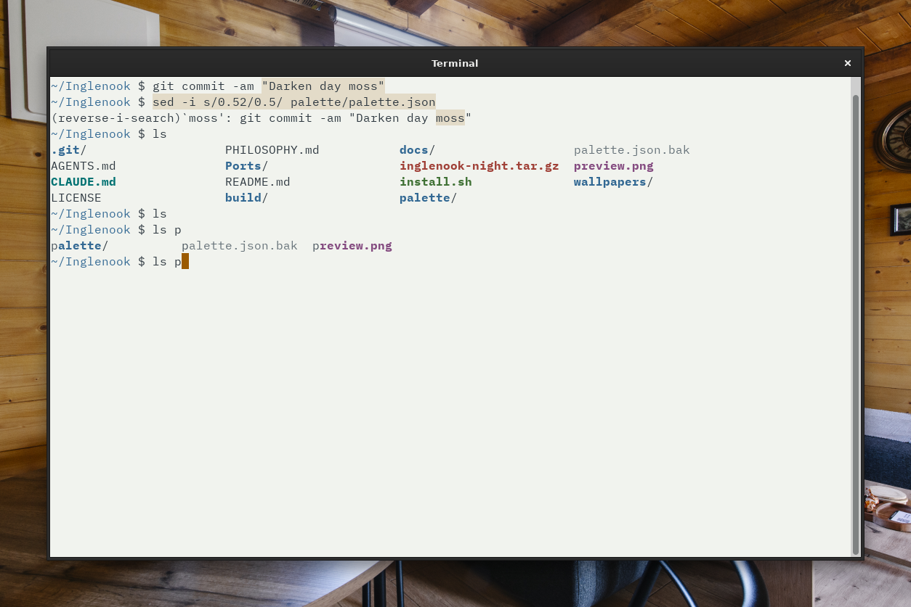
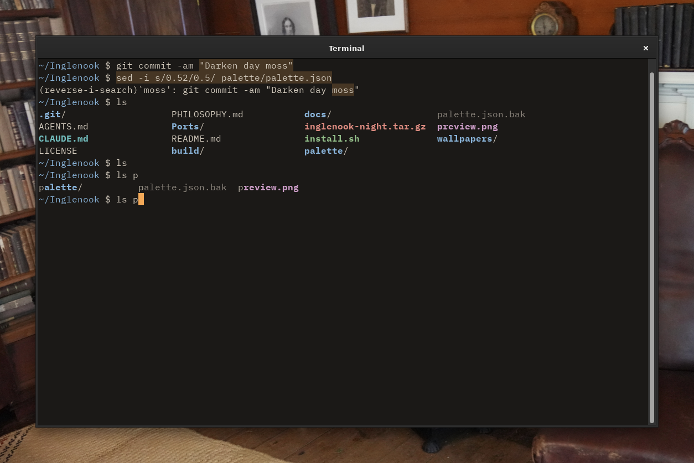

# Inglenook for the Bash line editor and completion list

**Tier:** 2 Partial\
**Variants:** Inglenook Day, Inglenook Night\
**Tested with:** Not tested yet

| Day | Night |
|---|---|
|  |  |

The theme colors two parts of Bash itself, through Readline, the line editor Bash uses:

- Where you type commands: selected text, text you just pasted, and the match while you search your history with Ctrl+R.
- The completion list you see when you press Tab twice: files, folders, links and programs in their own colors, and the part every entry shares in a quieter color.

## Before you start

- Bash 5.2 or newer. Check with `bash --version`. On macOS the built-in Bash is 3.2: install a newer one, for example with Homebrew (`brew install bash`). Git for Windows ships a new enough Bash.
- A terminal that shows 24-bit color, such as GNOME Terminal, iTerm2, or Windows Terminal. For the full look, theme the terminal with Inglenook too.

## Install

The theme is two files: one for Readline, which `~/.inputrc` loads, and one for Bash, which `~/.bashrc` loads.

1. Create the folder `~/.config/inglenook/`.
2. Save the two files of your variant there: [`dist/day/bash.inputrc`](dist/day/bash.inputrc) and [`dist/day/bash.sh`](dist/day/bash.sh), or [`dist/night/bash.inputrc`](dist/night/bash.inputrc) and [`dist/night/bash.sh`](dist/night/bash.sh).
3. If you have no `~/.inputrc` yet and your system has `/etc/inputrc` (most Linux systems and Git for Windows do), create `~/.inputrc` with this line first, so you keep your system's key settings:

   ```
   $include /etc/inputrc
   ```

4. Add this line to the end of `~/.inputrc`:

   ```
   $include ~/.config/inglenook/bash.inputrc
   ```

5. Add this line to the end of `~/.bashrc`, after anything that sets `LS_COLORS` (such as `dircolors`):

   ```sh
   source ~/.config/inglenook/bash.sh
   ```

6. Open a new terminal.

**Nowhere users**: Nowhere's `theme.zsh` and `theme.ps1` are for Zsh and PowerShell, so for Bash use `~/.inputrc` and `~/.bashrc` as above.

Files to use:

- Inglenook Day: `dist/day/bash.inputrc` and `dist/day/bash.sh`
- Inglenook Night: `dist/night/bash.inputrc` and `dist/night/bash.sh`

## Set the font

Bash uses your terminal's font. Set it there, for example in GNOME Terminal under **Preferences**, your profile, **Text**, **Custom font**, or in Windows Terminal under **Settings**, your profile, **Appearance**, **Font face**.

1. Pick **IBM Plex Mono**. If it is not installed yet, follow [Font](../../README.md#font) in the main README.

## Check that it worked

1. Type `ls ` and press Tab twice. Folders, programs and links show in their own colors. Type `ls p` and press Tab twice: the `p` every entry starts with shows in a quieter gray.
2. Paste some text. It sits on a soft amber background until you press the next key.
3. Press Ctrl+R and type part of an earlier command. The matching text sits on the same soft amber background.

## Switch between Day and Night

1. Save the other variant's two files over the ones in `~/.config/inglenook/`.
2. Open a new terminal. Readline reads its settings only when Bash starts.

Bash has no light or dark setting of its own, so it cannot follow the OS setting.

## Uninstall

1. Remove the `$include ~/.config/inglenook/bash.inputrc` line from `~/.inputrc`. If you created `~/.inputrc` for the theme and only `$include /etc/inputrc` is left, delete the file.
2. Remove the `source ~/.config/inglenook/bash.sh` line from `~/.bashrc`.
3. Delete `~/.config/inglenook/bash.inputrc` and `~/.config/inglenook/bash.sh`.
4. Open a new terminal. Pasted and found text is back to inverse video, and the completion list is back to plain text.

## Troubleshooting

- **The completion list has no colors**: `~/.inputrc` does not load the theme. Run `bind -v | grep colored`: both settings should say `on`. Turning them on later with a `bind` command in `~/.bashrc` is too late for the file colors, because Readline reads them only when it starts.
- **The completion list has the default colors, not yours**: something in `~/.bashrc` runs `bind` before `LS_COLORS` is set, so Readline starts early. Move `dircolors` or your `LS_COLORS` line above that.
- **A message like `unknown variable name` when Bash starts**: your Bash is older than 5.2. Update Bash.
- **Pasted text shows no background, or odd colors**: your terminal does not show 24-bit color. Use a terminal that does.

## Known limits

- Selected text, pasted text and the history search match share one color: Readline has a single highlight for all three.
- Readline marks a selection only after Ctrl+X Ctrl+X (swap the cursor and the mark), not while you move after setting the mark.
- If `LS_COLORS` is already set, as on most Linux systems, the completion list keeps its file colors, the same as `ls`. The theme adds only the color of the shared part. Without `LS_COLORS`, the completion list gets the theme's file colors and `ls` stays as it was.
- The prompt is not part of this theme.

## Sources

- [Bash manual: Readline Init File Syntax](https://www.gnu.org/software/bash/manual/html_node/Readline-Init-File-Syntax.html) (`active-region-start-color`, `active-region-end-color`, `colored-completion-prefix`, `colored-stats`, `enable-active-region`)
- [Bash manual: Conditional Init Constructs](https://www.gnu.org/software/bash/manual/html_node/Conditional-Init-Constructs.html) (`$if version`, `$include`)
- [Bash manual: Commands For Moving](https://www.gnu.org/software/bash/manual/html_node/Commands-For-Moving.html) and [Some Miscellaneous Commands](https://www.gnu.org/software/bash/manual/html_node/Miscellaneous-Commands.html) (`set-mark`, `exchange-point-and-mark`)
- [GNU Readline](https://tiswww.case.edu/php/chet/readline/rltop.html)
