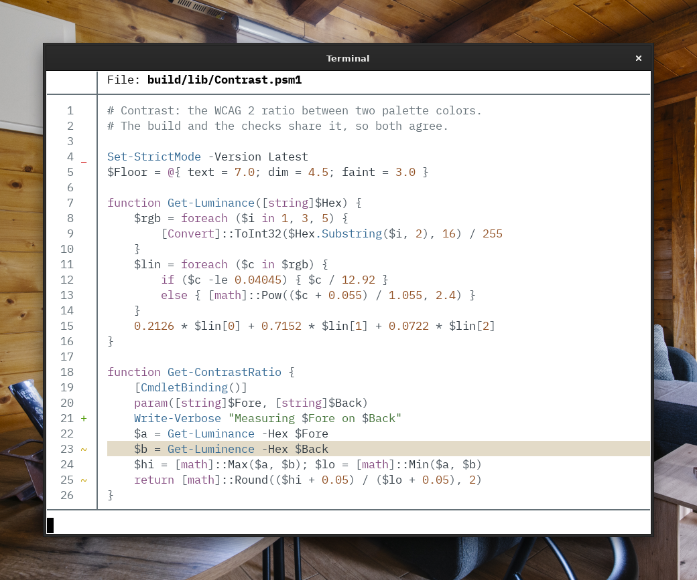
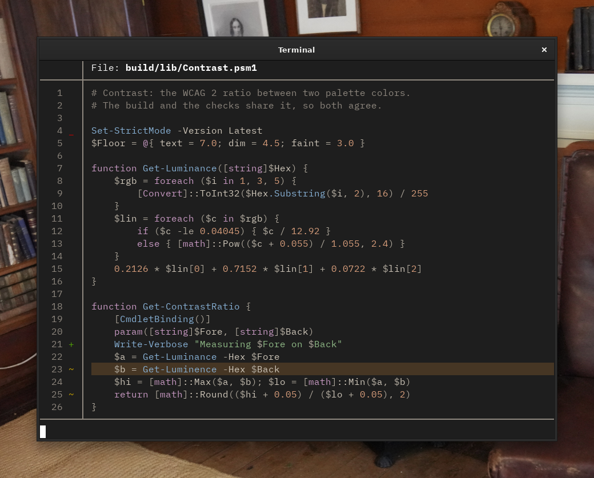

# Inglenook for bat

**Tier:** 1 Full\
**Variants:** Inglenook Day, Inglenook Night\
**Tested with:** bat 0.26.1 on Linux Mint 22.3

| Day | Night |
|---|---|
|  |  |

## Before you start

- bat 0.25 or later, so it can pick Day or Night from your terminal's background. On an older bat, see [Switch between Day and Night](#switch-between-day-and-night).
- On Debian and Ubuntu the command is `batcat` instead of `bat`. Use `batcat` in every step below.
- Your terminal should use Inglenook too. bat colors the text, but the background, the change marks in the margin, and the font come from the terminal.

## Install

1. Run `bat --config-dir` to see bat's settings folder. On Windows it is usually `%APPDATA%\bat`; on Linux and macOS, `~/.config/bat`.
2. Make a folder named `themes` inside it. In a shell: `mkdir -p "$(bat --config-dir)/themes"`. In PowerShell: `New-Item -ItemType Directory -Force "$(bat --config-dir)\themes"`.
3. Copy both theme files into that `themes` folder. Keep their names: bat names a theme after its file.
4. Run `bat cache --build`. It ends with `okay` lines.
5. Run `bat --config-file` to see where bat's config file goes. If the file does not exist yet, run `bat --generate-config-file`.
6. Open the config file and add these two lines at the end:

   ```
   --theme-light="Inglenook Day"
   --theme-dark="Inglenook Night"
   ```

7. If the file has a `--theme=` line, delete it or put a `#` in front of it. It would override the two lines above.

Files to use:

- Inglenook Day: `dist/day/Inglenook Day.tmTheme`
- Inglenook Night: `dist/night/Inglenook Night.tmTheme`

## Set the font

Inglenook uses [IBM Plex Mono](https://github.com/IBM/plex). Where the app shows icons, use [BlexMono Nerd Font](https://www.nerdfonts.com/font-downloads) instead, the same font with icons added. If it is not installed yet, follow [Font](../../README.md#font) in the main README.

bat prints into your terminal, so it uses the terminal's font. Set **IBM Plex Mono** in your terminal's settings.

## Check that it worked

1. Run `bat --list-themes`. **Inglenook Day** and **Inglenook Night** are in the list.
2. Run `bat` on any code file. Comments are quiet, strings are green, and the line numbers and frame lines are soft gray.

## Switch between Day and Night

bat picks Day or Night by asking the terminal for its background color, every time it runs. Switch your terminal to Inglenook Day or Night, and bat follows.

To always use one variant, put one line in the config file instead of the two from the install steps:

```
--theme="Inglenook Night"
```

You can also set it for one shell with the `BAT_THEME` environment variable, such as `export BAT_THEME="Inglenook Day"` or `$env:BAT_THEME = 'Inglenook Day'`. bat 0.24 and older only take this way.

## Uninstall

1. Delete `Inglenook Day.tmTheme` and `Inglenook Night.tmTheme` from the `themes` folder.
2. Delete the `--theme-light` and `--theme-dark` lines, or the `--theme` line, from the config file.
3. Run `bat cache --build`. If the `themes` folder is now empty, run `bat cache --clear` instead.

## Troubleshooting

- **The themes are not in `bat --list-themes`**: run `bat cache --build` again, and check that the files are in the `themes` folder inside `bat --config-dir`, not in a folder below it.
- **bat shows Night on a light terminal, or Day on a dark one**: some terminals, and some setups inside tmux or over SSH, do not answer bat's question about the background. Use the one-variant `--theme` line from [Switch between Day and Night](#switch-between-day-and-night).
- **bat says the theme is unknown**: the name in the config file must match the file name exactly, with the capital letters and the space.

## Known limits

- The background is your terminal's own. bat colors the text and one highlighted line, never the whole page.
- The `+`, `~` and `_` change marks in the margin use your terminal's green, yellow and red, not the theme.
- The file name in the header is bold in your terminal's text color.

## Sources

- [bat: Highlighting theme, Adding new themes, and Configuration file](https://github.com/sharkdp/bat#highlighting-theme)
- [Sublime Text: tmTheme color schemes](https://www.sublimetext.com/docs/color_schemes_tmtheme.html)
