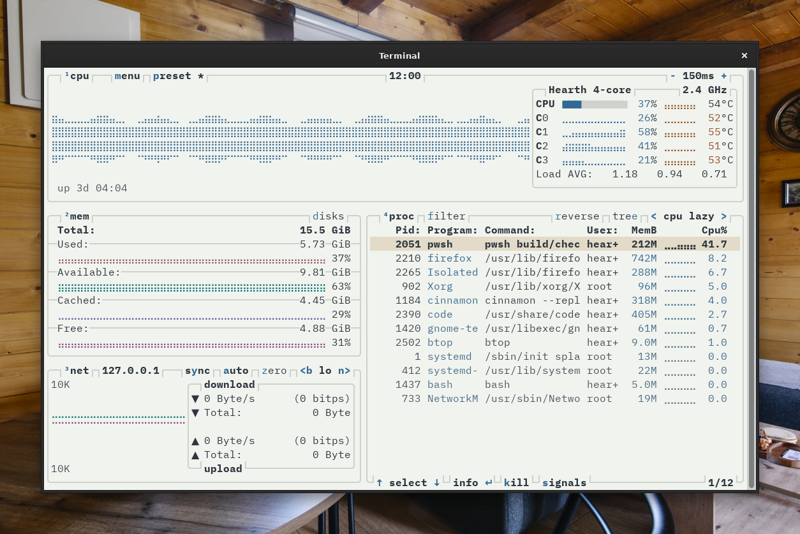
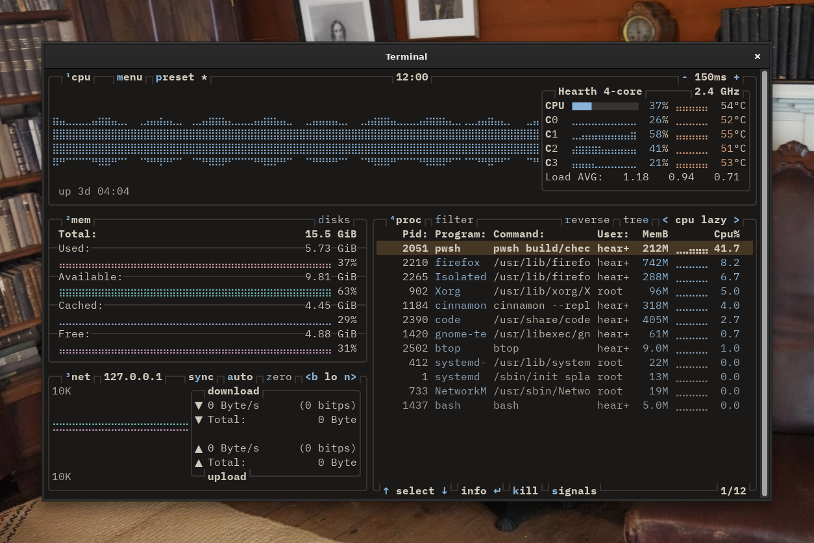

# Inglenook for btop++

**Tier:** 1 Full\
**Variants:** Inglenook Day, Inglenook Night\
**Tested with:** btop 1.3.0 on Linux Mint 22.3, in GNOME Terminal 3.52.0

| Day | Night |
|---|---|
|  |  |

## Before you start

- btop++ on Linux or macOS, or btop4win on Windows.
- A terminal that shows 24-bit color. Most do: Windows Terminal, GNOME Terminal, iTerm2, and others.

## Install

1. Pick the theme file: `dist/day/inglenook-day.theme` for Inglenook Day, `dist/night/inglenook-night.theme` for Inglenook Night.
2. Make btop's themes folder if it does not exist:
   - Windows (btop4win): a `themes` folder next to `btop4win.exe`
   - Linux and macOS: `~/.config/btop/themes/` (or `$XDG_CONFIG_HOME/btop/themes/` if you set `XDG_CONFIG_HOME`)
3. Save the theme file into that folder.
4. Open btop, press `Esc`, and choose **Options**.
5. Under **Color theme**, pick `inglenook-day` or `inglenook-night`, then close the menu.

Instead of steps 4 and 5, you can set it in btop's config file (`btop.conf`, next to `btop4win.exe` on Windows, in `~/.config/btop/` elsewhere):

```
color_theme = "inglenook-day"
```

Files to use:

- Inglenook Day: `dist/day/inglenook-day.theme`
- Inglenook Night: `dist/night/inglenook-night.theme`

## Set the font

Inglenook uses [IBM Plex Mono](https://github.com/IBM/plex). Where the app shows icons, use [BlexMono Nerd Font](https://www.nerdfonts.com/font-downloads) instead, the same font with icons added. If it is not installed yet, follow [Font](../../README.md#font) in the main README.

btop draws in your terminal's font.

1. Open your terminal's font setting (Windows Terminal: **Settings**, your profile, **Appearance**, **Font face**; GNOME Terminal: **Preferences**, your profile, **Custom font**).
2. Pick **IBM Plex Mono**.

## Check that it worked

The background turns the theme's soft neutral, the CPU graph is a muted blue, and the memory meters are four calm colors.

## Switch between Day and Night

1. Save both theme files in the themes folder.
2. In **Options**, change **Color theme**, or change `color_theme` in `btop.conf`.

btop cannot follow the system's light or dark setting by itself.

## Make it see-through (optional)

The theme draws its own background. To let your terminal's background show through, set **Theme background** to off in **Options** (`theme_background = false` in `btop.conf`).

## Uninstall

1. In **Options**, set **Color theme** back to `Default`.
2. Delete the theme file from the themes folder.

## Troubleshooting

- **The theme is not in the list**: check that the file ends in `.theme` and sits in the themes folder for your system.
- **Colors look wrong or blocky**: your terminal may not show 24-bit color. Check that **Truecolor** is on in **Options**.
- **Graphs show boxes or gaps**: your font lacks the braille characters btop draws graphs with. Set **Graph symbol** to `block` in **Options**.

## Known limits

- Each graph and meter is one color. It does not shift from cool to hot as the load rises.
- The paused and followed process banners need btop 1.4 or newer. Older versions ignore those lines.
- With **Truecolor** off, btop rounds every color to the nearest of 256, so the colors are approximate.

## Sources

- [btop++ README: Themes and the config file](https://github.com/aristocratos/btop#themes)
- [btop++ theme file keys (btop_theme.cpp)](https://github.com/aristocratos/btop/blob/main/src/btop_theme.cpp)
- [btop4win README: Themes](https://github.com/aristocratos/btop4win#themes)
