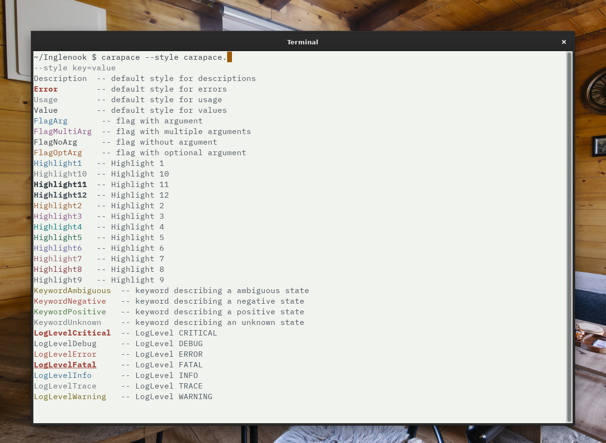
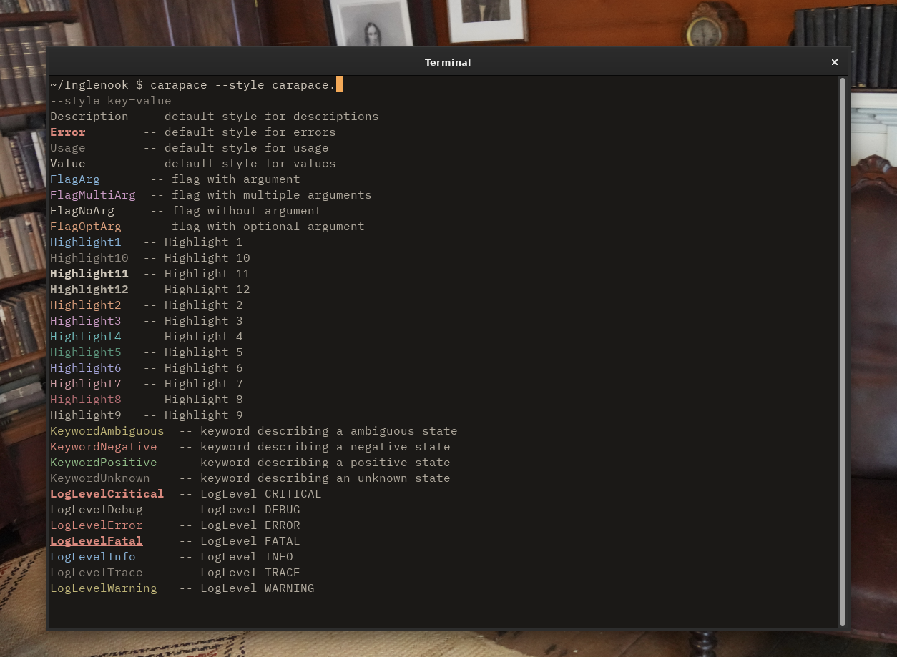

# Inglenook for carapace

**Tier:** 1 Full\
**Variants:** Inglenook Day, Inglenook Night\
**Tested with:** Not tested yet

| Day | Night |
|---|---|
|  |  |

## Before you start

- carapace (carapace-bin) set up in your shell, following [its setup guide](https://carapace-sh.github.io/carapace-bin/setup.html). Pressing Tab after a command already shows carapace's completions.
- A shell where carapace draws colors: Zsh, PowerShell, Nushell, Elvish or Xonsh. Bash and Fish show carapace's completions without colors.
- A terminal that shows 24-bit color. Most do: Windows Terminal, GNOME Terminal, iTerm2, and others.

The port is one file per variant, `styles.json`. It colors what carapace draws in a completion list: values, descriptions, flags, yes and no words, log levels, errors, and the values of tools carapace knows well, such as Git branches and tags, Docker images and GitHub issue states.

## Install

1. Pick the variant folder: `dist/day/` for Inglenook Day, `dist/night/` for Inglenook Night.
2. Make carapace's config folder if it does not exist:
   - Windows: `%APPDATA%\carapace\`
   - Linux: `~/.config/carapace/`
   - macOS: `~/Library/Application Support/carapace/`

   If you set `XDG_CONFIG_HOME`, carapace uses `carapace` inside that folder instead, on every system.
3. Save `styles.json` from the variant folder into that folder. The name must stay `styles.json`. It replaces any styles you set before with `carapace --style`.
4. Open a new shell.

Files to use:

- Inglenook Day: `dist/day/styles.json`
- Inglenook Night: `dist/night/styles.json`

carapace colors file and folder names from the `LS_COLORS` variable, not from `styles.json`, so they keep the colors your `ls` already uses, or none if `LS_COLORS` is not set. Everything else works without it. If you want Inglenook file colors too, you can also install the `LS_COLORS` file from the [eza port](../eza/README.md) (steps 5 to 7 there).

## Set the font

Inglenook uses [IBM Plex Mono](https://github.com/IBM/plex). Where the app shows icons, use [BlexMono Nerd Font](https://www.nerdfonts.com/font-downloads) instead, the same font with icons added. If it is not installed yet, follow [Font](../../README.md#font) in the main README.

carapace draws in your terminal's font.

1. Open your terminal's font setting (Windows Terminal: **Settings**, your profile, **Appearance**, **Font face**; GNOME Terminal: **Preferences**, your profile, **Custom font**).
2. Pick **IBM Plex Mono**, or **BlexMono Nerd Font Mono** if your prompt shows icons.

## Check that it worked

Type `carapace --style carapace.` and press Tab (in Zsh, Ctrl+D also lists). Each style name shows in its own color, with its description in a softer gray.

## Switch between Day and Night

1. Save the other variant's `styles.json` over the one in carapace's config folder.
2. Open a new shell.

carapace cannot follow the system's light or dark setting by itself.

## Uninstall

1. Delete `styles.json` from carapace's config folder.
2. Open a new shell. carapace is back to its own colors.

## Troubleshooting

- **No colors in the list**: check your shell is one carapace colors (not Bash or Fish), and that the file is named `styles.json` in the folder for your system, or in `XDG_CONFIG_HOME/carapace` if you set it.
- **PowerShell shows codes such as `^[[39;49m` instead of colors**: carapace needs `Set-PSReadlineKeyHandler -Key Tab -Function MenuComplete` in your `$PROFILE`, as its setup guide says.
- **A few values keep their old colors**: `carapace --style` writes to the same file. Save this port's `styles.json` again.

## Known limits

- carapace sets text colors only. The background, and the highlight on the entry you pick in a menu, come from your terminal and your shell.
- File and folder names follow `LS_COLORS`, so they only match Inglenook with a matching `LS_COLORS`.
- In Zsh, carapace turns its colors off for very long lists, to stay fast.

## Sources

- [carapace-bin: Style](https://carapace-sh.github.io/carapace-bin/style.html)
- [carapace-bin: Setup](https://carapace-sh.github.io/carapace-bin/setup.html)
- [carapace-bin: UserConfigDir](https://carapace-sh.github.io/carapace-bin/setup/userConfigDir.html)
