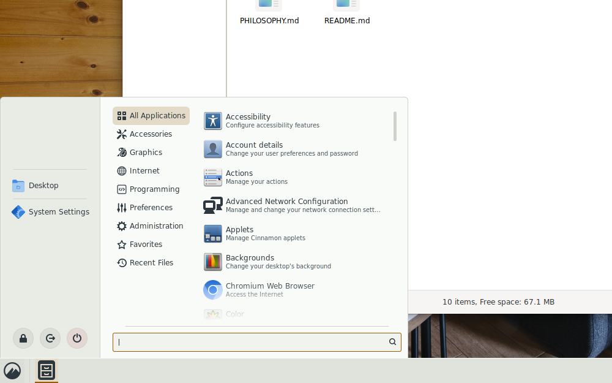
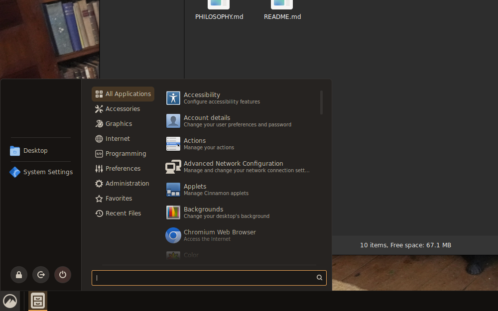

# Inglenook for Cinnamon

**Tier:** 1 Full\
**Variants:** Inglenook Day, Inglenook Night\
**Tested with:** Not tested yet

| Day | Night |
|---|---|
|  |  |

Cinnamon is the desktop of Linux Mint. Its **desktop theme** draws the panel, the menu, applets and their popups, the calendar, notifications, on-screen displays (volume, workspace switch), Alt-Tab, the run dialog, and tooltips. Each variant is one theme folder: `Inglenook Day` or `Inglenook Night`.

## Before you start

- Cinnamon 6.4 or later (Linux Mint 22.1 or later). Check it in **System Settings** > **System Info**.
- Nothing else to install.

## Install

1. Download or clone this repo.
2. Open your home folder in the file manager and press **Ctrl+H** to show hidden folders.
3. Create a folder named `.themes` if there is none.
4. Copy the folder `Inglenook Day` from `Ports/cinnamon/dist/day/` into `.themes`. For Night, copy `Inglenook Night` from `Ports/cinnamon/dist/night/`. You can copy both.
5. Open **System Settings** > **Themes**.
6. Under **Themes**, click **Desktop** and pick **Inglenook Day** or **Inglenook Night**.

Or from a terminal in the repo folder:

```sh
mkdir -p ~/.themes
cp -r "Ports/cinnamon/dist/night/Inglenook Night" ~/.themes/
gsettings set org.cinnamon.theme name "Inglenook Night"
```

Files to use:

- Inglenook Day: [`dist/day/Inglenook Day/`](<dist/day/Inglenook Day/cinnamon/cinnamon.css>)
- Inglenook Night: [`dist/night/Inglenook Night/`](<dist/night/Inglenook Night/cinnamon/cinnamon.css>)

The Inglenook theme folders for GTK apps and window borders use the same names, so both can live in one folder in `.themes`.

## Set the font

Inglenook uses [IBM Plex Mono](https://github.com/IBM/plex). If it is not installed yet, follow [Font](../../README.md#font) in the main README.

The theme does not change the desktop font. Cinnamon uses your **Default font** for the panel and menus, and so do your apps. To use IBM Plex Mono everywhere:

1. Open **System Settings** > **Fonts**.
2. Set **Default font** to **IBM Plex Mono**.

## Check that it worked

The panel turns a soft green-gray in Day, or a dark walnut brown in Night. Open the menu: the item under the pointer has a warm amber tint.

## Switch between Day and Night

1. Open **System Settings** > **Themes**.
2. Click **Desktop** and pick the other variant.

The change shows at once. Each variant is its own theme, so switching means picking the other one.

## Uninstall

1. Open **System Settings** > **Themes**, click **Desktop**, and pick **Mint-Y** (or your previous theme).
2. Delete `Inglenook Day` and `Inglenook Night` from `~/.themes`, unless you also use the Inglenook GTK theme from the same folders. Then delete only the `cinnamon` folder inside each.

## Troubleshooting

- **The theme is not in the list**: the folder must sit directly in `~/.themes`, as `~/.themes/Inglenook Night/cinnamon/cinnamon.css`. Check that you copied the folder, not its contents.
- **Some parts still look like Mint-Y after switching**: press **Ctrl+Alt+Escape** to restart Cinnamon, or log out and back in.

## Known limits

- **Apps and window borders keep their own theme.** Windows, their title bars, and dialogs from apps are drawn by the GTK and window border themes (**Applications** and **Window borders** in **Themes**), not by the desktop theme.
- **The panel is solid.** Mint-Y's slightly see-through panel and the drop shadows under menus are left out; menus get a thin border instead.
- **The hot corner shows no ripple** when the pointer reaches it, and the trash area in the workspace overview has no icon.

## Sources

- [Cinnamon wiki: Theming](https://github.com/linuxmint/cinnamon/wiki/Theming)
- [Cinnamon wiki: Theming, CSS reference](https://github.com/linuxmint/cinnamon/wiki/Theming,-CSS-reference)
- [Cinnamon source: where desktop themes are looked up](https://github.com/linuxmint/cinnamon/blob/6.6.9/js/ui/themeManager.js)
- Based on the Cinnamon theme of [Mint-Y](https://github.com/linuxmint/mint-themes) (linuxmint/mint-themes 2.3.8), by Clement Lefebvre and the Linux Mint team, under the GPL 3.0 or later. The theme file here keeps that license.
