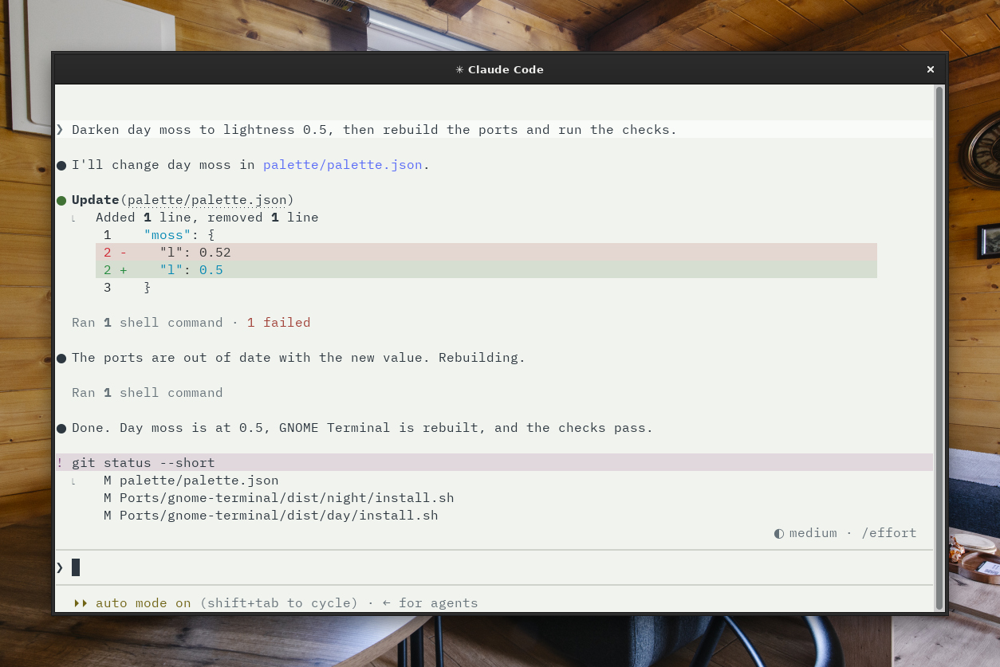
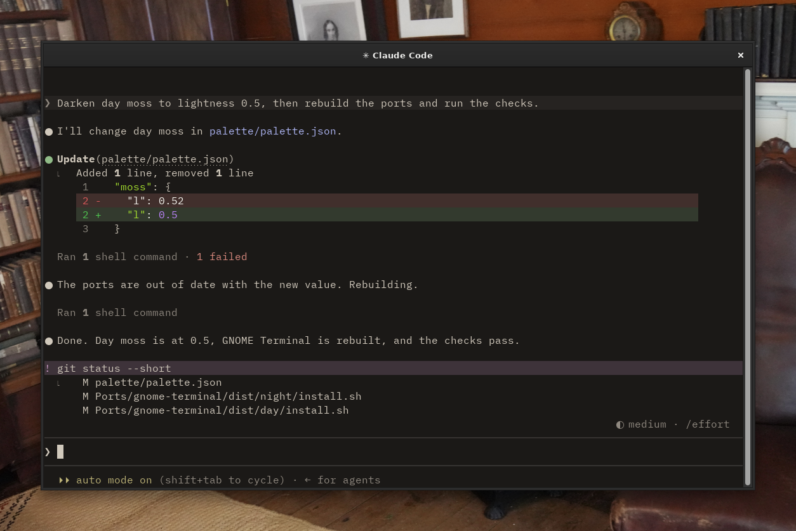

# Inglenook for Claude Code

**Tier:** 2 Partial\
**Variants:** Inglenook Day, Inglenook Night\
**Tested with:** Not tested yet

| Day | Night |
|---|---|
|  |  |

The port is a pair of Claude Code custom themes, one file per variant. It covers the Claude Code CLI in a terminal: the prompt box, dialogs, status colors, diffs, mode indicators, and message backgrounds.

Claude Code draws on your terminal's background. Pair this port with an Inglenook terminal port, such as [GNOME Terminal](../gnome-terminal/README.md), on the same variant. The diff and message backgrounds are made for the Inglenook background, so they look right only on an Inglenook terminal.

## Before you start

- Claude Code with custom themes. Run `/theme` in Claude Code: if the list ends with **New custom theme…**, you are set. If not, run `claude update` first.
- A terminal that shows 24-bit color. Windows Terminal, GNOME Terminal, iTerm2, and most modern terminals do.
- An Inglenook terminal port installed, on the same variant you plan to use here.

## Install

Claude Code reads custom themes from the `themes` folder inside its config folder.

| OS | Folder |
|---|---|
| Windows | `%USERPROFILE%\.claude\themes` |
| macOS, Linux | `~/.claude/themes` |

If you set the `CLAUDE_CONFIG_DIR` environment variable, use the `themes` folder inside that folder instead.

1. Download or clone this repo.
2. Open your `.claude` folder. On Windows, open File Explorer, type `%USERPROFILE%\.claude` in the address bar, and press **Enter**.
3. If there is no `themes` folder, create one. On Windows you can also run `mkdir -Force ~/.claude/themes` in PowerShell; on macOS and Linux, `mkdir -p ~/.claude/themes`.
4. Copy `Ports/claude-code/dist/day/inglenook-day.json` into `themes`.
5. Copy `Ports/claude-code/dist/night/inglenook-night.json` into `themes` too. With both installed, switching is one menu pick.
6. If you created the `themes` folder in step 3, quit any running Claude Code session and start it again. Claude Code watches the folder only if it existed at startup. After that, changes apply without a restart.
7. In Claude Code, run `/theme`.
8. Pick **Inglenook Day** (or **Inglenook Night**) and press **Enter**. The spinner turns a warm terracotta and the prompt box border softens to match the terminal.

Claude Code saves the choice as `"theme": "custom:inglenook-day"` (or `custom:inglenook-night`) in `~/.claude/settings.json`. You can also set that line by hand instead of steps 7 and 8.

Files to use:

- Inglenook Day: [`dist/day/inglenook-day.json`](dist/day/inglenook-day.json)
- Inglenook Night: [`dist/night/inglenook-night.json`](dist/night/inglenook-night.json)

## Set the font

Inglenook uses [IBM Plex Mono](https://github.com/IBM/plex). Where the app shows icons, use [BlexMono Nerd Font](https://www.nerdfonts.com/font-downloads) instead, the same font with icons added. If it is not installed yet, follow [Font](../../README.md#font) in the main README.

Claude Code cannot set a font. It uses your terminal's font, so set **BlexMono Nerd Font Mono** in the terminal. The [GNOME Terminal](../gnome-terminal/README.md) port already does this.

## Check that it worked

1. Run `/theme`. **Inglenook Day** (or Night) is marked as the current theme.
2. Ask Claude to edit a file. Added lines sit on a soft green wash, removed lines on a soft red wash, and the text stays readable on both.

## Switch between Day and Night

1. Switch your terminal to the same variant first, so the background matches.
2. In Claude Code, run `/theme`.
3. Pick **Inglenook Day** or **Inglenook Night** and press **Enter**.

Claude Code cannot follow your OS light or dark setting with a custom theme. Its **auto** option switches only between the built-in themes.

## Uninstall

1. In Claude Code, run `/theme`.
2. Pick **Dark** (or any built-in theme) and press **Enter**.
3. Delete `inglenook-day.json` and `inglenook-night.json` from the `themes` folder.

## Troubleshooting

- **Inglenook is not in the `/theme` list**: the `themes` folder did not exist when Claude Code started. Restart Claude Code. Also check that the files end in `.json` and sit directly in `themes`, not in a subfolder.
- **There is no New custom theme… entry in `/theme`**: your Claude Code is too old for custom themes. Run `claude update`.
- **Diff lines and your messages look muddy or barely tinted**: the terminal is not on an Inglenook color scheme, or it is on the other variant. Switch the terminal to the matching Inglenook profile.
- **Colors look dull or slightly off**: the terminal is not showing 24-bit color. On Windows, use Windows Terminal rather than the old console window.
- **The theme is ignored after you set it in `settings.json`**: a project's `.claude/settings.json` or `.claude/settings.local.json` sets `theme` too, and wins. Run `/status` to see which files loaded.
- **Code blocks, inline code, and diffs keep Claude Code's own code colors**: expected, see [Known limits](#known-limits).

## Known limits

- **Code colors are not themeable.** Code blocks, diffs, and file previews use Claude Code's built-in highlighter, which custom themes cannot reach. To drop its colors, set `"syntaxHighlightingDisabled": true` in `~/.claude/settings.json`.
- **Inline code keeps Claude Code's own color.**
- **Diff and message backgrounds need an Inglenook terminal.** On another background they look off.
- **No word-level diff emphasis.** The changed words in a line are tinted the same as the rest of the line.
- **No shimmer and no rainbow.** Spinner shimmers and the `ultrathink` rainbow are one color each.
- **Cannot follow the OS light or dark setting.** Switch with `/theme`.
- **The desktop app, claude.ai, and the VS Code chat panel are not covered.** The desktop app and claude.ai pick from a fixed list of code themes, and the VS Code panel follows VS Code's theme.

## Sources

- [Claude Code terminal configuration, Create a custom theme](https://code.claude.com/docs/en/terminal-config#create-a-custom-theme)
- [Claude Code settings reference, `theme`](https://code.claude.com/docs/en/settings-reference#theme)
- [Claude Code settings reference, `syntaxHighlightingDisabled`](https://code.claude.com/docs/en/settings-reference#syntaxhighlightingdisabled)
- [Claude Code settings](https://code.claude.com/docs/en/settings)
