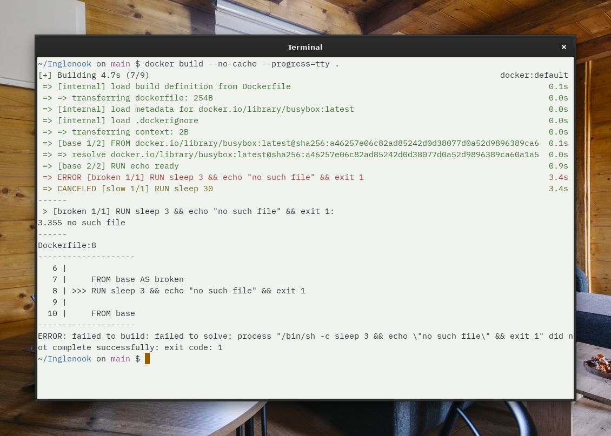
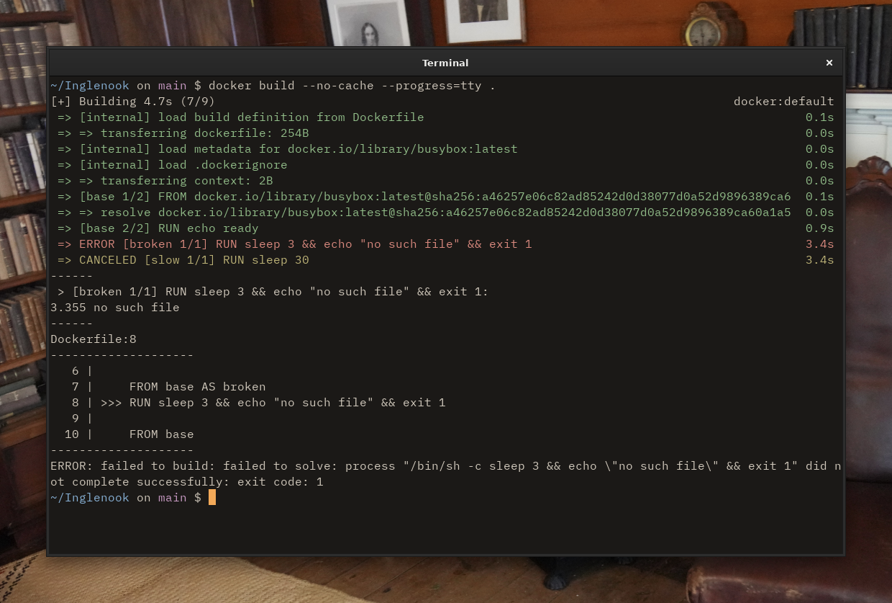

# Inglenook for Docker build output

**Tier:** 3 Minimal\
**Variants:** Inglenook Day, Inglenook Night\
**Tested with:** Docker 29.10.1 (buildx 0.39.1) on Linux

| Day | Night |
|---|---|
|  |  |

This themes the step list that `docker build` (and `docker buildx build`, `docker compose build`) draws while it builds: finished steps, canceled steps, and the step that failed.

## Before you start

- Docker with BuildKit, which every `docker build` uses since Docker 23. Check with `docker buildx version`. Docker Desktop on Windows and macOS has it.
- Your terminal set to Inglenook in the same variant, such as [GNOME Terminal](../gnome-terminal/README.md). Docker only picks from the terminal's 16 colors, so the terminal decides how they look.

## Install

Docker reads these colors from one environment variable, `BUILDKIT_COLORS`. The theme is a file that sets it, which your shell loads when it starts.

### Zsh or Bash (Linux, macOS, WSL)

1. Create the folder `~/.config/inglenook/`.
2. Save [`dist/day/docker.sh`](dist/day/docker.sh) or [`dist/night/docker.sh`](dist/night/docker.sh) there as `docker.sh`.
3. Add this line to the end of `~/.zshrc` (Zsh) or `~/.bashrc` (Bash):

   ```sh
   source ~/.config/inglenook/docker.sh
   ```

4. Open a new terminal.

### PowerShell (Windows, also macOS and Linux)

1. Create the folder `~/.config/inglenook/` (on Windows, `%USERPROFILE%\.config\inglenook\`).
2. Save [`dist/day/docker.ps1`](dist/day/docker.ps1) or [`dist/night/docker.ps1`](dist/night/docker.ps1) there as `docker.ps1`.
3. Run `notepad $PROFILE` (or open `$PROFILE` in any editor) and add this line to the end:

   ```powershell
   . ~/.config/inglenook/docker.ps1
   ```

4. Open a new PowerShell window.

### With Nowhere

Nowhere loads `~/.config/nowhere/theme.zsh` and `~/.config/nowhere/theme.ps1` last. Put the same `source` line (Zsh) or `.` line (PowerShell) in that file instead of in your profile.

### Setting the variable another way

To set it yourself (Windows system variables, a dotfiles manager), use this value. It is the same for Inglenook Day and Inglenook Night, because the terminal supplies the colors.

```sh
BUILDKIT_COLORS='run=green:cancel=yellow:warning=yellow:error=red'
```

## Set the font

Docker draws in your terminal, so it uses the terminal's font. Set [IBM Plex Mono](https://github.com/IBM/plex) in your terminal's settings, for example in Windows Terminal under **Settings**, your profile, **Appearance**, **Font face**, or in GNOME Terminal under **Preferences**, your profile, **Text**, **Custom font**. If it is not installed yet, follow [Font](../../README.md#font) in the main README.

## Check that it worked

Run `docker build .` in a folder with a `Dockerfile`. Each step turns green when it finishes. A step that fails shows in red, and steps canceled because of it in yellow.

## Switch between Day and Night

1. Switch your terminal to the other variant. The Docker file is the same for both, so nothing else changes.
2. To keep the files matching, save the other variant's file over `~/.config/inglenook/docker.sh` (or `docker.ps1`).

Docker has no light or dark setting of its own. The colors follow whatever your terminal does.

## Uninstall

1. Remove the `source ~/.config/inglenook/docker.sh` line (or the `. ~/.config/inglenook/docker.ps1` line) from your profile.
2. Delete the file from `~/.config/inglenook/`.
3. Open a new terminal. Finished steps are back to Docker's own blue (cyan on Windows).

## Troubleshooting

- **The colors did not change**: the build is not drawing its live step list. Docker only colors it in a terminal; with `--progress=plain`, or when the output goes to a file or a pipe, there are no colors. Use `--progress=tty` to force the live list.
- **No colors at all**: the `NO_COLOR` variable is set. Docker turns colors off whenever it is.
- **The colors look nothing like Inglenook**: your terminal is not set to Inglenook. Docker uses the terminal's own green, yellow and red.

## Known limits

- Only the step lines are colored. The `[+] Building` header, the error report after a failed build, and the warnings Docker prints at the end use your terminal's normal text.
- A running step's log lines are drawn dimmed by Docker, not by the theme.
- Steps never show the warning color yet: Docker reads the setting but does not use it.
- The classic builder (`DOCKER_BUILDKIT=0`) has no colors.

## Sources

- [Docker docs: Build variables, BUILDKIT_COLORS](https://docs.docker.com/build/building/variables/#buildkit_colors)
- [Docker docs: docker buildx build, --progress](https://docs.docker.com/reference/cli/docker/buildx/build/#progress)
