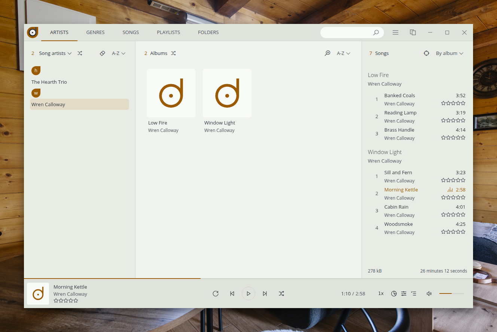
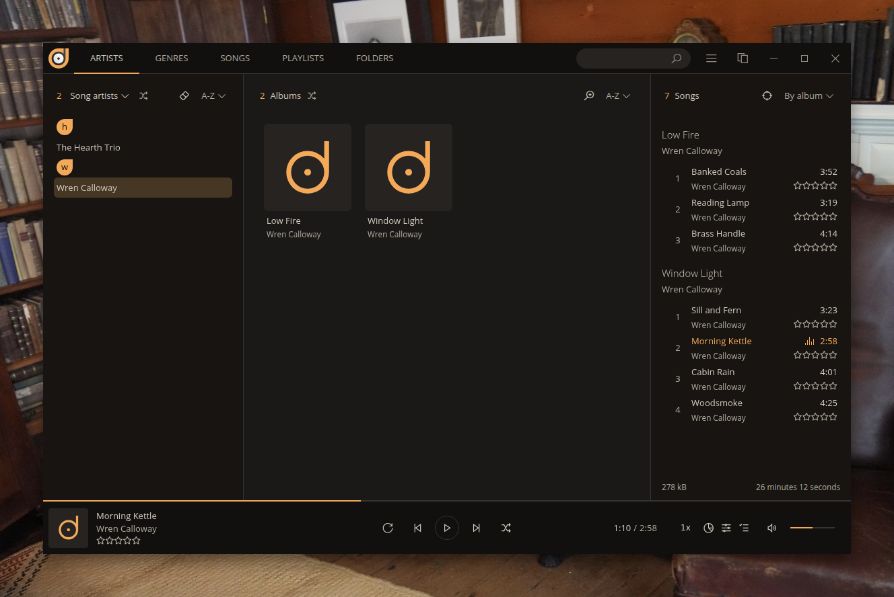

# Inglenook for Dopamine

**Tier:** 2 Partial\
**Variants:** Inglenook Day, Inglenook Night\
**Tested with:** Not tested yet

| Day | Night |
|---|---|
|  |  |

Dopamine is a music player for Windows, macOS, and Linux. It reads its themes from `.theme` files in a folder of its own. Each variant here is one theme file: **Inglenook Day** and **Inglenook Night**.

## Before you start

- Dopamine 3. Check it in the menu (three lines, top left) > **Information**.
- Nothing else.

## Install

1. Download or clone this repo.
2. Open Dopamine.
3. Click the menu button (three lines) at the top left and choose **Settings**.
4. Open the **Appearance** tab.
5. Click **Add more themes**. Dopamine opens its themes folder:
   - Windows: `%APPDATA%\Dopamine\Themes`
   - macOS: `~/Library/Application Support/Dopamine/Themes`
   - Linux: `~/.config/Dopamine/Themes`
6. Copy `Ports/dopamine/dist/day/inglenook-day.theme` and `Ports/dopamine/dist/night/inglenook-night.theme` into that folder.
7. Back in Dopamine, click **Refresh themes**. Two new swatches appear under **Theme**. Hover one to see its name.
8. Click the **Inglenook Night** swatch and turn **Use light theme** off. For Day, click **Inglenook Day** and turn **Use light theme** on.

Files to use:

- Inglenook Day: `dist/day/inglenook-day.theme`
- Inglenook Night: `dist/night/inglenook-night.theme`

## Set the font

Dopamine cannot change its font. It always uses its own. Only the size can change, in **Settings** > **Appearance**.

## Check that it worked

Inglenook Day is a soft, faintly green off-white; Inglenook Night is a warm, dark walnut brown. The top bar and the playback bar are a shade deeper than the track list. The playing song, the progress bar, and the buttons you can press are amber.

## Switch between Day and Night

1. Open **Settings** > **Appearance**.
2. Click the other Inglenook swatch.
3. Turn **Use light theme** on for Day, off for Night.

Each variant is its own theme, so **Use light theme** alone does not switch between them, and **Follow the system theme** cannot switch them for you. Leave **Follow the system theme** off.

## Uninstall

1. Open **Settings** > **Appearance** and click another theme's swatch, such as **Dopamine**.
2. Click **Add more themes** to open the themes folder.
3. Delete `inglenook-day.theme` and `inglenook-night.theme`.
4. Click **Refresh themes**.

## Troubleshooting

- **The swatches do not appear**: check that the files end in `.theme` and sit directly in the `Themes` folder, then click **Refresh themes** or restart Dopamine.
- **The accent is not amber**: turn off **Follow the system color** and **Follow the album cover color** in **Settings** > **Appearance**. Both replace the theme's accent.
- **Menus or text boxes look too light or too dark**: **Use light theme** is set the wrong way for the variant. Turn it on for Day, off for Night.

## Known limits

- **Buttons glow when you hover them.** Dopamine adds a soft amber shadow around buttons and covers on hover.
- **Some list rows, menus, and the scroll area use see-through shades** of the text color that Dopamine draws itself.
- **Checkboxes and other small controls** use lighter and darker shades of the amber that Dopamine works out on its own.
- **Album covers you have no art for** show Dopamine's placeholder in amber.
- **Rich lyrics**, if you turn them on, show the words still to come in a color that is hard to read.
- **There are no colors for errors or warnings.** Dopamine has no setting for them.

## Sources

- [Dopamine's theme model](https://github.com/digimezzo/dopamine/blob/v3.0.12/src/app/services/appearance/theme/theme-neutral-colors.ts): every key a theme file sets
- [How Dopamine loads theme files](https://github.com/digimezzo/dopamine/blob/v3.0.12/src/app/services/appearance/appearance.service.ts): the themes folder, `.theme` files as JSON, and the light and dark sets
- [The themes folder](https://github.com/digimezzo/dopamine/blob/v3.0.12/src/app/common/application/application-paths.ts): `Themes` inside Dopamine's data folder
- [Dopamine's built-in themes](https://github.com/digimezzo/dopamine/tree/v3.0.12/src/app/services/appearance/themes): the format of a full theme
