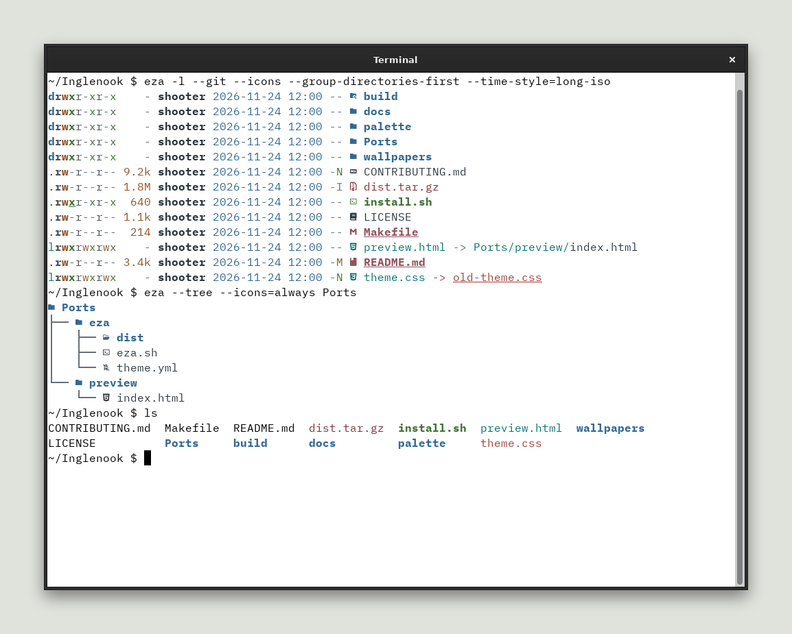
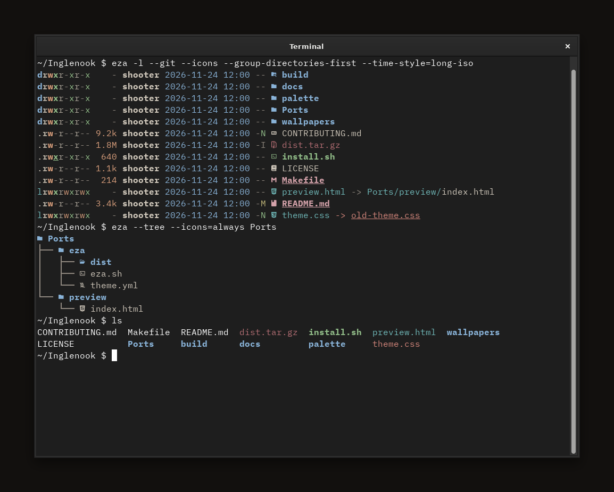

# Inglenook for eza

**Tier:** 1 Full\
**Variants:** Inglenook Day, Inglenook Night\
**Tested with:** Not tested yet

| Inglenook Day | Inglenook Night |
|---|---|
|  |  |

## Before you start

- eza 0.19.2 or newer (`eza --version`). Older versions ignore `theme.yml`.
- A terminal that shows 24-bit color. Most do: Windows Terminal, GNOME Terminal, iTerm2, and others.

The port has two files per variant:

- `theme.yml` colors everything eza shows: file names, permissions, sizes, users, dates, and Git status.
- `eza.sh` (Bash and Zsh) or `eza.ps1` (PowerShell) sets `LS_COLORS`, so `ls`, fd, carapace and Zsh's completion list color file names the same way. It is optional for eza itself.

## Install

1. Pick the variant folder: `dist/day/` for Inglenook Day, `dist/night/` for Inglenook Night.
2. Make eza's config folder if it does not exist:
   - Windows: `%APPDATA%\eza\`
   - Linux: `~/.config/eza/`
   - macOS: `~/Library/Application Support/eza/`
3. Save `theme.yml` from the variant folder into that folder. The name must stay `theme.yml`.
4. Run `eza -l`. Folders, sizes and dates now show in the theme's colors.

To also color `ls`, fd, carapace and Zsh's completion list:

5. Save `eza.sh` (Bash or Zsh) or `eza.ps1` (PowerShell) from the same variant folder to `~/.config/inglenook/`.
6. Add one line to your shell profile, after anything else that sets `LS_COLORS` (such as `eval "$(dircolors)"`):
   - Bash (`~/.bashrc`) or Zsh (`~/.zshrc`): `source ~/.config/inglenook/eza.sh`
   - PowerShell (`$PROFILE`): `. ~/.config/inglenook/eza.ps1`
7. Open a new shell.

If you set environment variables another way, the value of `LS_COLORS` is the quoted text in `eza.sh`.

Nowhere users: put the same source line in `~/.config/nowhere/theme.zsh` or `~/.config/nowhere/theme.ps1` instead of your profile. Nowhere loads them last.

To keep eza's config somewhere else, set `EZA_CONFIG_DIR` to that folder and put `theme.yml` in it.

Files to use:

- Inglenook Day: `dist/day/theme.yml`, `dist/day/eza.sh`, `dist/day/eza.ps1`
- Inglenook Night: `dist/night/theme.yml`, `dist/night/eza.sh`, `dist/night/eza.ps1`

## Set the font

Inglenook uses [IBM Plex Mono](https://github.com/IBM/plex). Where the app shows icons, use [BlexMono Nerd Font](https://www.nerdfonts.com/font-downloads) instead, the same font with icons added. If it is not installed yet, follow [Font](../../README.md#font) in the main README.

eza draws in your terminal's font, and its icons (`--icons`) need a Nerd Font.

1. Open your terminal's font setting (Windows Terminal: **Settings**, your profile, **Appearance**, **Font face**; GNOME Terminal: **Preferences**, your profile, **Custom font**).
2. Pick **BlexMono Nerd Font Mono**.

## Check that it worked

Run `eza -l --git --icons` in a Git repository. Folders are bold blue, sizes are a warm orange-brown, and a changed file shows a yellow-brown `M`.

## Switch between Day and Night

1. Save the other variant's `theme.yml` over the one in eza's config folder.
2. If you use `LS_COLORS`, save the other variant's `eza.sh` or `eza.ps1` over the one in `~/.config/inglenook/` and open a new shell.

eza cannot follow the system's light or dark setting by itself.

## Uninstall

1. Delete `theme.yml` from eza's config folder.
2. Remove the source line from your shell profile and delete `~/.config/inglenook/eza.sh` or `eza.ps1`.
3. Open a new shell. eza is back to its own colors.

## Troubleshooting

- **eza ignores the theme**: check `eza --version` is 0.19.2 or newer, the file is named `theme.yml`, and it sits in the folder for your system (or in `EZA_CONFIG_DIR`, if you set it).
- **Folders or links keep other colors**: `LS_COLORS` and `EZA_COLORS` override `theme.yml`. Use this port's `eza.sh`, or remove the line that sets them.
- **Icons show as boxes**: set your terminal font to BlexMono Nerd Font Mono.

## Known limits

- eza sets text colors only. The background is your terminal's, so use it with an Inglenook terminal theme.
- `ls`, fd and the Zsh completion list color file names only by kind and extension. They do not know eza's file groups such as source and build files.

## Sources

- [eza_colors-explanation(5): the theme.yml format](https://github.com/eza-community/eza/blob/main/man/eza_colors-explanation.5.md)
- [eza_colors(5): LS_COLORS and EZA_COLORS](https://github.com/eza-community/eza/blob/main/man/eza_colors.5.md)
- [eza(1): EZA_CONFIG_DIR](https://github.com/eza-community/eza/blob/main/man/eza.1.md)
