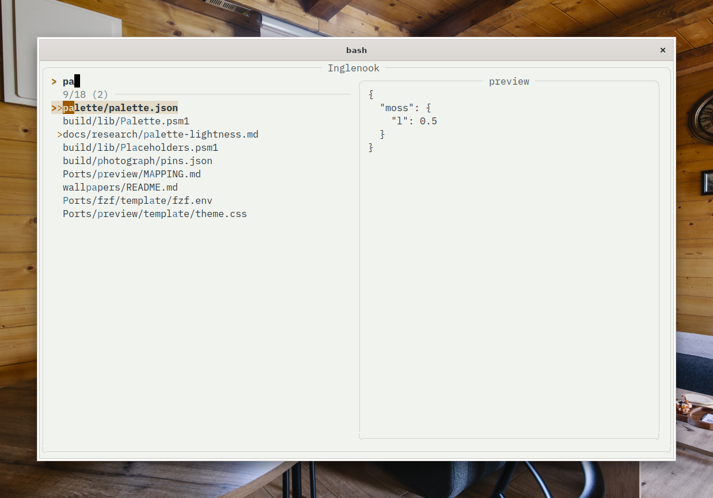
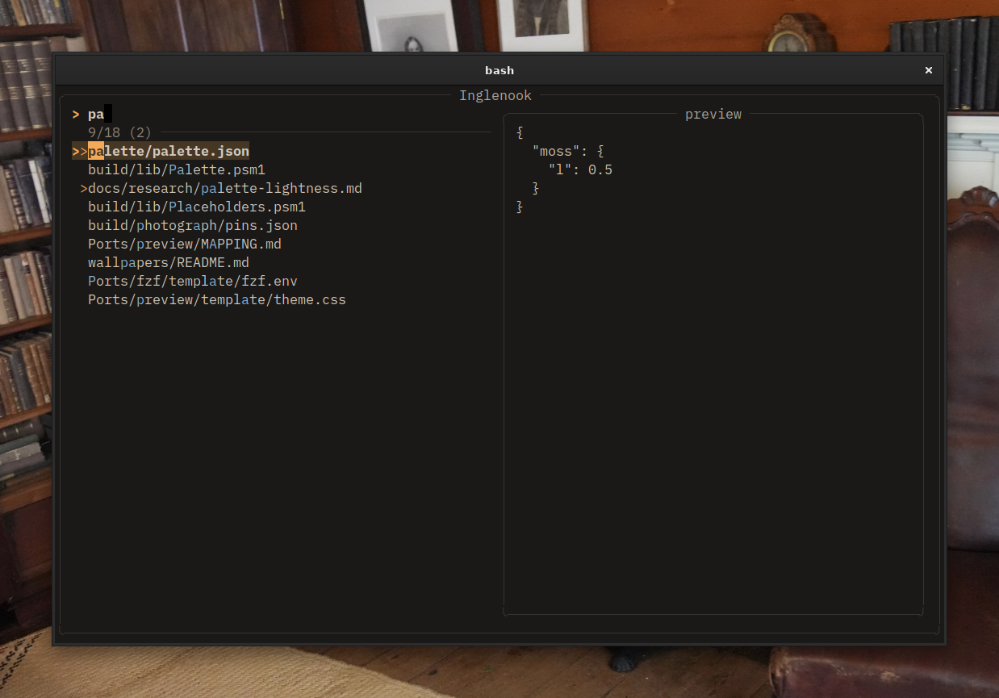

# Inglenook for fzf

**Tier:** 1 Full\
**Variants:** Inglenook Day, Inglenook Night\
**Tested with:** fzf 0.44.1 on Linux Mint 22.3

| Day | Night |
|---|---|
|  |  |

The same file also colors the interactive picker of [zoxide](https://github.com/ajeetdsouza/zoxide) (`zi`, or `cdi` with `--cmd cd`), which runs fzf.

## Before you start

- fzf 0.41 or later. Check with `fzf --version`.
- A terminal that shows 24-bit color (Windows Terminal, GNOME Terminal, iTerm2, and most others).

## Install

### Zsh or Bash (Linux, macOS, WSL)

1. Make the folder: `mkdir -p ~/.config/inglenook`
2. Download [`dist/day/fzf.sh`](dist/day/fzf.sh) (or [`dist/night/fzf.sh`](dist/night/fzf.sh)) and save it as `~/.config/inglenook/fzf.sh`.
3. Open `~/.zshrc` (Zsh) or `~/.bashrc` (Bash) and add this line near the end, after any line that sets `FZF_DEFAULT_OPTS`:

   ```sh
   source ~/.config/inglenook/fzf.sh
   ```

4. Open a new terminal.

### PowerShell (Windows, macOS, Linux)

1. Make the folder: `New-Item -ItemType Directory -Force ~/.config/inglenook`
2. Download [`dist/day/fzf.ps1`](dist/day/fzf.ps1) (or [`dist/night/fzf.ps1`](dist/night/fzf.ps1)) and save it as `~/.config/inglenook/fzf.ps1`.
3. Run `notepad $PROFILE` (or open `$PROFILE` in any editor) and add this line near the end, after any line that sets `FZF_DEFAULT_OPTS`:

   ```powershell
   . ~/.config/inglenook/fzf.ps1
   ```

4. Open a new PowerShell window.

### With Nowhere

Nowhere loads `~/.config/nowhere/theme.zsh` and `~/.config/nowhere/theme.ps1` last. Put the same `source` line (Zsh) or `.` line (PowerShell) in that file instead of in your profile.

### Setting the variable another way

The file sets one environment variable, `FZF_DEFAULT_OPTS`. To set it yourself (Windows system variables, a dotfiles manager), copy the value between the single quotes from the file for your variant.

Files to use:

- Inglenook Day: `dist/day/fzf.sh` (Zsh, Bash) or `dist/day/fzf.ps1` (PowerShell)
- Inglenook Night: `dist/night/fzf.sh` (Zsh, Bash) or `dist/night/fzf.ps1` (PowerShell)

## Set the font

fzf draws in your terminal, so it uses the terminal's font. Set [IBM Plex Mono](https://github.com/IBM/plex) in your terminal's settings. If it is not installed yet, follow [Font](../../README.md#font) in the main README.

## Check that it worked

Run `ls | fzf`. The list sits on the theme's background, the line under the pointer has a soft amber band, and the prompt and pointer are amber.

## Switch between Day and Night

1. Replace `~/.config/inglenook/fzf.sh` (or `fzf.ps1`) with the file from the other variant.
2. Open a new terminal.

fzf cannot follow the system light or dark setting.

## Uninstall

1. Delete the `source` (or `.`) line from your profile.
2. Delete `~/.config/inglenook/fzf.sh` (or `fzf.ps1`).
3. Open a new terminal.

## Troubleshooting

- **Your own fzf options stopped working**: the file sets `FZF_DEFAULT_OPTS`, which replaces a value set before it. Add your options after the line that loads the file: `export FZF_DEFAULT_OPTS="$FZF_DEFAULT_OPTS --height=40%"` (Zsh, Bash) or `$env:FZF_DEFAULT_OPTS += ' --height=40%'` (PowerShell).
- **zoxide's picker is not themed**: if you set `_ZO_FZF_OPTS`, zoxide hands fzf that instead of `FZF_DEFAULT_OPTS`. Start it with the theme's value: `export _ZO_FZF_OPTS="$FZF_DEFAULT_OPTS --height=45%"`.
- **fzf says "invalid color specification"**: your fzf is older than 0.41. Update it.
- **Colors look wrong or banded**: your terminal shows only 256 colors. Turn on 24-bit color in the terminal, or use one that has it.

## Known limits

- The cursor in the query line is drawn by your terminal, so it takes the terminal's color.
- Colored output from a preview command (such as `bat` or `ls --color`) keeps that tool's own colors.

## Sources

- [fzf README: environment variables](https://github.com/junegunn/fzf#environment-variables)
- [fzf man page: `--color`](https://github.com/junegunn/fzf/blob/master/man/man1/fzf.1)
- [fzf color schemes wiki](https://github.com/junegunn/fzf/wiki/Color-schemes)
- [zoxide README: `_ZO_FZF_OPTS`](https://github.com/ajeetdsouza/zoxide#environment-variables)
