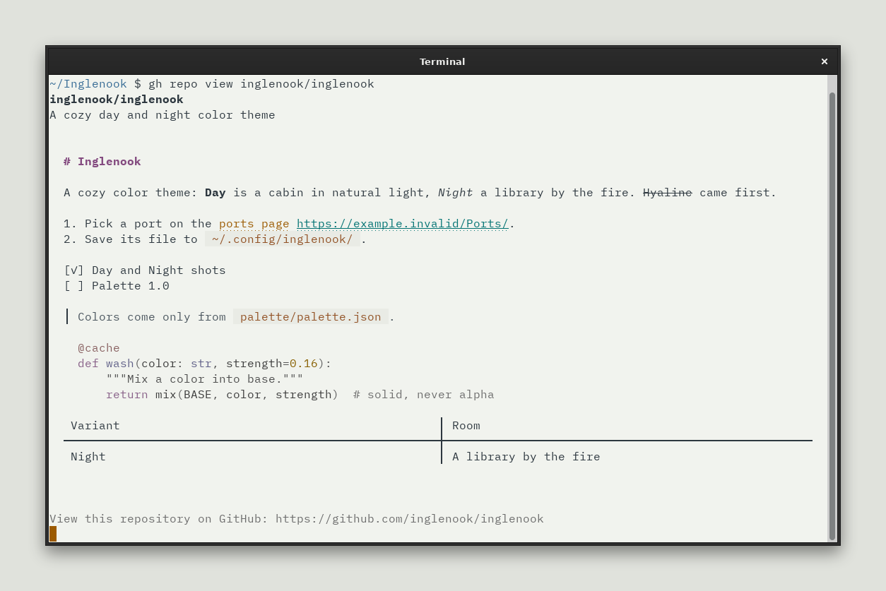
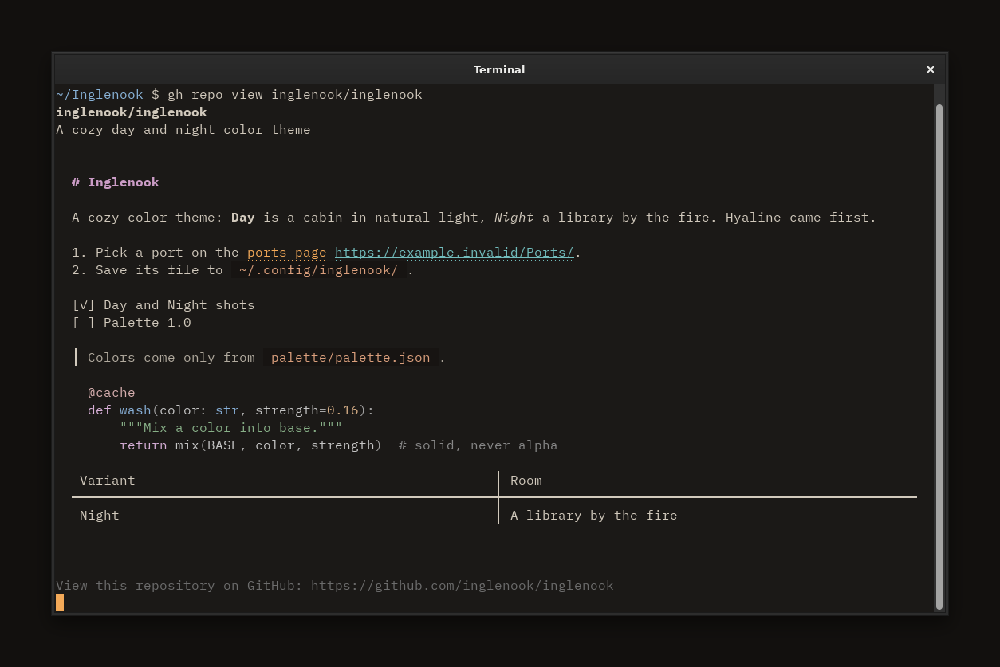

# Inglenook for GitHub CLI

**Tier:** 2 Partial\
**Variants:** Inglenook Day, Inglenook Night\
**Tested with:** Not tested yet

| Day | Night |
|---|---|
|  |  |

This colors the Markdown that `gh` shows in the terminal: READMEs in `gh repo view`, and the text of issues, pull requests, comments and releases in `gh issue view`, `gh pr view` and `gh release view`.

## Before you start

- GitHub CLI (`gh`). Check with `gh --version`.
- A terminal that shows 24-bit color (Windows Terminal, GNOME Terminal, iTerm2, and most others), best set to Inglenook in the same variant, such as [GNOME Terminal](../gnome-terminal/README.md).

## Install

The theme is two files: `gh-markdown.json`, the Markdown style, and a small shell file that points gh at it through the `GLAMOUR_STYLE` environment variable.

### Zsh or Bash (Linux, macOS, WSL)

1. Make the folder: `mkdir -p ~/.config/inglenook`
2. Download [`dist/day/gh-markdown.json`](dist/day/gh-markdown.json) (or [`dist/night/gh-markdown.json`](dist/night/gh-markdown.json)) and save it as `~/.config/inglenook/gh-markdown.json`.
3. Download [`dist/day/gh.sh`](dist/day/gh.sh) (or [`dist/night/gh.sh`](dist/night/gh.sh)) and save it as `~/.config/inglenook/gh.sh`.
4. Open `~/.zshrc` (Zsh) or `~/.bashrc` (Bash) and add this line near the end, after any line that sets `GLAMOUR_STYLE`:

   ```sh
   source ~/.config/inglenook/gh.sh
   ```

5. Open a new terminal.

### PowerShell (Windows, macOS, Linux)

1. Make the folder: `New-Item -ItemType Directory -Force ~/.config/inglenook`
2. Download [`dist/day/gh-markdown.json`](dist/day/gh-markdown.json) (or [`dist/night/gh-markdown.json`](dist/night/gh-markdown.json)) and save it as `~/.config/inglenook/gh-markdown.json`.
3. Download [`dist/day/gh.ps1`](dist/day/gh.ps1) (or [`dist/night/gh.ps1`](dist/night/gh.ps1)) and save it as `~/.config/inglenook/gh.ps1`.
4. Run `notepad $PROFILE` (or open `$PROFILE` in any editor) and add this line near the end, after any line that sets `GLAMOUR_STYLE`:

   ```powershell
   . ~/.config/inglenook/gh.ps1
   ```

5. Open a new PowerShell window.

### With Nowhere

Nowhere loads `~/.config/nowhere/theme.zsh` and `~/.config/nowhere/theme.ps1` last. Put the same `source` line (Zsh) or `.` line (PowerShell) in that file instead of in your profile.

### Setting the variable another way

The shell file sets one environment variable, `GLAMOUR_STYLE`, to the full path of `gh-markdown.json`. To set it yourself (Windows system variables, a dotfiles manager), use the full path, such as `/home/you/.config/inglenook/gh-markdown.json` or `C:\Users\you\.config\inglenook\gh-markdown.json`. gh does not expand `~` in it.

Files to use:

- Inglenook Day: `dist/day/gh-markdown.json`, with `dist/day/gh.sh` (Zsh, Bash) or `dist/day/gh.ps1` (PowerShell)
- Inglenook Night: `dist/night/gh-markdown.json`, with `dist/night/gh.sh` (Zsh, Bash) or `dist/night/gh.ps1` (PowerShell)

## Set the font

gh draws in your terminal, so it uses the terminal's font. Set [IBM Plex Mono](https://github.com/IBM/plex) in your terminal's settings. If it is not installed yet, follow [Font](../../README.md#font) in the main README.

## Check that it worked

Run `gh repo view cli/cli`. Headings are a soft purple, link text is amber, and inline code is a warm clay on a slightly darker strip.

## Switch between Day and Night

1. Replace `~/.config/inglenook/gh-markdown.json` with the file from the other variant. The shell file is the same for both.
2. Run the gh command again. No new terminal is needed.

gh cannot follow the system light or dark setting while `GLAMOUR_STYLE` is set.

## Uninstall

1. Delete the `source` (or `.`) line from your profile.
2. Delete `~/.config/inglenook/gh.sh` (or `gh.ps1`) and `~/.config/inglenook/gh-markdown.json`.
3. Open a new terminal. gh goes back to its own light or dark style.

## Troubleshooting

- **gh says "glamour: error reading file"**: `gh-markdown.json` is not where `GLAMOUR_STYLE` points. Check with `echo $GLAMOUR_STYLE` (or `$env:GLAMOUR_STYLE`) and save the file there.
- **Colors look wrong or banded**: your terminal shows only 256 colors. Turn on 24-bit color in the terminal, or use one that has it.
- **No colors at all**: gh only colors output that goes to a terminal. Piped output, and `NO_COLOR` set, stay plain.

## Known limits

- Only Markdown is themed. gh's own lines around it (titles, issue states, the "View this on GitHub" line, tables from `gh issue list`) take the terminal's colors.
- Label colors in `gh issue view` and `gh pr view` come from the labels on GitHub.
- List bullets, numbers, check boxes and table borders take the color of the text around them.
- Code blocks that name a language keep their syntax colors, but gh draws them with the nearest of 256 terminal colors, not the exact theme colors, and a theme cannot change that. Most tokens stay close; strings in Day come out gray rather than green.
- Code blocks have no background of their own: they sit on the terminal's background.
- The setting is shared: other tools that read `GLAMOUR_STYLE` use the same style.

## Sources

- [GitHub CLI manual: environment variables (`GLAMOUR_STYLE`)](https://cli.github.com/manual/gh_help_environment)
- [Glamour: styles](https://github.com/charmbracelet/glamour#styles)
- [Glamour style guide (the style file format)](https://github.com/charmbracelet/glamour/tree/master/styles)
