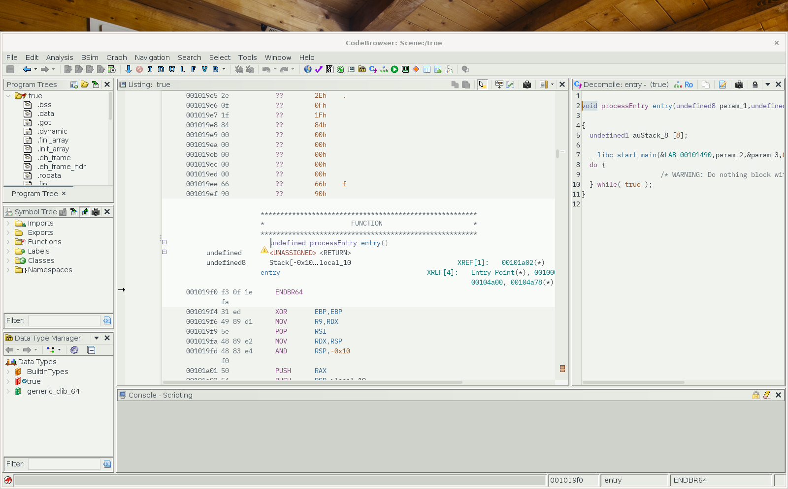
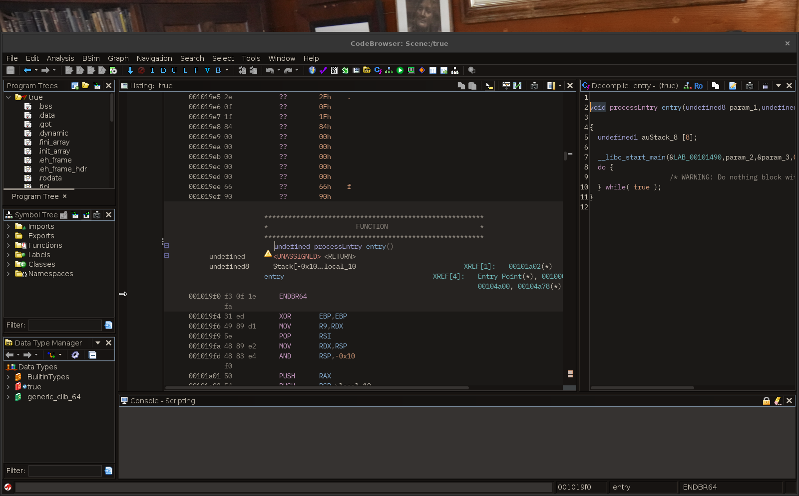

# Inglenook for Ghidra

**Tier:** 2 Partial\
**Variants:** Inglenook Day, Inglenook Night\
**Tested with:** Ghidra 12.2 on Linux Mint 22.3

| Day | Night |
|---|---|
|  |  |

## Before you start

- Ghidra 11.0 or later. Themes came in Ghidra 10.3; the steps below follow the menus of 11 and 12.
- Nothing else to install.

## Install

1. Download both theme files below.
2. Open Ghidra. In the project window (the one titled **Ghidra:** and your project name), choose **Edit** > **Theme** > **Import...**.
3. Pick `inglenook-night.theme` and click **Import**. Ghidra switches to Inglenook Night and saves a copy in its own `themes` folder.
4. Choose **Edit** > **Theme** > **Import...** again and pick `inglenook-day.theme`. Ghidra switches to Inglenook Day.
5. If Ghidra asks to restart because the look and feel changed, click **Yes**.

Files to use:

- Inglenook Day: `dist/day/inglenook-day.theme`
- Inglenook Night: `dist/night/inglenook-night.theme`

## Set the font

Inglenook uses [IBM Plex Mono](https://github.com/IBM/plex). Where the app shows icons, use [BlexMono Nerd Font](https://www.nerdfonts.com/font-downloads) instead, the same font with icons added. If it is not installed yet, follow [Font](../../README.md#font) in the main README.

1. In the project window, choose **Edit** > **Theme** > **Configure**.
2. Open the **Fonts** tab and double-click `font.monospaced`.
3. Pick **IBM Plex Mono**, a size such as **14**, and click **OK**. The listing, the decompiler and the byte viewer all use this font.
4. Click **Save** and keep the theme's name, so the font is saved into Inglenook Day.
5. Switch to Inglenook Night and do the same, since each theme keeps its own font.

## Check that it worked

Open a program in the CodeBrowser. Inglenook Day is a soft, faintly green off-white; Inglenook Night is a warm, dark walnut brown. Panels and toolbars are a shade deeper than the listing, instructions are soft purple, function names blue-gray, and the cursor and selection are amber.

## Switch between Day and Night

1. In the project window, choose **Edit** > **Theme** > **Change...**.
2. Pick **Inglenook Day** or **Inglenook Night** and click **OK**.

Ghidra does not follow the light or dark setting of your system.

## Uninstall

1. Choose **Edit** > **Theme** > **Change...** and pick a built-in theme, such as **Flat Light** or **Flat Dark**.
2. Choose **Edit** > **Theme** > **Delete...**, pick **Inglenook Day** and click **OK**. Do the same for **Inglenook Night**.

## Troubleshooting

- **Some colors stay the same after importing**: colors you changed yourself in **Edit** > **Tool Options**, under **Listing Display** or **Decompiler** > **Display**, win over any theme. Click **Restore Defaults** on those pages.
- **The listing font looks like a plain sans-serif**: IBM Plex Mono is not installed, or Ghidra was open while you installed it. Install the font, restart Ghidra, and set it again.
- **Import says the file is not a theme**: the file name must end in `.theme`. Some browsers add `.txt` when saving.

## Known limits

- Graphs (Function Graph, Function Call Graph, the program graph) keep Ghidra's own colors for their nodes and edges.
- The Debugger, Version Tracking and BSim windows keep Ghidra's own colors for their highlights.
- Strings in the listing and the decompiler use the same color as numbers: Ghidra has one color for both.
- The splash screen at startup is always black.
- The current search match is a stronger amber tint, not a solid block, so the code on it keeps its colors.

## Sources

- [Theming User Documentation](https://github.com/NationalSecurityAgency/ghidra/blob/Ghidra_12.2_build/Ghidra/Framework/Docking/src/main/help/help/topics/Theming/ThemingUserDocs.html): theme files, Import, Change, Configure, Delete
- [Theming Developer's Guide](https://github.com/NationalSecurityAgency/ghidra/blob/Ghidra_12.2_build/Ghidra/Framework/Docking/src/main/help/help/topics/Theming/ThemingDeveloperDocs.html): property names, color and font values
- [ThemeReader.java](https://github.com/NationalSecurityAgency/ghidra/blob/Ghidra_12.2_build/Ghidra/Framework/Gui/src/main/java/generic/theme/ThemeReader.java) and [ThemeWriter.java](https://github.com/NationalSecurityAgency/ghidra/blob/Ghidra_12.2_build/Ghidra/Framework/Gui/src/main/java/generic/theme/ThemeWriter.java): the header keys a theme file starts with
