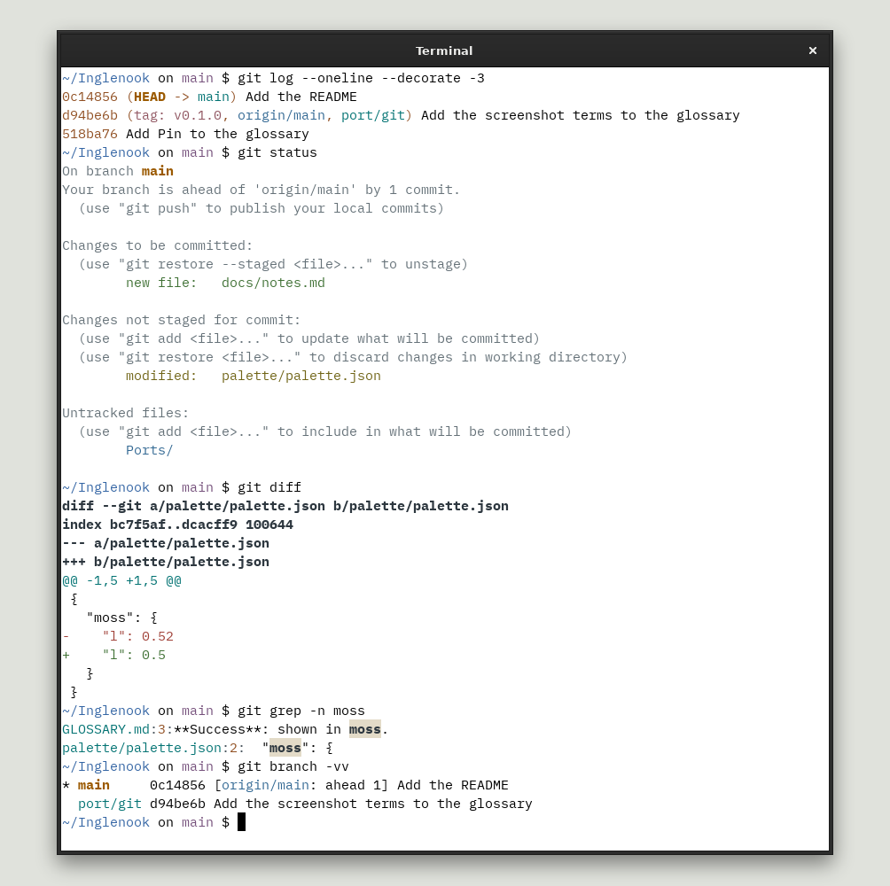
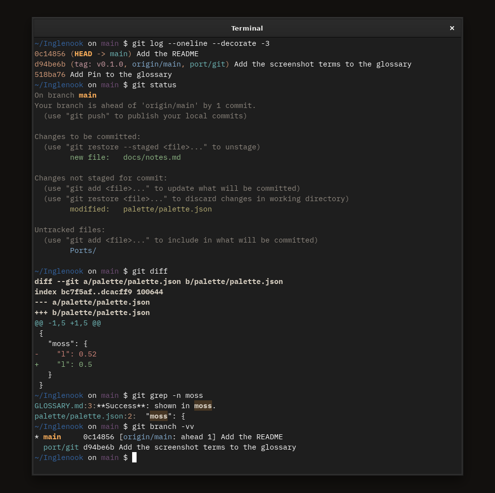

# Inglenook for Git

**Tier:** 1 Full\
**Variants:** Inglenook Day, Inglenook Night\
**Tested with:** Not tested yet

| Day | Night |
|---|---|
|  |  |

## Before you start

- Git 2.12 or newer, in a terminal that shows 24-bit color (Windows Terminal, GNOME Terminal, iTerm2, and most others do).
- Git colors its output in the terminal by default. If you turned that off, turn it back on: `git config --global color.ui auto`.

## Install

The same steps work in PowerShell, Zsh, and Bash.

1. Pick a variant: `dist/day/gitconfig` for Inglenook Day, or `dist/night/gitconfig` for Inglenook Night.
2. Make the folder `~/.config/inglenook/`. On Windows that is `%USERPROFILE%\.config\inglenook\`.
3. Save the file there as `gitconfig`, so its path is `~/.config/inglenook/gitconfig`.
4. Open a terminal and add it to your Git config:

   ```sh
   git config --global --add include.path '~/.config/inglenook/gitconfig'
   ```

   This adds an `[include]` section to `~/.gitconfig` (`%USERPROFILE%\.gitconfig` on Windows). Git reads `~` as your home folder on every platform.

Files to use:

- Inglenook Day: `dist/day/gitconfig`
- Inglenook Night: `dist/night/gitconfig`

## Set the font

Git uses your terminal's font and cannot change it. Set [IBM Plex Mono](https://github.com/IBM/plex) in your terminal's settings. If it is not installed yet, follow [Font](../../README.md#font) in the main README.

## Check that it worked

Run `git status` in any repository. The current branch name is orange and bold, and the file lists are green for staged and yellow for changed files.

## Switch between Day and Night

1. Save the other variant's `gitconfig` over `~/.config/inglenook/gitconfig`.

Git has no light and dark mode, so it cannot follow the OS setting. The next Git command uses the new colors.

## Uninstall

1. Remove the include line:

   ```sh
   git config --global --unset include.path inglenook/gitconfig
   ```

2. Delete `~/.config/inglenook/gitconfig`.

## Troubleshooting

- **Some colors did not change**: a `[color "..."]` section of your own in `~/.gitconfig` that comes after the `[include]` section wins. Move the `[include]` section to the end of the file, or remove your own color lines.
- **No colors at all**: run `git config --global color.ui auto`. A pager that does not understand colors also hides them: Git's default pager, `less`, does.
- **Colors look wrong or blocky**: the terminal shows only 256 colors. Use a terminal with 24-bit color.

## Known limits

- Git colors only its own text. The background, the plain text, and the cursor are your terminal's.
- Search matches in `git grep` get a soft background that is made for the Inglenook background. On another terminal background it still reads, but looks less even.

## Sources

- [git-config: color values and every `color.*` setting](https://git-scm.com/docs/git-config#_values)
- [git-config: includes](https://git-scm.com/docs/git-config#_includes)
