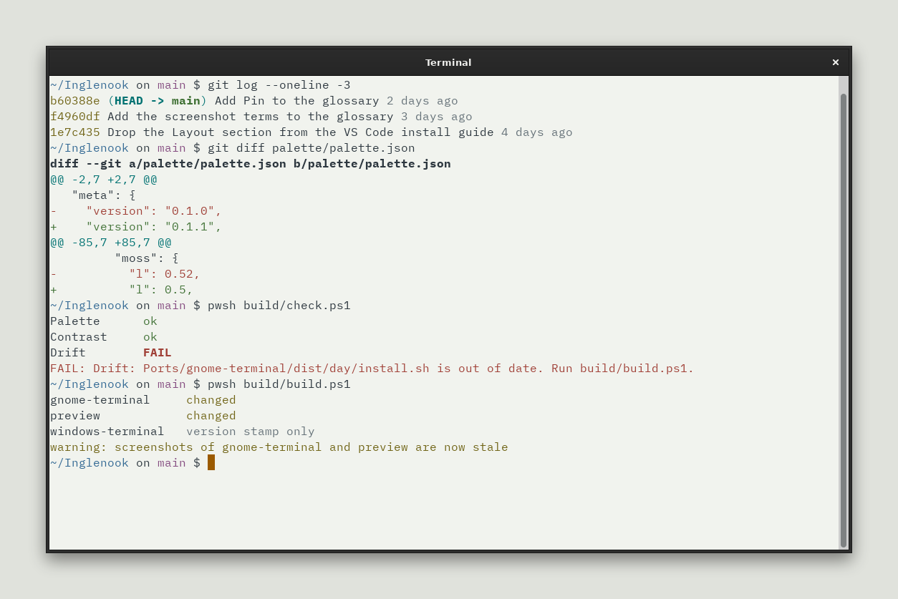
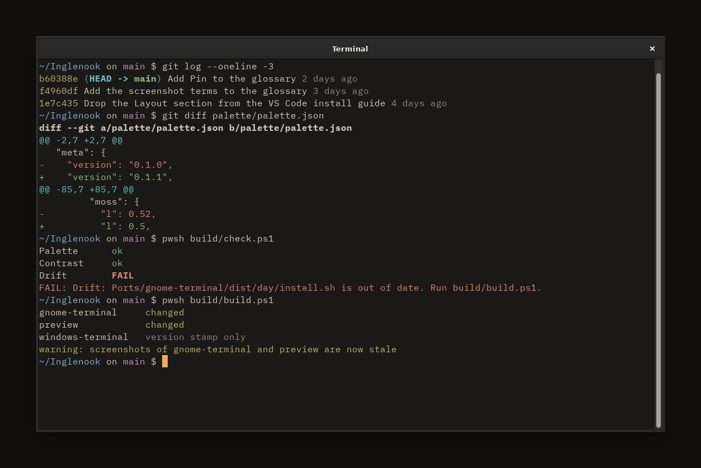

# Inglenook for GNOME Terminal

**Tier:** 1 Full\
**Variants:** Inglenook Day, Inglenook Night\
**Tested with:** Not tested yet

| Inglenook Day | Inglenook Night |
|---|---|
|  |  |

GNOME Terminal is the default terminal in Linux Mint Cinnamon, Ubuntu, Fedora Workstation, and other GNOME-based systems. It keeps its colors in **profiles**, which live in your settings database (dconf), not in a file. Each variant here is a small script that adds one profile: `Inglenook Day` or `Inglenook Night`. Your existing profiles are not touched.

## Before you start

- GNOME Terminal 3.8 or later. Any version from the last decade works. Check it in **Help** > **About**.
- `dconf` and `gsettings` on the command line. Every GNOME and Cinnamon desktop has them. If `dconf` is missing, install `dconf-cli` (Debian, Ubuntu, Mint) or `dconf` (Fedora).

## Install

1. Download or clone this repo.
2. Open GNOME Terminal and `cd` into the repo folder.
3. Add both profiles and make Inglenook Night the default:

   ```sh
   bash Ports/gnome-terminal/dist/day/install.sh
   bash Ports/gnome-terminal/dist/night/install.sh --default
   ```

   Each script prints a line such as `Inglenook Night is installed and is now the default profile.` Use `--default` on the variant you want new windows to open with.
4. Close the window and open a new one. It opens with the default profile.

To install only one variant, run only its script. Running a script again updates the profile; it never adds a second copy.

Files to use:

- Inglenook Day: [`dist/day/install.sh`](dist/day/install.sh), [`dist/day/uninstall.sh`](dist/day/uninstall.sh)
- Inglenook Night: [`dist/night/install.sh`](dist/night/install.sh), [`dist/night/uninstall.sh`](dist/night/uninstall.sh)

## Set the font

Inglenook uses [IBM Plex Mono](https://github.com/IBM/plex). In a terminal, where prompts and file listings show icons, use [BlexMono Nerd Font](https://www.nerdfonts.com/font-downloads) instead, the same font with icons added. If it is not installed yet, follow [Font](../../README.md#font) in the main README.

The install script already sets **BlexMono Nerd Font Mono** at size 12 in both profiles. To change the size, or if the font was not installed when you ran the script:

1. Open **Edit** > **Preferences**. On builds without a menu bar, click the menu button in the top-right corner and pick **Preferences**.
2. In the sidebar, under **Profiles**, select **Inglenook Day** or **Inglenook Night**.
3. Open the **Text** tab.
4. Tick **Custom font** and click the button next to it.
5. Search for `BlexMono Nerd Font Mono`, pick it, set the size, and click **Select**.

## Check that it worked

The background is a soft off-white with a faint green lean in Day, and a warm dark walnut brown in Night. Run `ls --color` in a folder with some files: folders show in a muted blue, and the cursor is a solid amber block.

## Switch between Day and Night

To change the profile of the window you are in:

1. Open **Terminal** > **Change Profile**.
2. Pick **Inglenook Day** or **Inglenook Night**.

To change the default for new windows:

1. Open **Edit** > **Preferences**.
2. In the sidebar, select **Inglenook Day** or **Inglenook Night**.
3. Click the arrow next to the profile name and pick **Set as default**.

Or from the command line, run the variant's script again with `--default`.

GNOME Terminal cannot switch profiles when the system switches between light and dark. The window frame and tab bar follow your desktop theme. To match them to the variant, open **Edit** > **Preferences** > **General** and set **Theme variant** to **Light** for Day or **Dark** for Night.

## Make it see-through (optional)

The theme is solid. On Ubuntu and Linux Mint, GNOME Terminal has its own transparency setting:

1. Open **Edit** > **Preferences** and select the Inglenook profile.
2. On the **Colors** tab, tick **Use transparent background** and move the slider.

Upstream GNOME and Debian builds do not have this setting.

## Uninstall

1. Open GNOME Terminal and `cd` into the repo folder.
2. Run the uninstall script for each variant you installed:

   ```sh
   bash Ports/gnome-terminal/dist/night/uninstall.sh
   bash Ports/gnome-terminal/dist/day/uninstall.sh
   ```

   If the profile was the default, the script makes your first other profile the default before removing it. Each script prints a line such as `Inglenook Night is removed.`
3. Close the window and open a new one.

You can also remove a profile by hand: **Edit** > **Preferences**, select it, click the arrow next to its name, and pick **Delete...**.

## Troubleshooting

- **`dconf: command not found`**: install the `dconf-cli` package (Debian, Ubuntu, Mint) or `dconf` (Fedora), then run the script again.
- **`No such schema "org.gnome.Terminal.ProfilesList"`**: GNOME Terminal is not installed, or you are running the script over SSH or in a different user session. Run it inside GNOME Terminal on the desktop.
- **The colors look right but the text is still the old font**: BlexMono Nerd Font is not installed. Install it, then reopen the window. See [Set the font](#set-the-font).
- **The uninstall script says it is your only profile**: GNOME Terminal needs at least one profile. Create another one in **Edit** > **Preferences** (the **+** next to **Profiles**), then run the script again.

## Known limits

- **The window frame and tab bar** follow your desktop theme, not the profile. Use **Theme variant** in **Preferences** > **General** to pick its light or dark version.
- **No automatic light and dark switching.** A profile has one set of colors, so switching variants means switching profiles.
- **Bold text keeps its color.** **Show bold text in bright colors** is off, so bold text is bold, not brighter.

## Sources

- [GNOME Terminal help: Manage profiles](https://help.gnome.org/users/gnome-terminal/stable/pref-profiles.html)
- [GNOME Terminal help: Change font and style](https://help.gnome.org/users/gnome-terminal/stable/app-fonts.html)
- [GNOME Terminal help: Color schemes](https://help.gnome.org/users/gnome-terminal/stable/app-colors.html)
- [GNOME Terminal settings schema](https://gitlab.gnome.org/GNOME/gnome-terminal/-/blob/master/src/org.gnome.Terminal.gschema.xml)
