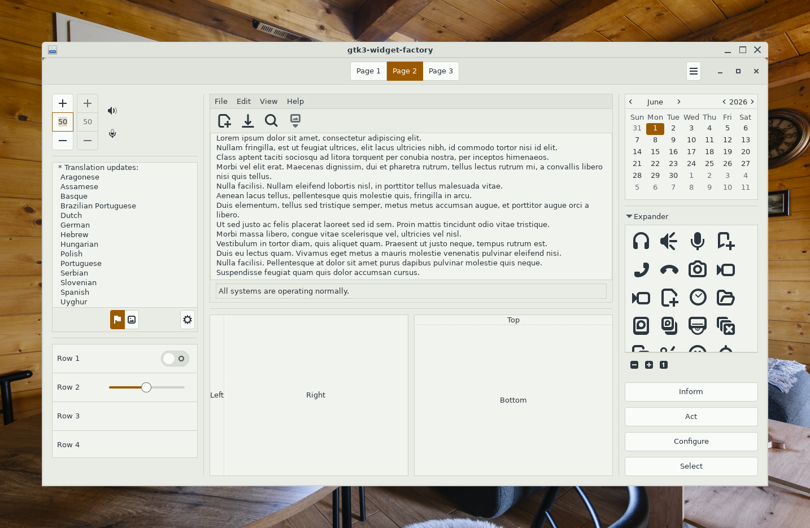
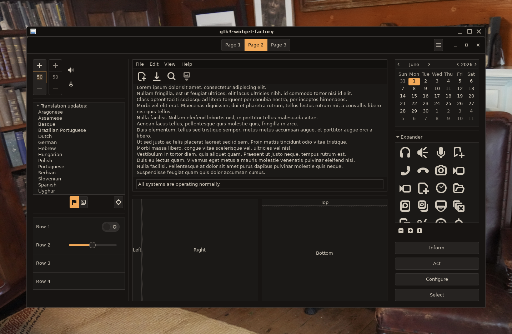

# Inglenook for GTK and MATE

**Tier:** 2 Partial\
**Variants:** Inglenook Day, Inglenook Night\
**Tested with:** GTK 3.24.41 and Marco 1.26.2 on Linux Mint 22.3

| Day | Night |
|---|---|
|  |  |

## Before you start

- A Linux desktop that uses GTK themes: MATE, Cinnamon, Xfce, or GNOME Flashback.
- GTK 3 apps get the full theme. GTK 4 apps get it too, unless they are built with libadwaita (see [Known limits](#known-limits)).
- Window borders work in Marco (MATE), Muffin (Cinnamon), and Metacity.

## Install

1. Make the themes folder in your home folder: `mkdir -p ~/.themes`
2. Copy both theme folders into it, keeping their names: `Inglenook Day` and `Inglenook Night`.
3. Pick the theme for your desktop:
   - **MATE**: open **Control Center** > **Appearance** > **Theme** > **Customize...**. On the **Controls** tab pick **Inglenook Day** or **Inglenook Night**. On the **Window Border** tab pick the same name. Click **Close**.
   - **Cinnamon**: open **System Settings** > **Themes**. Set **Applications** and **Window borders** to **Inglenook Day** or **Inglenook Night**.
   - **Any other desktop**: open `~/.config/gtk-3.0/settings.ini` (make it if it is missing) and put `gtk-theme-name=Inglenook Day` under a `[Settings]` line. Do the same in `~/.config/gtk-4.0/settings.ini`.
4. Close and reopen your apps.

Files to use:

- Inglenook Day: `dist/day/Inglenook Day/`
- Inglenook Night: `dist/night/Inglenook Night/`

The Inglenook theme for the Cinnamon desktop uses the same folder names, so both can share one folder. Each also works on its own.

### GTK 4 apps built with libadwaita (optional)

Apps built with libadwaita, such as most new GNOME apps, ignore the theme you pick. You can still give them the theme's colors:

1. Make the folder: `mkdir -p ~/.config/gtk-4.0`
2. Copy `gtk-4.0/gtk.css` from the variant you want into `~/.config/gtk-4.0/`. If a `gtk.css` is already there, rename the old one first.
3. Close and reopen the app.

This is a known method, but not an official one: libadwaita reads this file and the color names in it, and its developers do not promise to keep them. Some parts of libadwaita apps stay see-through or keep their own shading.

## Set the font

Inglenook uses [IBM Plex Mono](https://github.com/IBM/plex). If it is not installed yet, follow [Font](../../README.md#font) in the main README. The theme does not set your interface font; set the fixed-width font where your desktop keeps it:

1. **MATE**: **Control Center** > **Appearance** > **Fonts** > **Fixed width font**. **Cinnamon**: **System Settings** > **Font Selection** > **Monospace font**.
2. Pick **IBM Plex Mono**.

## Check that it worked

Open any app with a settings window. Buttons and boxes are soft and solid, a checked box or a switched-on switch is amber, and the window border has a plain title bar with simple line buttons.

## Switch between Day and Night

1. Pick the other variant in the same place as in step 3 of the install, for both the controls and the window border.
2. If you use the libadwaita file, copy the other variant's `gtk.css` over it.

The theme does not follow a light or dark setting on its own: each variant is its own theme.

## Uninstall

1. Pick your old theme again in step 3 of the install.
2. Delete `~/.themes/Inglenook Day` and `~/.themes/Inglenook Night`.
3. If you copied the libadwaita file, delete `~/.config/gtk-4.0/gtk.css`.

## Troubleshooting

- **The theme is not in the list**: check that the folders are directly in `~/.themes`, such as `~/.themes/Inglenook Day/gtk-3.0/gtk.css`, not one folder deeper.
- **An app still looks the same**: close every window of it and open it again. An app started with a `GTK_THEME` setting in its environment ignores the theme you pick.
- **The window border did not change**: pick the theme on the **Window Border** tab (MATE) or under **Window borders** (Cinnamon) too.

## Known limits

- GTK 2 apps are not themed. They keep your old theme.
- Apps built with libadwaita ignore the theme unless you add the optional file above, and even then only their colors change.
- Apps that draw their own title bar, such as many GNOME apps, show the theme's header bar instead of the window border.
- Widgets are drawn flat and solid: no shadows and no see-through menus or popovers.
- Icons and the mouse pointer come from your icon theme, not from this theme.

## Sources

- [GTK 3 CSS overview](https://docs.gtk.org/gtk3/css-overview.html) and [GTK 3 CSS properties](https://docs.gtk.org/gtk3/css-properties.html)
- [GTK 4 CSS overview](https://docs.gtk.org/gtk4/css-overview.html) and [GTK 4 CSS properties](https://docs.gtk.org/gtk4/css-properties.html)
- [Metacity theme format](https://gitlab.gnome.org/GNOME/metacity/-/blob/master/doc/theme-format.txt), which Marco and Muffin also read
- [GtkSettings: gtk-theme-name and settings.ini](https://docs.gtk.org/gtk3/class.Settings.html)
- [Libadwaita named colors](https://gnome.pages.gitlab.gnome.org/libadwaita/doc/1.5/named-colors.html)
- [GTK 4 user stylesheet: `~/.config/gtk-4.0/gtk.css`](https://docs.gtk.org/gtk4/const.STYLE_PROVIDER_PRIORITY_USER.html)
