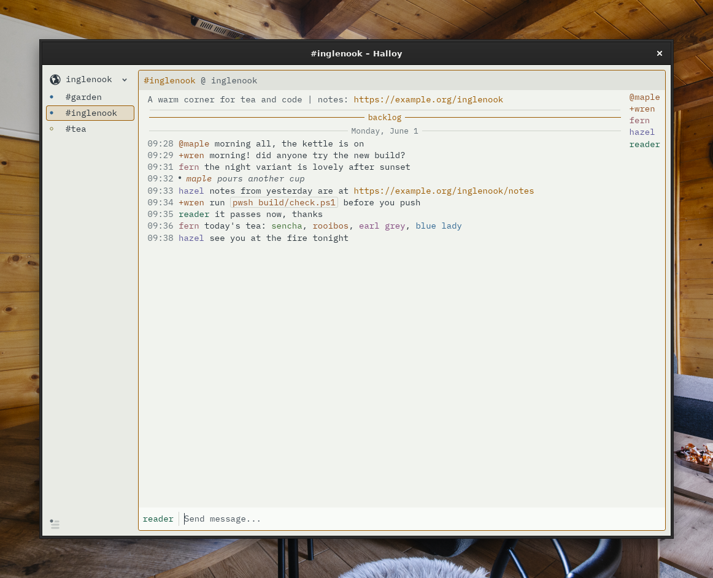
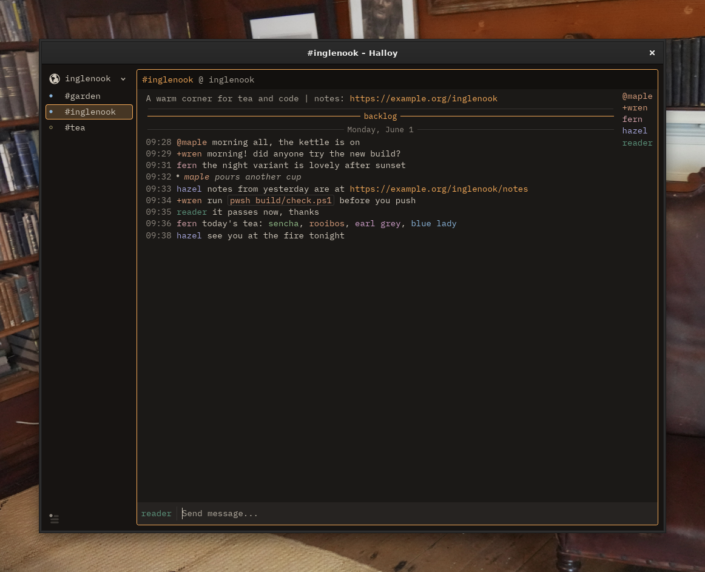

# Inglenook for Halloy

**Tier:** 1 Full\
**Variants:** Inglenook Day, Inglenook Night\
**Tested with:** Halloy 2026.9 on Linux Mint 22.3

| Day | Night |
|---|---|
|  |  |

## Before you start

- Halloy 2026.9 or later. The version is in the user menu at the bottom of the sidebar.
- Run Halloy once, so it creates its configuration folder and `config.toml`.

## Install

1. Find Halloy's configuration folder:
   - Windows: `%AppData%\halloy`
   - macOS: `~/Library/Application Support/halloy`
   - Linux: `~/.config/halloy` (Flatpak: `~/.var/app/org.squidowl.halloy/config/halloy`)
2. Make a folder named `themes` inside it, if there is none.
3. Copy `inglenook-day.toml` and `inglenook-night.toml` into the `themes` folder. Keep their names: Halloy names a theme after its file.
4. Open `config.toml` in the configuration folder.
5. Add this line at the very top, above every line that starts with `[`:

   ```toml
   theme = { light = "inglenook-day", dark = "inglenook-night" }
   ```

   If the file already has a `theme =` line, replace it.
6. Find the `[buffer.nickname]` section, or add one at the end of the file, and set its `color` so nicknames use the theme:

   ```toml
   [buffer.nickname]
   color = "solid"
   ```

7. Save the file. In Halloy, open the user menu at the bottom of the sidebar and choose **Reload config**, or restart Halloy.

Files to use:

- Inglenook Day: `dist/day/inglenook-day.toml`
- Inglenook Night: `dist/night/inglenook-night.toml`

### Colored nicknames (optional, one variant)

With `color = "solid"` every nickname has the same color, and it follows Day and Night. To give each person their own color instead, use one variant only (see [Switch between Day and Night](#switch-between-day-and-night)), then:

1. Open `nicknames.toml` for that variant: `dist/day/nicknames.toml` or `dist/night/nicknames.toml`.
2. In `config.toml`, replace the `color = "solid"` line under `[buffer.nickname]` with the `color = { palette = [...] }` line from that file.
3. Reload config.

Each person keeps the same color every time. The colors are made for one variant, so change this line back to `color = "solid"` if you go back to following your system.

## Set the font

Inglenook uses [IBM Plex Mono](https://github.com/IBM/plex). Where the app shows icons, use [BlexMono Nerd Font](https://www.nerdfonts.com/font-downloads) instead, the same font with icons added. If it is not installed yet, follow [Font](../../README.md#font) in the main README.

1. Open `config.toml`.
2. Add a `[font]` section at the end, or find the one already there, and set `family`:

   ```toml
   [font]
   family = "IBM Plex Mono"
   ```

3. Restart Halloy. Font changes need a restart; **Reload config** is not enough.

## Check that it worked

The sidebar and pane title bars are a soft, slightly deeper shade than the chat. The selected channel in the sidebar has a warm amber tint, and links are amber.

## Switch between Day and Night

The `theme = { light = ..., dark = ... }` line from the install makes Halloy follow your system's light or dark setting.

To always use one variant, use one name instead:

```toml
theme = "inglenook-night"
```

Reload config after each change.

## Uninstall

1. Delete the `theme =` line from `config.toml`, or set it back to `theme = "ferra"`.
2. Delete the `color =` line under `[buffer.nickname]`, or set it back to `color = "unique"`.
3. Delete `inglenook-day.toml` and `inglenook-night.toml` from the `themes` folder.
4. Reload config.

## Troubleshooting

- **Halloy still shows its default colors**: the `theme =` line must be above every `[section]` line in `config.toml`. Below a section, Halloy reads it as part of that section.
- **Halloy says the config is invalid after adding the nickname colors**: `config.toml` has `[buffer.nickname]` twice. Keep one, with the `color =` line in it.
- **Nicknames are bright and every one is a different hue**: the `color` line under `[buffer.nickname]` is missing or says `"unique"`. Set it to `"solid"` or to the palette line.
- **The font did not change**: restart Halloy, and check that the name is exactly `IBM Plex Mono`.

## Known limits

- Halloy fades some things itself: the row under the mouse in a chat, the message you jumped to, and the names of people who are away. These are lighter versions of the theme's colors.
- Halloy's default `"unique"` nickname colors are picked by Halloy, not by the theme. That is why the install sets `"solid"` or the theme's own list.
- The theme's nickname list is for one variant at a time. While following your system, nicknames share one color.
- Colors that people send in messages (mIRC colors) follow the theme. White text sent on Day, or black text sent on Night, is hard to read, as it is in a terminal.

## Sources

- [Halloy: Themes](https://halloy.chat/configuration/themes)
- [Halloy: Custom themes](https://halloy.chat/guides/custom-themes)
- [Halloy: Buffer, nickname color](https://halloy.chat/configuration/buffer)
- [Halloy: Font](https://halloy.chat/configuration/font)
- [Halloy: Configuration directory](https://halloy.chat/configuration)
