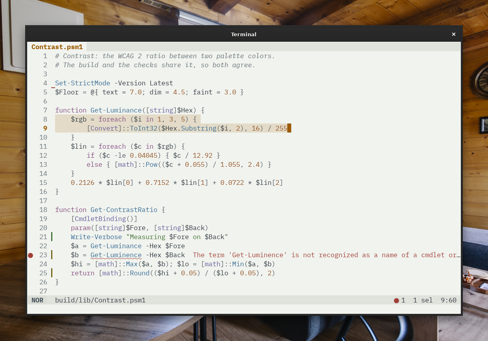
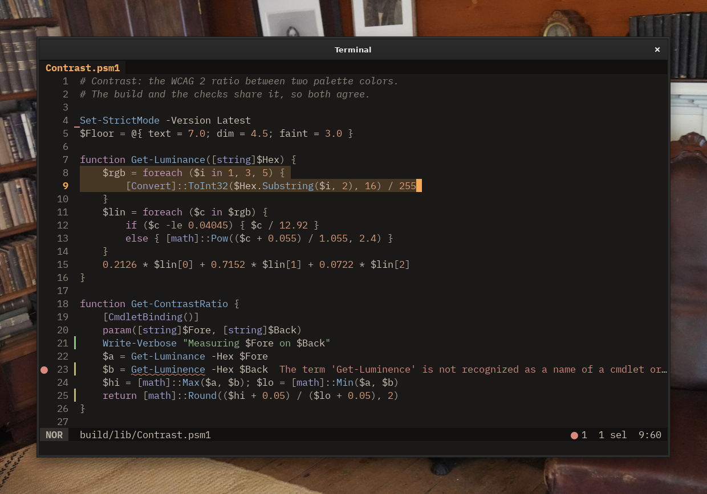

# Inglenook for Helix

**Tier:** 1 Full\
**Variants:** Inglenook Day, Inglenook Night\
**Tested with:** Helix 25.07.1 on Linux Mint 22.3, in GNOME Terminal 3.52.0

| Day | Night |
|---|---|
|  |  |

## Before you start

- Helix 25.01 or later.
- A terminal that shows 24-bit color, such as Windows Terminal, GNOME Terminal, iTerm2, or kitty.

## Install

1. Open Helix's config folder. On Windows it is `%AppData%\helix`; on Linux and macOS it is `~/.config/helix`.
2. In that folder, create a folder named `themes` if it is missing.
3. Copy [`dist/day/inglenook-day.toml`](dist/day/inglenook-day.toml) and [`dist/night/inglenook-night.toml`](dist/night/inglenook-night.toml) into `themes`.
4. Open `config.toml` in the config folder (in Helix, run `:config-open`; create the file if it is missing).
5. Add this line at the very top, above any `[editor]` section:

   ```toml
   theme = "inglenook-night"
   ```

   Use `inglenook-day` for Inglenook Day.
6. Save the file and run `:config-reload`, or restart Helix.

Files to use:

- Inglenook Day: `dist/day/inglenook-day.toml`
- Inglenook Night: `dist/night/inglenook-night.toml`

## Set the font

Inglenook uses [IBM Plex Mono](https://github.com/IBM/plex). Helix runs in a terminal and uses the terminal's font. If you use icons in your terminal, use [BlexMono Nerd Font](https://www.nerdfonts.com/font-downloads), the same font with icons added. If it is not installed yet, follow [Font](../../README.md#font) in the main README.

1. Open your terminal's settings and set the font to **BlexMono Nerd Font Mono** (or **IBM Plex Mono**). For GNOME Terminal, see [Inglenook for GNOME Terminal](../gnome-terminal/README.md); for Windows Terminal, see [Inglenook for Windows Terminal](../windows-terminal/README.md).

## Check that it worked

Run `:theme` with no name. Helix prints `inglenook-day` or `inglenook-night`, and the background turns soft green-gray (Day) or warm dark brown (Night).

## Switch between Day and Night

1. To try the other variant, run `:theme inglenook-day` or `:theme inglenook-night`. The colors change at once, until Helix restarts.
2. To keep it, change the `theme` line in `config.toml` and run `:config-reload`.

Helix 25.07 does not follow the OS light and dark setting. Newer Helix builds can: replace the `theme` line with this, and Helix picks the variant from a terminal that reports light or dark mode:

```toml
[theme]
light = "inglenook-day"
dark = "inglenook-night"
```

## Make it see-through (optional)

Helix has no transparency of its own. Some terminals do: Windows Terminal (**Settings** > your profile > **Appearance** > **Background opacity**) and GNOME Terminal (**Preferences** > your profile > **Colors** > **Use transparent background**). The theme itself stays solid.

## Uninstall

1. Remove the `theme` line from `config.toml`.
2. Delete `inglenook-day.toml` and `inglenook-night.toml` from the `themes` folder.
3. Run `:config-reload`, or restart Helix.

## Troubleshooting

- **Helix keeps its default colors**: the files are not in the `themes` folder inside the config folder from step 1, or the name in `config.toml` does not match the file name without `.toml`.
- **`Bad config`** when Helix starts: the `theme` line is below a `[section]` header. Move it to the top of `config.toml`.
- **The colors look wrong or too bright**: your terminal does not report 24-bit color. Add `true-color = true` under `[editor]` in `config.toml`, or use a terminal that supports 24-bit color.

## Known limits

- Search has no highlight of its own in Helix: a search moves your selection to the next match, so the match shows as a selection.
- The mode colors in the status line only show with `color-modes = true` under `[editor]`.
- Colors need a terminal with 24-bit color. In a terminal limited to 256 colors, Helix picks the nearest colors it can.

## Sources

- [Helix: Themes](https://docs.helix-editor.com/themes.html)
- [Helix: Configuration](https://docs.helix-editor.com/configuration.html) and [Editor options](https://docs.helix-editor.com/editor.html)
