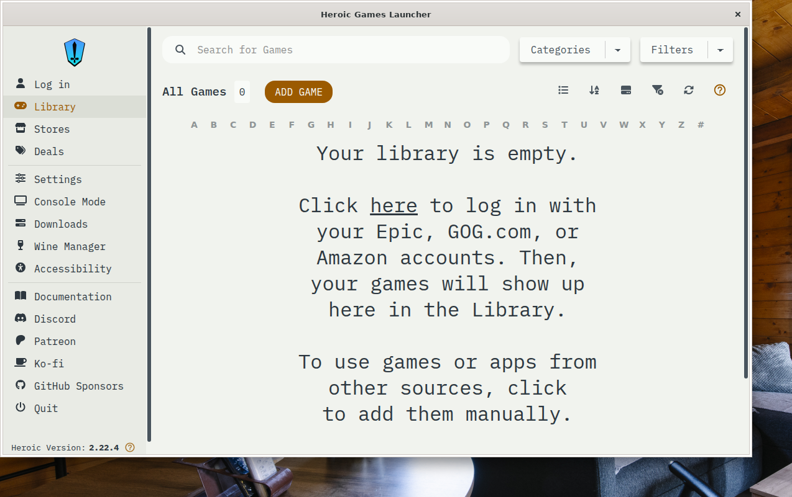
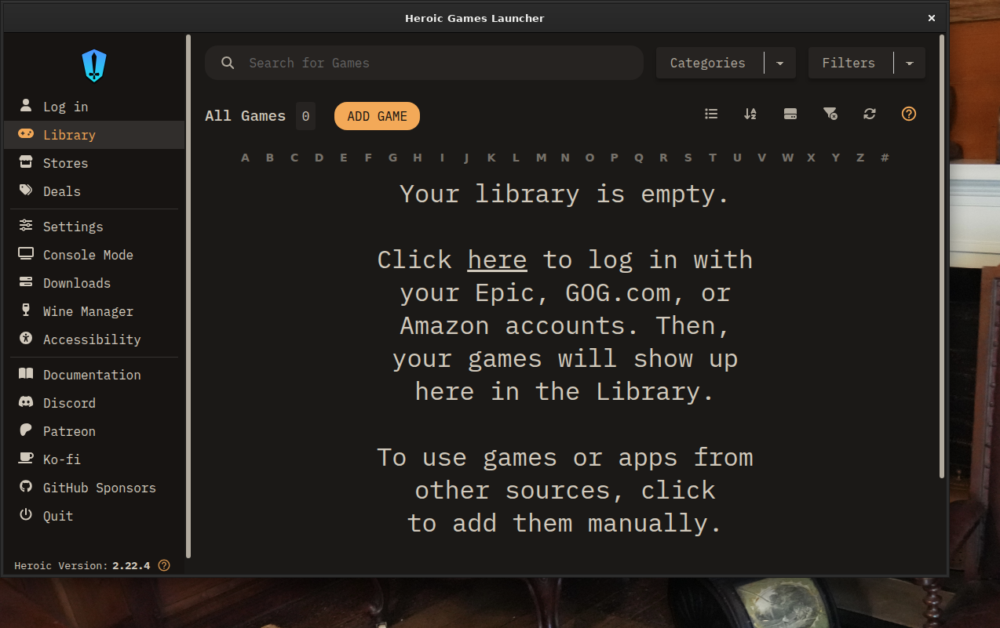

# Inglenook for Heroic Games Launcher

**Tier:** 1 Full\
**Variants:** Inglenook Day, Inglenook Night\
**Tested with:** Not tested yet

| Day | Night |
|---|---|
|  |  |

## Before you start

- Heroic Games Launcher 2.22 or later, on Windows, macOS, or Linux.
- You do not need to log in to a store to use the theme.

## Install

1. Download or clone this repo.
2. Make a folder for Heroic themes, such as `Documents\Heroic Themes` on Windows or `~/.config/inglenook/heroic` on macOS and Linux.
3. Copy `inglenook-day.css` and `inglenook-night.css` into that folder. Keep the file names as they are: Heroic reads the theme's name from the file name.
4. Open Heroic and click **Settings** in the sidebar, then **General**.
5. Under **Custom Themes Path**, click the folder icon and pick the folder from step 2.
6. Open **Select Theme** and pick **inglenook-day.css** or **inglenook-night.css**.

Files to use:

- Inglenook Day: `dist/day/inglenook-day.css`
- Inglenook Night: `dist/night/inglenook-night.css`

The same two settings are also on the **Accessibility** page in the sidebar.

## Set the font

Inglenook uses [IBM Plex Mono](https://github.com/IBM/plex). If it is not installed yet, follow [Font](../../README.md#font) in the main README.

1. Click **Accessibility** in the sidebar.
2. Set **Content font family** to **IBM Plex Mono**.
3. Set **Actions font family** to **IBM Plex Mono**.

## Check that it worked

The background turns soft green-gray in Day or warm brown in Night, and the page you are on is marked in amber in the sidebar.

## Switch between Day and Night

1. Click **Settings**, then **General** (or **Accessibility**).
2. Open **Select Theme** and pick the other Inglenook file.

Heroic does not follow the OS light or dark setting, so you switch by hand.

## Uninstall

1. Open **Select Theme** and pick one of Heroic's own themes, such as **Midnight Mirage**.
2. Delete the two Inglenook files from your themes folder.

## Troubleshooting

- **The theme is not in Select Theme**: check that **Custom Themes Path** points at the folder that holds the `.css` files, not at a folder above it.
- **A change to a file does not show**: pick another theme, then pick the Inglenook one again. Heroic reads the file only when you select it.

## Known limits

- Game cover art keeps its own colors. Game titles on library cards sit on a solid band instead of the usual fade.
- Store pages (Epic, GOG, Amazon) are websites shown inside Heroic and keep their own look.
- Dialog backdrops keep Heroic's own dimming.

## Sources

- [Custom Themes](https://github.com/Heroic-Games-Launcher/HeroicGamesLauncher/wiki/Custom-Themes), Heroic wiki
- [Heroic's built-in themes](https://github.com/Heroic-Games-Launcher/HeroicGamesLauncher/blob/v2.22.4/src/frontend/themes.scss), the CSS variables a theme sets
- The list of themed variables started from [Catppuccin for Heroic](https://github.com/catppuccin/heroic), [MIT License](https://github.com/catppuccin/heroic/blob/main/LICENSE), Copyright (c) 2021 Catppuccin. Its license notice is at the top of each CSS file.
