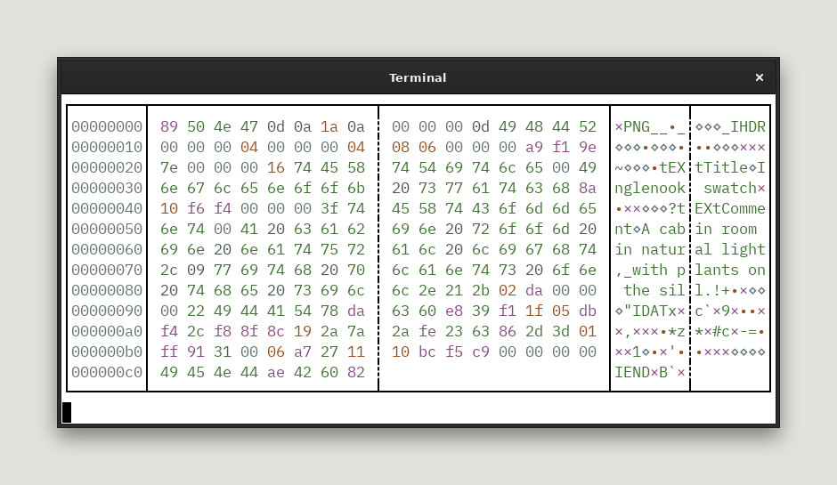
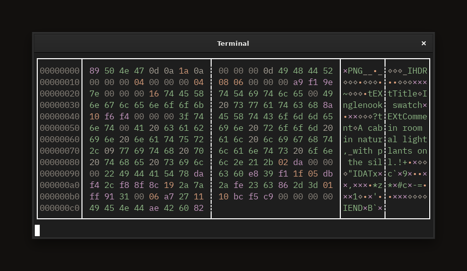

# Inglenook for hexyl

**Tier:** 2 Partial\
**Variants:** Inglenook Day, Inglenook Night\
**Tested with:** Not tested yet

| Day | Night |
|---|---|
|  |  |

## Before you start

- hexyl 0.17 or newer. Check with `hexyl --version`. Debian and Ubuntu ship an older hexyl that ignores these colors: get 0.17 from the [release page](https://github.com/sharkdp/hexyl/releases), or with `cargo install hexyl`, Homebrew, or Scoop.
- A terminal that shows 24-bit color, such as Windows Terminal or GNOME Terminal. For the full look, theme the terminal with Inglenook too.

## Install

hexyl reads its colors from environment variables. The theme is a file that sets them, which your shell loads when it starts.

**Zsh or Bash** (Linux, macOS):

1. Create the folder `~/.config/inglenook/`.
2. Save [`dist/day/hexyl.sh`](dist/day/hexyl.sh) or [`dist/night/hexyl.sh`](dist/night/hexyl.sh) there as `hexyl.sh`.
3. Add this line to the end of `~/.zshrc` (Zsh) or `~/.bashrc` (Bash):

   ```sh
   source ~/.config/inglenook/hexyl.sh
   ```

4. Open a new terminal.

**PowerShell** (Windows, also macOS and Linux):

1. Create the folder `~/.config/inglenook/` (on Windows, `%USERPROFILE%\.config\inglenook\`).
2. Save [`dist/day/hexyl.ps1`](dist/day/hexyl.ps1) or [`dist/night/hexyl.ps1`](dist/night/hexyl.ps1) there as `hexyl.ps1`.
3. Run `notepad $PROFILE` (or open `$PROFILE` in any editor) and add this line to the end:

   ```powershell
   . ~/.config/inglenook/hexyl.ps1
   ```

4. Open a new PowerShell window.

**Nowhere users**: put the same line in `~/.config/nowhere/theme.zsh` or `~/.config/nowhere/theme.ps1` instead of your profile. Nowhere loads those last.

**Setting the variables another way**: these are the values for Inglenook Day. The Night values are in [`dist/night/hexyl.sh`](dist/night/hexyl.sh).

```sh
HEXYL_COLOR_OFFSET='#657178'
HEXYL_COLOR_NULL='#657178'
HEXYL_COLOR_ASCII_PRINTABLE='#407135'
HEXYL_COLOR_ASCII_WHITESPACE='#49545d'
HEXYL_COLOR_ASCII_OTHER='#915023'
HEXYL_COLOR_NONASCII='#844b80'
```

## Set the font

hexyl uses your terminal's font. Set it there, for example in Windows Terminal under **Settings**, your profile, **Appearance**, **Font face**, or in GNOME Terminal under **Preferences**, your profile, **Text**, **Custom font**.

1. Pick **IBM Plex Mono**. If it is not installed yet, follow [Font](../../README.md#font) in the main README.

## Check that it worked

Run `hexyl --print-color-table`. Each kind of byte shows in its own color: null bytes and the offset column quiet, text green, other ASCII bytes a terracotta brown, and bytes above 0x7F a heather purple.

## Switch between Day and Night

1. Save the other variant's file over `~/.config/inglenook/hexyl.sh` (or `hexyl.ps1`).
2. Open a new terminal.

hexyl has no light or dark setting of its own, so it cannot follow the OS setting.

## Uninstall

1. Remove the `source ~/.config/inglenook/hexyl.sh` line (or the `. ~/.config/inglenook/hexyl.ps1` line) from your profile.
2. Delete the file from `~/.config/inglenook/`.
3. Open a new terminal. hexyl is back to its own colors.

## Troubleshooting

- **The colors did not change**: run `hexyl --version`. Versions before 0.17 ignore the variables.
- **The colors look wrong or too bright**: your terminal may not show 24-bit color. Use a terminal that does.
- **No colors at all**: the `NO_COLOR` variable is set, or the output is not going to a terminal. Use `hexyl --color=always` to force them.

## Known limits

- The background, the border lines, and the help text come from your terminal, not from this theme.
- `--color-scheme gradient` uses hexyl's own fixed colors and ignores the theme.
- Whitespace shows its color only in the hex columns; in the text column it is a dot or a blank.

## Sources

- [hexyl README: Configuration](https://github.com/sharkdp/hexyl#configuration)
- [hexyl releases](https://github.com/sharkdp/hexyl/releases)
