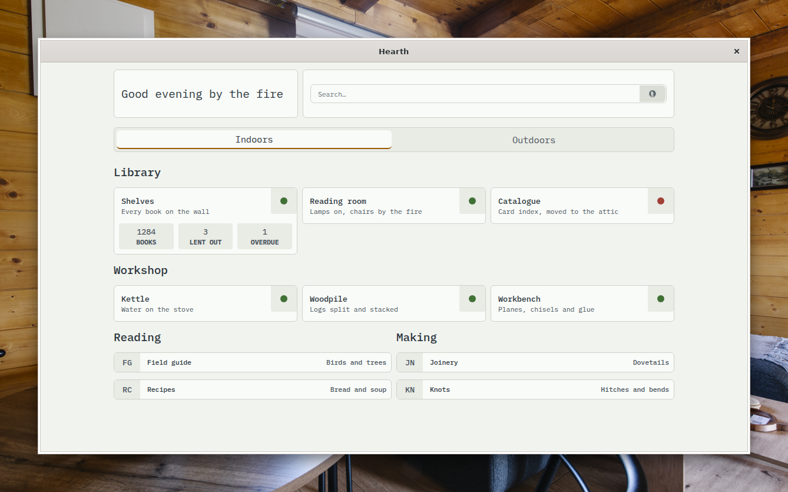
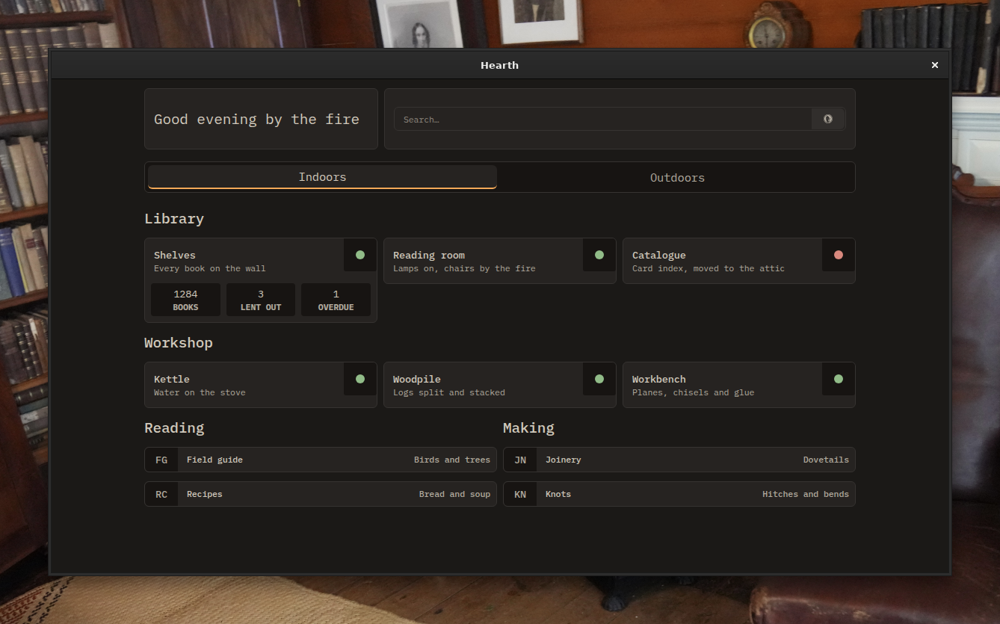

# Inglenook for Homepage

**Tier:** 2 Partial\
**Variants:** Inglenook Day, Inglenook Night\
**Tested with:** Not tested yet

| Day | Night |
|---|---|
|  |  |

This port is a `custom.css` file for [Homepage](https://gethomepage.dev), the self-hosted dashboard. It replaces Homepage's built-in color palettes.

## Before you start

- Homepage 2.8 or newer, in Docker or built from source.
- Access to Homepage's config folder: the folder you mount at `/app/config` in Docker, or `config/` in a source install.
- A browser from 2024 or later. The file uses relative color syntax, which older browsers ignore.

## Install

1. Download or clone this repo.
2. Open Homepage's config folder.
3. If the folder already has a `custom.css` with your own rules, save a copy of it.
4. Copy `Ports/homepage/dist/night/custom.css` (Night) or `Ports/homepage/dist/day/custom.css` (Day) into the config folder, replacing `custom.css`.
5. Open `settings.yaml` in the same folder.
6. Add `theme: dark` for Night, or `theme: light` for Day, on a line of its own. If a `theme:` line is already there, change it instead.
7. Reload the dashboard in your browser. Homepage reads `custom.css` on every page load. A change to `settings.yaml` can need a container restart (`docker restart homepage`).

Files to use:

- Inglenook Day: `dist/day/custom.css`, with `theme: light`
- Inglenook Night: `dist/night/custom.css`, with `theme: dark`

The `color:` setting does not matter: the file replaces every palette Homepage offers.

## Set the font

Inglenook uses [IBM Plex Mono](https://github.com/IBM/plex). Homepage ships it, so there is nothing to install.

1. Open `settings.yaml` in the config folder.
2. Add `font: plex` on a line of its own, for IBM Plex Mono everywhere. `font: plexData` uses it only for values, stats, the clock and status tags.

## Check that it worked

The page background turns soft green-gray (Day) or warm dark brown (Night), and service cards and bookmarks become solid panels with a thin border. If you use tabs, the current one is underlined in amber.

## Switch between Day and Night

1. Copy the other variant's `custom.css` over the one in the config folder.
2. Change the `theme:` line in `settings.yaml` to match: `light` for Day, `dark` for Night.
3. Reload the dashboard.

Each file holds one variant, so the theme cannot follow the OS light or dark setting: switching is by hand.

## Uninstall

1. Delete `custom.css` from the config folder, or put back the copy you saved in step 3.
2. Remove the `theme:` line from `settings.yaml` if you added it.
3. Reload the dashboard.

## Troubleshooting

- **Nothing changed**: check that the file is named `custom.css` and sits next to `settings.yaml`, then reload with the cache cleared (Ctrl+Shift+R).
- **Some text or icons look too bright or too pale**: the `theme:` line does not match the file. Use `theme: light` with Day and `theme: dark` with Night.
- **The light/dark switcher is still at the bottom of the page**: the `theme:` line is missing from `settings.yaml`. Setting it also hides the switcher.

## Known limits

- Service widgets keep the status colors their authors chose for charts and some badges. The theme covers status dots and tags, widget blocks and their highlight levels, and resource bars.
- Cards are always solid. A background image (`background:` in `settings.yaml`) shows around the cards, and `cardBlur` has no visible effect.
- Service icons keep their own colors.
- The sign-in page, shown only when Homepage authentication is on, is only partly themed.

## Sources

- [Custom CSS & JS](https://gethomepage.dev/configs/custom-css-js/), Homepage docs
- [Settings: Theme, Color Palette, Font](https://gethomepage.dev/configs/settings/), Homepage docs
- Structure after [Dracula for Homepage](https://github.com/dracula/homepage-app) by Jas Singh, MIT License
