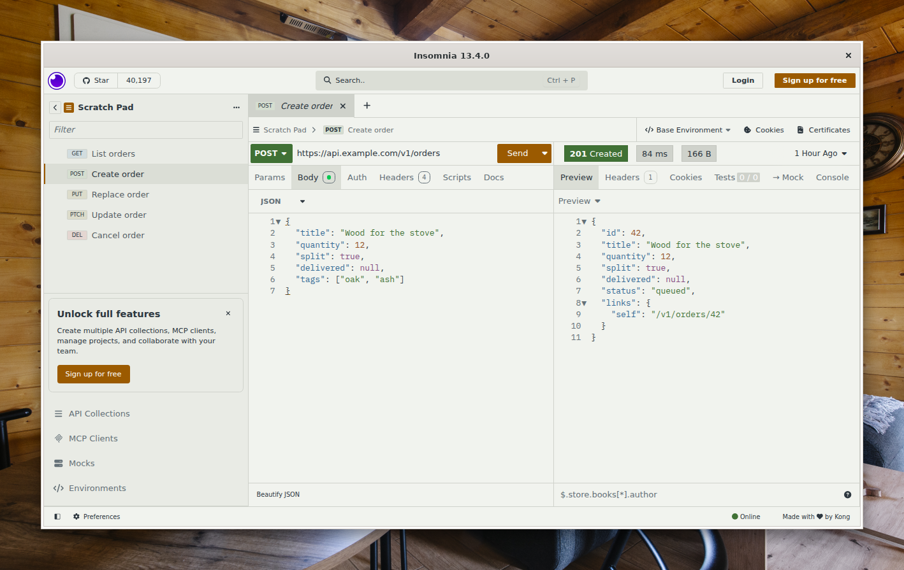
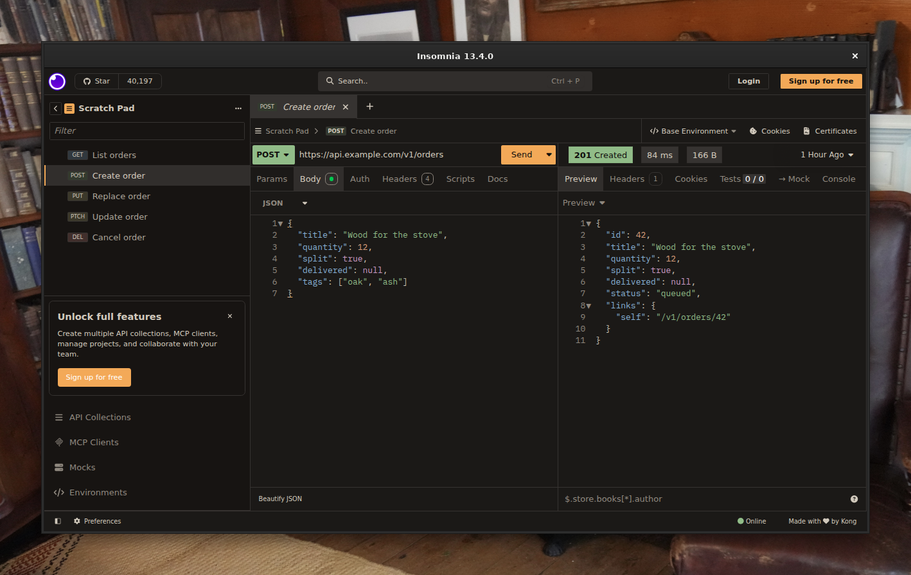

# Inglenook for Insomnia

**Tier:** 2 Partial\
**Variants:** Inglenook Day, Inglenook Night\
**Tested with:** Not tested yet

| Day | Night |
|---|---|
|  |  |

## Before you start

- Insomnia 13 or later. No account is needed: the theme works in the local Scratch Pad too.
- Nothing else to install.

## Install

Each variant is an Insomnia theme plugin: a folder with two files, `package.json` and `theme.js`.

1. Open Insomnia and go to **Preferences** (bottom left, or **Application** > **Preferences**), then the **Plugins** tab.
2. Click **Reveal Plugins Folder**. On Windows it is `%APPDATA%\Insomnia\plugins\`, on macOS `~/Library/Application Support/Insomnia/plugins/`, and on Linux `~/.config/Insomnia/plugins/`.
3. In that folder, make a folder named `insomnia-plugin-inglenook-day`.
4. Copy `dist/day/package.json` and `dist/day/theme.js` into it.
5. Make a second folder named `insomnia-plugin-inglenook-night`, and copy `dist/night/package.json` and `dist/night/theme.js` into it.
6. Back in **Preferences** > **Plugins**, click **Reload** beside the plugin list. Both appear in the list as Inglenook Day and Inglenook Night.
7. Open the **Themes** tab and click **Inglenook Day** or **Inglenook Night**.

Files to use:

- Inglenook Day: `dist/day/package.json` and `dist/day/theme.js`
- Inglenook Night: `dist/night/package.json` and `dist/night/theme.js`

## Set the font

Inglenook uses [IBM Plex Mono](https://github.com/IBM/plex). If it is not installed yet, follow [Font](../../README.md#font) in the main README.

1. Go to **Preferences** > **General**, and scroll to **Font**.
2. Set **Text editor font** to **IBM Plex Mono**.

## Check that it worked

The sidebar sits a shade deeper than the request and response panes, the **Send** button is a warm amber, and JSON in a request body shows keys, strings and numbers in different calm colors.

## Switch between Day and Night

1. Go to **Preferences** > **Themes** and click the other variant.

Insomnia can follow your system's light and dark setting: in **Preferences** > **Themes**, check **Use OS color scheme**, then hover over **Inglenook Day** and click the sun, and hover over **Inglenook Night** and click the moon.

## Uninstall

1. Go to **Preferences** > **Themes** and pick any other theme.
2. Go to **Preferences** > **Plugins**, click **Reveal Plugins Folder**, and delete the `insomnia-plugin-inglenook-day` and `insomnia-plugin-inglenook-night` folders.
3. Click **Reload** beside the plugin list.

## Troubleshooting

- **Inglenook is not in the Themes tab**: check that each folder holds `package.json` and `theme.js` directly, not inside another folder, then click **Reload** in **Preferences** > **Plugins**.
- **Some colors stay the old ones after switching**: restart Insomnia.

## Known limits

- The Insomnia logo, the first-run Welcome page's animated lines, and a few icons keep Insomnia's own colors.
- Braces, commas and colons in JSON show in the main text color, not a softer one.
- The dark layer behind dialogs is Insomnia's own and is see-through.
- The method tags in the sidebar (GET, POST and the rest) are soft tints, so they read more quietly than in Insomnia's own themes.

## Sources

- [Insomnia plugin reference: themes](https://developer.konghq.com/insomnia/plugins/plugin-reference/)
- [Create and publish an Insomnia plugin: the plugins folder](https://developer.konghq.com/how-to/create-an-insomnia-plugin/)
- [Insomnia plugins: installing and managing plugins](https://developer.konghq.com/insomnia/plugins/)
- [Insomnia storage options: the local Scratch Pad](https://developer.konghq.com/insomnia/storage/)
