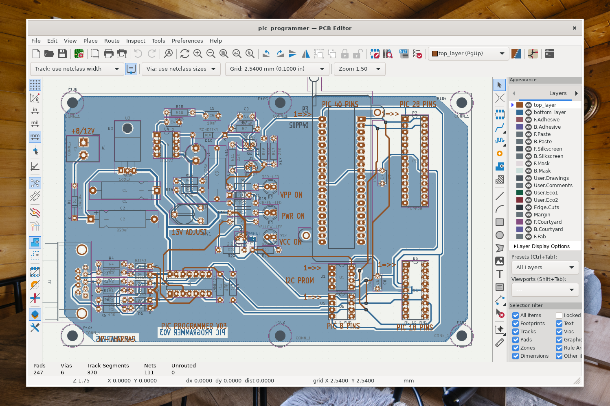
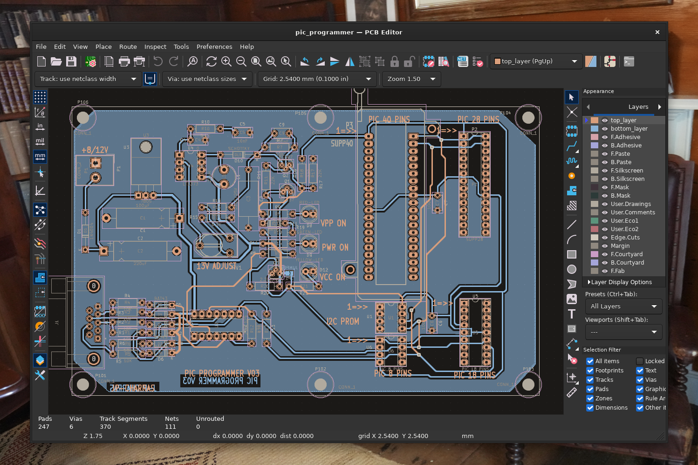

# Inglenook for KiCad

**Tier:** 1 Full\
**Variants:** Inglenook Day, Inglenook Night\
**Tested with:** KiCad 7.0.11 on Linux Mint 22.3

| Day | Night |
|---|---|
|  |  |

KiCad keeps its color themes as JSON files in a `colors` folder inside its settings folder. Each variant here is one theme file. A theme colors the drawing canvas of the Schematic and Symbol Editors, the PCB and Footprint Editors, and the Gerber Viewer: the background, grid, wires, symbols, every board layer, and the error and warning markers.

## Before you start

- KiCad 7.0 or later. Check it in **Help** > **About KiCad**.
- Nothing else to install.

## Install

1. Open KiCad.
2. Open **Preferences** > **Preferences...** and select **PCB Editor** > **Colors** in the list on the left.
3. Click **Open Theme Folder**. Your file manager opens the `colors` folder. If you would rather find it by hand, it is:
   - Windows: `%APPDATA%\kicad\<version>\colors`, such as `%APPDATA%\kicad\9.0\colors`
   - Linux: `~/.config/kicad/<version>/colors`
   - macOS: `~/Library/Preferences/kicad/<version>/colors`

   Create the `colors` folder if it is not there.
4. Copy `inglenook-day.json` and `inglenook-night.json` into that folder.
5. Close KiCad completely, then open it again. KiCad reads new theme files only when it starts.
6. Open **Preferences** > **Preferences...** again.
7. Select **PCB Editor** > **Colors** and pick **Inglenook Night** (or **Inglenook Day**) from the theme list at the top.
8. Select **Footprint Editor** > **Colors** and pick the same theme.
9. Select **Schematic Editor** > **Colors** and pick the same theme. The Symbol Editor uses the Schematic Editor's theme unless you change it under **Symbol Editor** > **Colors**.
10. Select **Gerber Viewer** > **Colors** and pick the same theme.
11. Click **OK**.

Files to use:

- Inglenook Day: [`dist/day/inglenook-day.json`](dist/day/inglenook-day.json)
- Inglenook Night: [`dist/night/inglenook-night.json`](dist/night/inglenook-night.json)

## Set the font

Inglenook uses [IBM Plex Mono](https://github.com/IBM/plex). If it is not installed yet, follow [Font](../../README.md#font) in the main README.

KiCad has no setting for the font of its menus and panels: they use your system font. Text on a schematic or a board is drawn in the KiCad font unless you pick another font for that text item:

1. Double-click a text item, label, or field.
2. In the **Font** list, pick **IBM Plex Mono**.
3. Click **OK**.

The font is saved in the schematic or board, so it is a choice for each design, not part of the theme.

## Check that it worked

In Inglenook Night the PCB Editor canvas turns a warm dark brown, with front copper in a terracotta orange and back copper in a muted blue. In Inglenook Day the same board sits on a soft off-white. The cursor is an amber cross.

## Switch between Day and Night

1. Open **Preferences** > **Preferences...**.
2. For each of **PCB Editor**, **Footprint Editor**, **Schematic Editor**, and **Gerber Viewer**, open its **Colors** page and pick **Inglenook Day** or **Inglenook Night**.
3. Click **OK**.

KiCad does not switch themes when the system switches between light and dark.

## Uninstall

1. Open **Preferences** > **Preferences...**.
2. For each of **PCB Editor**, **Footprint Editor**, **Schematic Editor**, and **Gerber Viewer**, open its **Colors** page and pick **KiCad Default**.
3. Click **OK**.
4. Click **Open Theme Folder** on any **Colors** page and delete `inglenook-day.json` and `inglenook-night.json`.

## Troubleshooting

- **The theme is not in the list**: KiCad reads the `colors` folder only when it starts. Close every KiCad window and open KiCad again. Also check that the files are in the folder for the KiCad version you run, such as `9.0`, not an older one.
- **Layer colors in the Appearance panel cannot be changed**: KiCad only allows changes to a theme you created. Make your own with **New Theme...** in the theme list; it starts as a copy of the theme selected before.
- **Zones and tracks look paler than the theme**: the opacity sliders under **Layer Display Options** in the PCB Editor's **Appearance** panel fade them. They are KiCad settings, not part of the theme.

## Known limits

- **KiCad's own windows are not themed.** Menus, toolbars, panels, and dialogs follow your system theme. Pick a light or dark system theme to match the variant.
- **The 3D Viewer keeps its own colors.** Its background and board colors do not follow the theme; they are set under **Preferences** > **Preferences...** > **3D Viewer** > **Colors**, and boards take their solder mask and silkscreen colors from the board's stackup.
- **Inner copper layers share colors.** Front and back copper each have their own color, and the inner layers cycle through six colors, so a board with more than six inner layers shows the same color on more than one of them. Gerber Viewer layers cycle the same way, through eight colors.
- **Layer opacity is up to you.** The theme sets solid colors. The PCB Editor's **Appearance** panel has its own opacity sliders for tracks, vias, pads, and zones.

## Sources

- [KiCad PCB Editor manual: Colors](https://docs.kicad.org/7.0/en/pcbnew/pcbnew.html#colors)
- [KiCad manual: Configuration file location](https://docs.kicad.org/7.0/en/kicad/kicad.html#config-file-location)
- [KiCad source: color theme settings](https://gitlab.com/kicad/code/kicad/-/blob/7.0.11/common/settings/color_settings.cpp)
