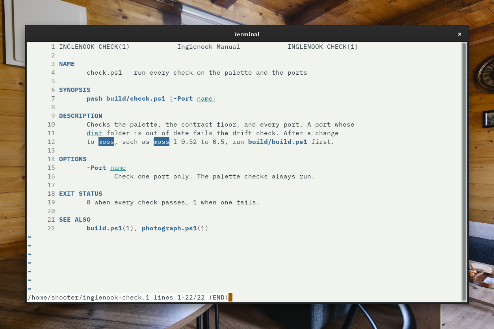
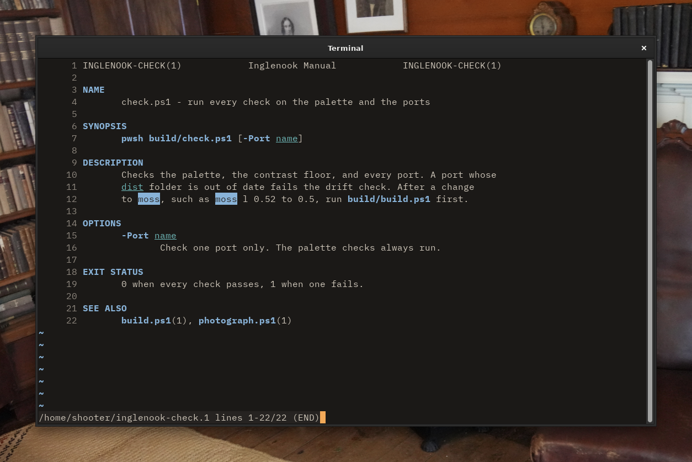

# Inglenook for less

**Tier:** 2 Partial\
**Variants:** Inglenook Day, Inglenook Night\
**Tested with:** less 590 on Linux Mint 22.3, in GNOME Terminal 3.52.0

| Day | Night |
|---|---|
|  |  |

## Before you start

- less 581 or later. Run `less --version` to check. On Windows, less comes with Git for Windows.
- Your terminal set to Inglenook in the same variant, such as [GNOME Terminal](../gnome-terminal/README.md). less only picks from the terminal's 16 colors, so the terminal decides how they look.

## Install

### Zsh or Bash (Linux, macOS, WSL)

1. Create the folder `~/.config/inglenook/`.
2. Save `dist/day/less.sh` (or `dist/night/less.sh`) into it as `~/.config/inglenook/less.sh`.
3. Open `~/.zshrc` (or `~/.bashrc`) and add this line at the end, after anything that sets `LESS`:

   ```sh
   source ~/.config/inglenook/less.sh
   ```

4. Open a new terminal.

### PowerShell (Windows, macOS, Linux)

1. Create the folder `~/.config/inglenook/` (on Windows, `%USERPROFILE%\.config\inglenook\`).
2. Save `dist/day/less.ps1` (or `dist/night/less.ps1`) into it as `less.ps1`.
3. Run `notepad $PROFILE` (or open `$PROFILE` in any editor) and add this line at the end, after anything that sets `LESS`:

   ```powershell
   . ~/.config/inglenook/less.ps1
   ```

4. Open a new PowerShell window.

### With Nowhere

Nowhere already sets `LESS` and loads `~/.config/nowhere/theme.zsh` and `theme.ps1` last. Put the same source line in those files instead of `~/.zshrc` and `$PROFILE`.

### Setting the variable another way

The file adds these options to the end of `LESS`, and adds `-R` first when `LESS` was empty. Use them as they are if you set `LESS` yourself. Each `-D` option ends with `$`, which tells less where its color ends.

- Inglenook Day: `--use-color -DPkW$ -DSWy$ -DEr$ -DNK$ -DMc$ -DBK$ -DCK$ -DRK$ -DWkW$ -Dd+b$ -Du+c$`
- Inglenook Night: `--use-color -DPWk$ -DSky$ -DEr$ -DNK$ -DMc$ -DBK$ -DCK$ -DRK$ -DWWk$ -Dd+b$ -Du+c$`

Files to use:

- Inglenook Day: `dist/day/less.sh`, `dist/day/less.ps1`
- Inglenook Night: `dist/night/less.sh`, `dist/night/less.ps1`

## Set the font

less uses the terminal's font. Set IBM Plex Mono in your terminal, as its Inglenook guide shows.

## Check that it worked

1. Run `echo $LESS` (or `$env:LESS` in PowerShell). It ends with the options above.
2. Run `man less` and type `/color`. Headings and options are blue, arguments are cyan and underlined, and every match is a solid blue block.

## Switch between Day and Night

1. Replace `~/.config/inglenook/less.sh` (or `less.ps1`) with the file of the other variant.
2. Switch your terminal to the same variant.
3. Open a new terminal.

less cannot follow the system's light or dark setting.

## Uninstall

1. Delete the source line from `~/.zshrc`, `~/.bashrc`, `$PROFILE` or the Nowhere theme file.
2. Delete `~/.config/inglenook/less.sh` and `less.ps1`.
3. Open a new terminal.

## Troubleshooting

- **less says "Invalid color string"**: an option before the Inglenook ones in `LESS` takes a string and does not end with `$`. Add `$` after it.
- **Raw codes such as `ESC[31m` show in git or man output**: `LESS` lost `-R`. Add `-R` to the start of `LESS`.
- **Colors look wrong**: the terminal is not set to Inglenook, or not to the same variant.

## Known limits

- less shows only the terminal's 16 colors, so its colors are approximate: they match Inglenook only in a terminal set to Inglenook.
- less cannot set the background. It is the terminal's.
- Search matches are a solid block, not a soft tint, and the match you jumped to looks the same as the others.
- On Windows, the bold and underline colors also apply to bold and underlined text from other programs, such as `git diff`.
- Text that a program already colored, such as `git log` output, keeps its own colors.

## Sources

- [less manual: the -D and --use-color options, and the LESS variable](https://github.com/gwsw/less/blob/master/less.nro.VER)
- [less home page](https://www.greenwoodsoftware.com/less/)
