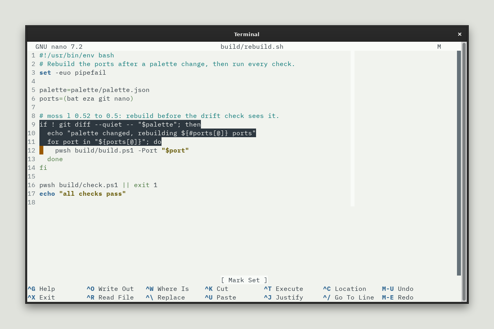
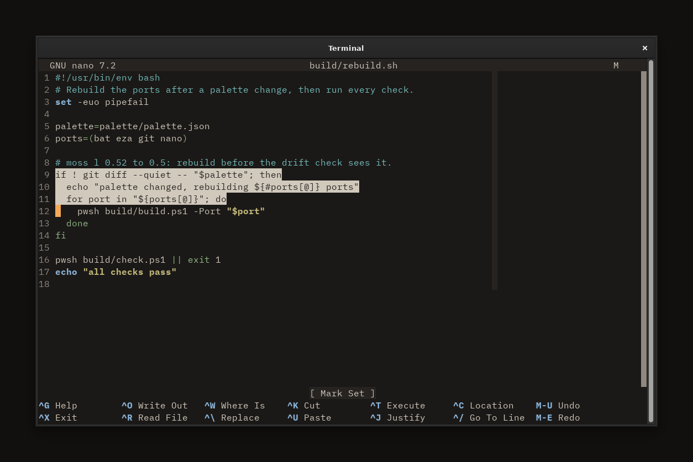

# Inglenook for nano

**Tier:** 2 Partial\
**Variants:** Inglenook Day, Inglenook Night\
**Tested with:** Not tested yet

| Day | Night |
|---|---|
|  |  |

## Before you start

- nano 5.8 or later. Run `nano --version` to check.
- Your terminal set to Inglenook in the same variant, such as [GNOME Terminal](../gnome-terminal/README.md). nano picks from the terminal's 16 colors, so the terminal decides how they look.

## Install

nano reads its interface colors only from your own nanorc file, so the theme is a few lines for that file.

1. Find your nanorc. nano uses `~/.nanorc` if it exists, otherwise `~/.config/nano/nanorc`.
2. If you have neither, create the folder `~/.config/nano/` and save `dist/day/nanorc` (or `dist/night/nanorc`) into it as `~/.config/nano/nanorc`. Skip to step 4.
3. If you have one, open it and paste the lines of `dist/day/nanorc` (or `dist/night/nanorc`) at the end. Delete any older `set ...color` lines of your own, such as `set titlecolor`, so they do not fight with the theme.
4. Start nano.

Files to use:

- Inglenook Day: `dist/day/nanorc`
- Inglenook Night: `dist/night/nanorc`

## Set the font

nano uses the terminal's font. Set IBM Plex Mono in your terminal, as its Inglenook guide shows.

## Check that it worked

1. Open a file with `nano --linenumbers somefile`.
2. The title bar at the top is a lifted strip in the background's tone, the line numbers are soft gray, and the shortcut keys in the two help lines at the bottom are bold blue.
3. Press `Ctrl+6` and move down a line. The selected text shows as a solid block, and the status bar says `[ Mark Set ]`.

## Switch between Day and Night

1. Replace the Inglenook lines in your nanorc with the lines of the other variant.
2. Switch your terminal to the same variant.
3. Start nano again.

nano cannot follow the system's light or dark setting.

## Uninstall

1. Delete the Inglenook lines from your nanorc, or delete `~/.config/nano/nanorc` if the theme was all it held.
2. Start nano again.

## Troubleshooting

- **nano starts with "Mistakes in ...nanorc" and "Unknown option"**: nano is older than 5.8. Update it, or delete the lines it names.
- **Colors look wrong**: the terminal is not set to Inglenook, or not to the same variant.
- **Nothing changed**: a `~/.nanorc` exists, so nano does not read `~/.config/nano/nanorc`. Put the lines in `~/.nanorc`.

## Known limits

- nano shows only the terminal's 16 colors, so its colors are approximate: they match Inglenook only in a terminal set to Inglenook.
- nano cannot set the background. It is the terminal's.
- Syntax highlighting keeps nano's own color choices for each language, drawn in your terminal's colors.
- Selected text is a solid block, not a soft tint: the terminal has no amber color. Search matches are a solid blue block.
- The Windows build of nano that winget installs is too old for these settings.

## Sources

- [nanorc manual: interface color options, color names, and where nano looks for the file](https://www.nano-editor.org/dist/latest/nanorc.5.html)
- [nano home page](https://www.nano-editor.org/)
