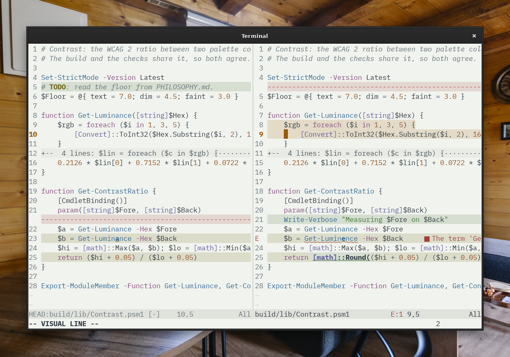
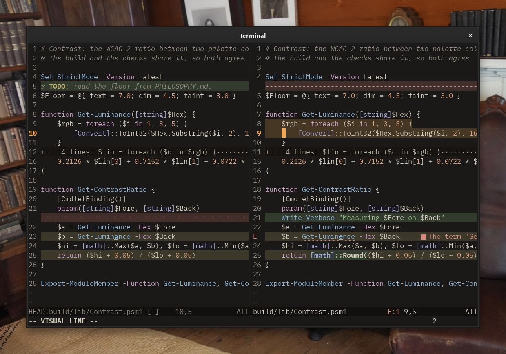

# Inglenook for Neovim

**Tier:** 1 Full\
**Variants:** Inglenook Day, Inglenook Night\
**Tested with:** Not tested yet

| Day | Night |
|---|---|
|  |  |

## Before you start

- Neovim 0.10 or later.
- A terminal that shows 24-bit color, such as Windows Terminal, GNOME Terminal, iTerm2, or kitty.

## Install

One colorscheme holds both variants. It shows Inglenook Day when Neovim's `background` option is `light` and Inglenook Night when it is `dark`.

1. Open Neovim and run `:echo stdpath('config')` to find your config folder. On Windows it is `~\AppData\Local\nvim`; on Linux and macOS it is `~/.config/nvim`.
2. In that folder, create a folder named `colors` and copy [`dist/day/colors/inglenook.lua`](dist/day/colors/inglenook.lua) into it.
3. In the same config folder, create the folders `lua\inglenook` (Windows) or `lua/inglenook` (Linux and macOS).
4. Copy [`dist/day/lua/inglenook/day.lua`](dist/day/lua/inglenook/day.lua) and [`dist/night/lua/inglenook/night.lua`](dist/night/lua/inglenook/night.lua) into `lua/inglenook`.
5. Open `init.lua` in the config folder (create it if it is missing) and add this line at the end:

   ```lua
   vim.cmd.colorscheme('inglenook')
   ```

   If you use `init.vim` instead, add `colorscheme inglenook`.
6. Restart Neovim.

Files to use:

- Both variants: `dist/day/colors/inglenook.lua` (the same file is in `dist/night/`)
- Inglenook Day: `dist/day/lua/inglenook/day.lua`
- Inglenook Night: `dist/night/lua/inglenook/night.lua`

If you only want one variant, copy only its file in step 4. Neovim then always shows that variant.

## Set the font

Inglenook uses [IBM Plex Mono](https://github.com/IBM/plex). Neovim shows icons in many plugins, so use [BlexMono Nerd Font](https://www.nerdfonts.com/font-downloads), the same font with icons added. If it is not installed yet, follow [Font](../../README.md#font) in the main README.

1. In a terminal, Neovim uses the terminal's font: set **BlexMono Nerd Font Mono** in your terminal's settings. For GNOME Terminal, see [Inglenook for GNOME Terminal](../gnome-terminal/README.md).
2. In a Neovim GUI such as Neovide, add `vim.o.guifont = 'BlexMono Nerd Font Mono:h11'` to `init.lua`.

## Check that it worked

Run `:colorscheme`. Neovim prints `inglenook`, and the background turns soft green-gray (Day) or warm dark brown (Night).

## Switch between Day and Night

1. Run `:set background=dark` for Inglenook Night, or `:set background=light` for Inglenook Day. The colors change at once.
2. To always start in one variant, add `vim.o.background = 'dark'` (or `'light'`) to `init.lua` above the `colorscheme` line.

Neovim sets `background` from the terminal's background color when it starts. If your terminal follows the OS light and dark setting, Neovim follows it too the next time it starts, as long as you have not set `background` yourself.

## Make it see-through (optional)

Neovim has no transparency of its own. Some terminals do: Windows Terminal (**Settings** > your profile > **Appearance** > **Background opacity**) and GNOME Terminal (**Preferences** > your profile > **Colors** > **Use transparent background**). The theme itself stays solid.

## Uninstall

1. Delete `colors/inglenook.lua` and the `lua/inglenook` folder from your config folder.
2. Remove the `colorscheme inglenook` line from `init.lua` or `init.vim`.
3. Restart Neovim.

## Troubleshooting

- **`E185: Cannot find color scheme 'inglenook'`**: `colors/inglenook.lua` is not in the config folder from step 1. Check the folder name is `colors`.
- **`inglenook: neither lua/inglenook/day.lua nor night.lua is installed`**: copy the files from step 4 into `lua/inglenook`, not into `lua`.
- **The colors look wrong or too bright**: your terminal does not show 24-bit color. Run `:set termguicolors?`; if it says `notermguicolors`, add `vim.o.termguicolors = true` to `init.lua`, or use a terminal that supports 24-bit color.
- **Neovim shows the wrong variant**: Neovim could not read your terminal's background. Set `background` in `init.lua` as in "Switch between Day and Night".

## Known limits

- Colors need a terminal with 24-bit color. In a terminal limited to 256 or 16 colors, Neovim falls back to its own default colors.
- Plugins that set their own colors instead of using Neovim's standard highlight groups keep their own colors.

## Sources

- [Neovim: `:colorscheme`](https://neovim.io/doc/user/syntax.html#%3Acolorscheme)
- [Neovim: highlight groups](https://neovim.io/doc/user/syntax.html#highlight-groups), [Tree-sitter highlight groups](https://neovim.io/doc/user/treesitter.html#treesitter-highlight-groups), [diagnostic highlights](https://neovim.io/doc/user/diagnostic.html#diagnostic-highlights)
- [Neovim: `'background'`](https://neovim.io/doc/user/options.html#'background') and [`'termguicolors'`](https://neovim.io/doc/user/options.html#'termguicolors')
- [Neovim: config folder locations](https://neovim.io/doc/user/starting.html#base-directories)
