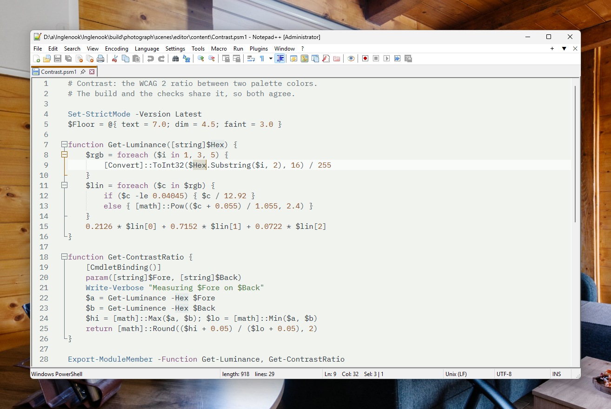
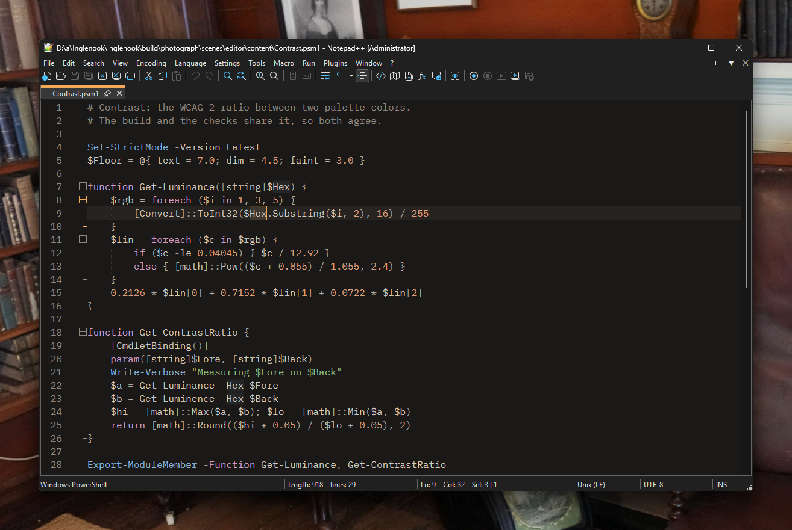

# Inglenook for Notepad++

**Tier:** 2 Partial\
**Variants:** Inglenook Day, Inglenook Night\
**Tested with:** Not tested yet

| Day | Night |
|---|---|
|  |  |

The port is two Style Configurator themes. They color the editor: the text and its syntax colors, the margins, the selection, search highlights, and the tabs. Notepad++ keeps one theme for Light Mode and one for Dark Mode, so you can set Day for one and Night for the other.

## Before you start

- Notepad++ 8.9 or later. Check it in **?** > **About Notepad++**.
- Nothing else.

## Install

1. Download or clone this repo.
2. Open File Explorer, click the address bar, type `%AppData%\Notepad++\themes`, and press **Enter**. If the folder does not exist, create it.

   With the portable version of Notepad++, or if you chose not to use `%AppData%` when you installed it, use the `themes` folder next to `notepad++.exe` instead.
3. Copy these two files into it:
   - `Ports/notepad-plus-plus/dist/day/Inglenook Day.xml`
   - `Ports/notepad-plus-plus/dist/night/Inglenook Night.xml`
4. Close Notepad++ and open it again. Themes are read at startup.
5. Open **Settings** > **Preferences** > **Dark Mode** and pick **Light mode**. Click **Close**.
6. Open **Settings** > **Style Configurator**. In **Select theme**, pick **Inglenook Day**, then click **Save & Close**.
7. Open **Settings** > **Preferences** > **Dark Mode** and pick **Dark mode**. Click **Close**.
8. Open **Settings** > **Style Configurator**. In **Select theme**, pick **Inglenook Night**, then click **Save & Close**.

Notepad++ now remembers Inglenook Day for Light Mode and Inglenook Night for Dark Mode.

Files to use:

- Inglenook Day: `dist/day/Inglenook Day.xml`
- Inglenook Night: `dist/night/Inglenook Night.xml`

## Set the font

Inglenook uses [IBM Plex Mono](https://github.com/IBM/plex). The themes already set it, so once it is installed there is nothing to do. If it is not installed yet, follow [Font](../../README.md#font) in the main README.

To use another font, or another size:

1. Open **Settings** > **Style Configurator**.
2. Under **Language**, pick **Global Styles**. Under **Style**, pick **Default Style**.
3. Change **Font name** and **Font size**, then click **Save & Close**.

The change applies to the theme that is selected. Do it once for each of the two themes.

## Check that it worked

Open a `.ps1` or `.py` file. In Light Mode the page is a soft, faintly green off-white; in Dark Mode it is a warm dark brown. Select a word: the selection is a soft amber, and the other places the same word appears get a soft blue-gray mark.

## Switch between Day and Night

Open **Settings** > **Preferences** > **Dark Mode** and pick **Light mode** for Day or **Dark mode** for Night. Notepad++ switches to the theme you set for that mode.

To follow Windows instead, pick **Follow Windows**. Notepad++ then uses Day while Windows is in light mode and Night while it is in dark mode.

In Dark Mode, Notepad++ draws its menu bar, toolbar, and panels in its own dark tone, set under **Settings** > **Preferences** > **Dark Mode**. **Black** sits closest to Inglenook Night.

## Uninstall

1. Open **Settings** > **Style Configurator**, pick **Default (stylers.xml)** in **Select theme**, and click **Save & Close**. In Dark Mode, pick **DarkModeDefault** instead.
2. Close Notepad++.
3. Delete `Inglenook Day.xml` and `Inglenook Night.xml` from the `themes` folder in step 2 of Install.

## Troubleshooting

- **Inglenook is missing from Select theme**: check that the files are in the folder from step 2, then restart Notepad++. If you use the portable version, they go in the `themes` folder next to `notepad++.exe`.
- **The theme changes when you switch modes**: that is how Notepad++ works. Set the theme for each mode (steps 5 to 8).
- **Text shows in another font**: IBM Plex Mono is not installed. Install it, or pick another font (see Set the font).
- **A language you use has no syntax colors**: the themes color the common languages. Others show in the plain text color until you set them in **Style Configurator**.

## Known limits

- **The menu bar, toolbar, status bar, and dialogs** keep the Windows look in Light Mode, and the Notepad++ dark tone in Dark Mode. A theme cannot color them.
- **Search marks** are drawn see-through over the text by Notepad++, so they look a little lighter than the color the theme gives them.
- **Some languages** have no syntax colors of their own: assembly, Fortran, LaTeX, Perl, R, and other less common ones show in the plain text color. The themes cover C, C++, C#, Java, JavaScript, TypeScript, Go, Rust, Python, Ruby, PHP, Lua, PowerShell, Bash, batch files, SQL, HTML, XML, CSS, JSON, YAML, TOML, INI and properties files, makefiles, diffs, and the search results panel.
- **Selected text** keeps its syntax colors. Notepad++ ignores a theme's color for selected text unless you turn that on yourself.
- **Your own language definitions** (User Defined Languages) keep their own colors.

## Sources

- [Themes](https://npp-user-manual.org/docs/themes/), Notepad++ User Manual
- [Preferences: Dark Mode](https://npp-user-manual.org/docs/preferences/#dark-mode), Notepad++ User Manual
- [Configuration Files: stylers.xml](https://npp-user-manual.org/docs/config-files/), Notepad++ User Manual
