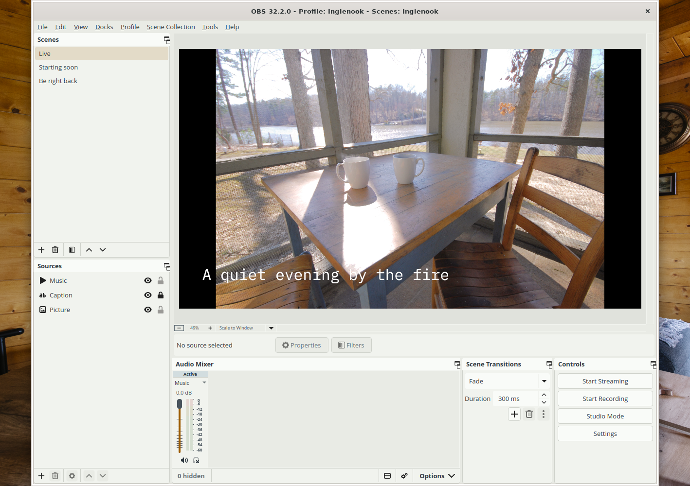
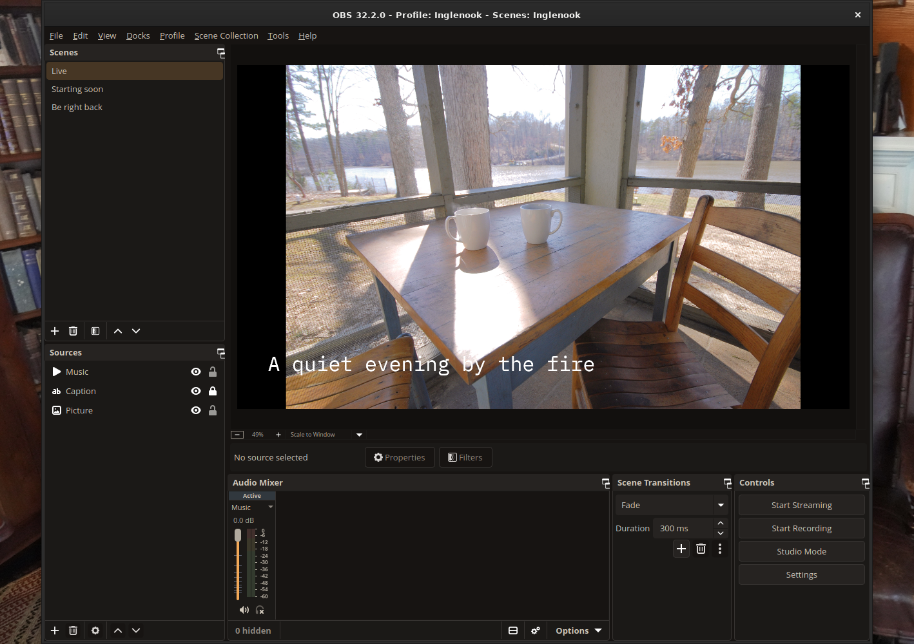

# Inglenook for OBS Studio

**Tier:** 1 Full\
**Variants:** Inglenook Day, Inglenook Night\
**Tested with:** OBS Studio 32.2.0 on Linux Mint 22.3

| Day | Night |
|---|---|
|  |  |

Each variant is one style file for Yami, the theme OBS Studio ships with: `dist/day/inglenook-day.ovt` is **Inglenook Day** and `dist/night/inglenook-night.ovt` is **Inglenook Night**. Install both, then pick one in OBS.

## Before you start

- OBS Studio 30.2 or later. Check it in **Help** > **About**. Older versions use a different theme format and will not list these styles.
- Nothing else.

## Install

1. Close OBS Studio.
2. Open the OBS themes folder. Create the `themes` folder if it does not exist.
   - Windows: press **Win+R**, type `%APPDATA%\obs-studio\themes`, and press **Enter**.
   - macOS: in Finder, press **Cmd+Shift+G**, type `~/Library/Application Support/obs-studio/themes`, and press **Return**.
   - Linux: `~/.config/obs-studio/themes`. For the Flatpak, `~/.var/app/com.obsproject.Studio/config/obs-studio/themes`.
3. Copy `dist/day/inglenook-day.ovt` into that folder.
4. Copy `dist/night/inglenook-night.ovt` into that folder.
5. Open OBS Studio.
6. Open **File** > **Settings** (on macOS, **OBS Studio** > **Settings**), then click **Appearance** in the list on the left.
7. Set **Theme** to **Yami**.
8. Set **Style** to **Inglenook Day** or **Inglenook Night**.
9. Click **OK**.

Files to use:

- Inglenook Day: `dist/day/inglenook-day.ovt`
- Inglenook Night: `dist/night/inglenook-night.ovt`

## Set the font

OBS Studio has no setting for the font of its own window, so it keeps its default font. **Font Size** under **Settings** > **Appearance** changes only the size.

To use IBM Plex Mono on screen in your stream, pick it in a Text source: double-click the source, click **Select Font**, and choose **IBM Plex Mono**. If it is not installed yet, follow [Font](../../README.md#font) in the main README.

## Check that it worked

Inglenook Day is a soft, faintly green off-white; Inglenook Night is a warm, dark walnut brown. Click a source in **Sources**: its row turns a soft amber tint. While you record, the recording button gets the same tint.

## Switch between Day and Night

1. Open **File** > **Settings** > **Appearance**.
2. Change **Style** to the other variant and click **OK**.

OBS Studio does not follow the light or dark setting of your system.

## Uninstall

1. Open **File** > **Settings** > **Appearance**.
2. Set **Style** to **Default** (or any other style) and click **OK**.
3. Close OBS Studio.
4. Delete `inglenook-day.ovt` and `inglenook-night.ovt` from the themes folder (step 2 of [Install](#install)).

## Troubleshooting

- **The styles are not in the Style list**: check that **Theme** is set to **Yami**, that both files are in the `themes` folder of your OBS settings (not the program folder), and that OBS was restarted after copying them. In OBS, **File** > **Show Settings Folder** opens the folder that holds `themes`.
- **Styles show "No Styles Available"**: another theme is selected. Set **Theme** to **Yami**.

## Known limits

- **The preview shows your scene's own colors.** The theme colors the window around it.
- **Icons are OBS's own**, in its gray.
- **Pinned and preview groups in the audio mixer** look the same as the default group. Their header names tell them apart.
- **Hovering over a selected row** does not change its color.
- **Plugin docks and dialogs** that bring their own colors keep them.

## Sources

- [Custom Themes](https://github.com/obsproject/obs-studio/wiki/Custom-Themes): the themes folder on each system, and where the theme setting is
- [OBS Studio Theme System](https://github.com/obsproject/obs-studio/wiki/OBS-Studio-Theme-System): `.obt` and `.ovt` files, `@OBSThemeMeta`, `@OBSThemeVars`, variants extending variants
- [Yami theme files](https://github.com/obsproject/obs-studio/tree/32.2.0/frontend/data/themes): the variables and rules these styles override
