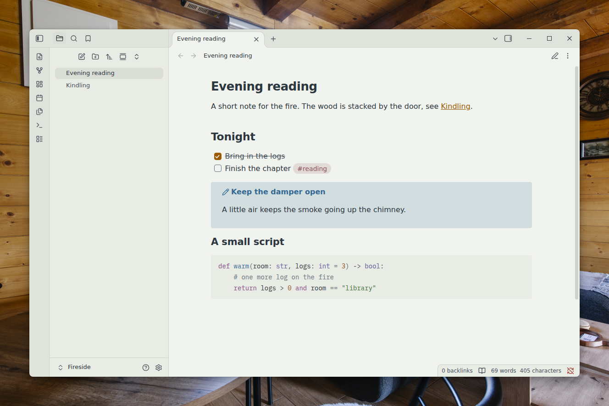
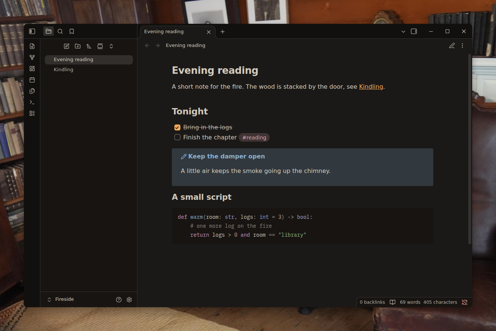

# Inglenook for Obsidian

**Tier:** 1 Full\
**Variants:** Inglenook Day, Inglenook Night\
**Tested with:** Not tested yet

| Day | Night |
|---|---|
|  |  |

Each variant is its own Obsidian theme: `dist/day/` is **Inglenook Day** and `dist/night/` is **Inglenook Night**. Install both in your vault, then pick one in **Settings**. Themes belong to a vault, so repeat the steps for each vault you want themed.

## Before you start

- Obsidian 1.0 or later. Check it in **Settings** > **General**.
- Nothing else to install.

## Install

1. Download or clone this repo.
2. Open your vault in Obsidian.
3. Open **Settings** (the gear at the bottom left) and go to **Appearance**.
4. Next to **Themes**, click the folder icon. Your file manager opens the vault's themes folder, `.obsidian/themes`.
5. In that folder, create a folder named exactly `Inglenook Day`.
6. Copy `Ports/obsidian/dist/day/manifest.json` and `Ports/obsidian/dist/day/theme.css` into `Inglenook Day`.
7. Create a folder named exactly `Inglenook Night` next to it.
8. Copy `Ports/obsidian/dist/night/manifest.json` and `Ports/obsidian/dist/night/theme.css` into `Inglenook Night`.
9. Close and reopen Obsidian, so it finds the new themes.
10. In **Settings** > **Appearance**, open the **Themes** list and pick **Inglenook Day** or **Inglenook Night**.
11. Set **Base color scheme** to **Light** for Inglenook Day, or **Dark** for Inglenook Night.

The folder names must match the theme names exactly, including the capital letters and the space.

Files to use:

- Inglenook Day: `dist/day/` (`manifest.json`, `theme.css`)
- Inglenook Night: `dist/night/` (`manifest.json`, `theme.css`)

## Set the font

Inglenook uses [IBM Plex Mono](https://github.com/IBM/plex). Where the app shows icons, use [BlexMono Nerd Font](https://www.nerdfonts.com/font-downloads) instead, the same font with icons added. If it is not installed yet, follow [Font](../../README.md#font) in the main README.

The theme already asks for IBM Plex Mono in code blocks, inline code and properties, once the font is installed. To set it yourself:

1. Open **Settings** > **Appearance** and scroll to **Font**.
2. Next to **Monospace font**, click **Manage**, type `IBM Plex Mono`, and add it.

Your notes keep Obsidian's text font. To set that too, use **Text font** the same way.

## Check that it worked

Inglenook Day is a soft, faintly green off-white; Inglenook Night is a warm, dark walnut brown. The side bar and the tab bar are a shade deeper than the note. Links are a warm amber, and tags sit on a soft rose chip.

## Switch between Day and Night

1. Open **Settings** > **Appearance**.
2. In the **Themes** list, pick the other variant.
3. Set **Base color scheme** to match: **Light** for Inglenook Day, **Dark** for Inglenook Night.

Obsidian picks one theme for a vault, so it cannot switch between Inglenook Day and Inglenook Night on its own when your system goes from light to dark. With **Adapt to system**, the theme you picked stays.

## Uninstall

1. Open **Settings** > **Appearance**.
2. In the **Themes** list, pick **Default**.
3. Click the folder icon next to **Themes** and delete the `Inglenook Day` and `Inglenook Night` folders.
4. Remove **IBM Plex Mono** from **Monospace font** if you added it.

## Troubleshooting

- **The themes are not in the list**: check that each folder holds both files and is named exactly `Inglenook Day` or `Inglenook Night`, then close and reopen Obsidian.
- **Some colors are Obsidian's own**: a CSS snippet may override the theme. Turn snippets off under **Settings** > **Appearance** > **CSS snippets** to check.
- **The accent color setting does nothing**: the theme sets its own accent, so **Accent color** in **Appearance** has no effect while it is on.
- **The folder icon does not open a folder**: open your vault's folder in your file manager and show hidden files. The themes folder is `.obsidian/themes` inside it.

## Known limits

- **One variant per vault at a time.** Obsidian cannot follow the system's light and dark setting from one variant to the other.
- **Selected text keeps its own colors.** The selection is a soft tint.
- **The current match in Find** shows as the selection, a soft tint, not a stronger highlight.
- **Shadows** under menus and popups, and the dimming behind a dialog, are Obsidian's own.
- **Community plugins** with their own colors may not follow the theme.

## Sources

- [Build a theme](https://docs.obsidian.md/Themes/App+themes/Build+a+theme): the theme folder, `manifest.json`, `theme.css`, `.theme-light` and `.theme-dark`
- [Manifest](https://docs.obsidian.md/Reference/Manifest): `name`, `version`, `minAppVersion`, `author`
- [CSS variables](https://docs.obsidian.md/Reference/CSS+variables/CSS+variables): the variables a theme sets
- [Settings](https://obsidian.md/help/settings): **Appearance**, **Base color scheme**, **Themes** folder, **Monospace font**
- [Themes](https://obsidian.md/help/themes): choosing and removing a theme
