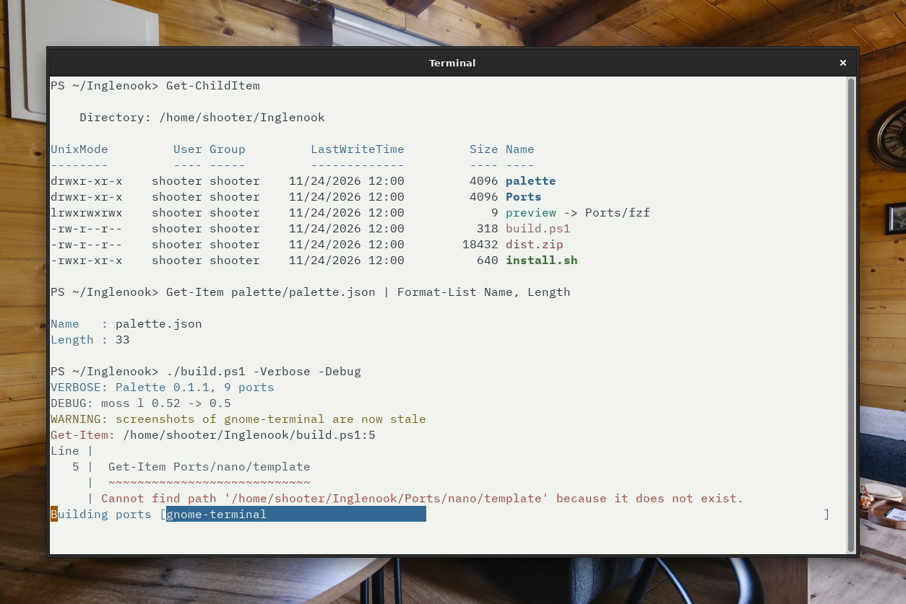
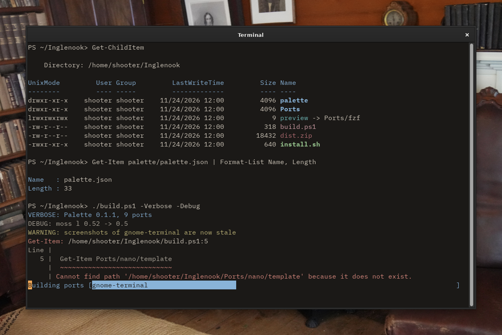

# Inglenook for PowerShell

**Tier:** 1 Full\
**Variants:** Inglenook Day, Inglenook Night\
**Tested with:** PowerShell 7.6.10 on Linux Mint 22.3, in GNOME Terminal 3.52.0

| Day | Night |
|---|---|
|  |  |

Colors the output PowerShell formats itself through `$PSStyle`: errors, warnings, verbose and debug messages, table headers and list labels, progress bars, and file and folder names from `Get-ChildItem`. The colors of the command line as you type come from PSReadLine, which has its own port.

## Before you start

- PowerShell 7.4 or later. Check with `$PSVersionTable.PSVersion`. Windows PowerShell 5.1 has no `$PSStyle`.
- A terminal that shows 24-bit color (Windows Terminal, GNOME Terminal, iTerm2, and most others).

## Install

1. Make the folder: `New-Item -ItemType Directory -Force ~/.config/inglenook`
2. Download [`dist/day/psstyle.ps1`](dist/day/psstyle.ps1) (or [`dist/night/psstyle.ps1`](dist/night/psstyle.ps1)) and save it as `~/.config/inglenook/psstyle.ps1`.
3. On Windows, unblock the downloaded file so PowerShell will load it: `Unblock-File ~/.config/inglenook/psstyle.ps1`
4. If you have no profile yet, make one: `if (-not (Test-Path $PROFILE)) { New-Item -ItemType File -Force $PROFILE }`
5. Run `notepad $PROFILE` (or open `$PROFILE` in any editor) and add this line near the end:

   ```powershell
   . ~/.config/inglenook/psstyle.ps1
   ```

6. Open a new PowerShell window.

### With Nowhere

Nowhere loads `~/.config/nowhere/theme.ps1` last. Put the same `.` line in that file instead of in your profile.

Files to use:

- Inglenook Day: `dist/day/psstyle.ps1`
- Inglenook Night: `dist/night/psstyle.ps1`

## Set the font

PowerShell draws in your terminal, so it uses the terminal's font. Set [IBM Plex Mono](https://github.com/IBM/plex) in your terminal's settings. If it is not installed yet, follow [Font](../../README.md#font) in the main README.

## Check that it worked

Run `Get-ChildItem`. The column headers are blue, folder names are blue and bold with no colored block behind them, and `.ps1` files are a soft rose. Run `Write-Warning 'test'`: the warning is a muted yellow.

## Switch between Day and Night

1. Replace `~/.config/inglenook/psstyle.ps1` with the file from the other variant.
2. Open a new PowerShell window.

PowerShell cannot follow the system light or dark setting.

## Uninstall

1. Delete the `.` line from your profile (or from `~/.config/nowhere/theme.ps1`).
2. Delete `~/.config/inglenook/psstyle.ps1`.
3. Open a new PowerShell window. PowerShell's own colors are back.

## Troubleshooting

- **"cannot be loaded because running scripts is disabled" or "is not digitally signed"**: on Windows, run `Unblock-File ~/.config/inglenook/psstyle.ps1`. If scripts are off altogether, allow your own with `Set-ExecutionPolicy -Scope CurrentUser RemoteSigned`.
- **Nothing changed**: check `$PSVersionTable.PSVersion`. On versions before 7.4 the file does nothing. Also check that you opened the profile of the PowerShell you run: `$PROFILE` differs between PowerShell 7 and Windows PowerShell, and between terminals and editors.
- **Colors look wrong or banded**: your terminal shows only 256 colors. Turn on 24-bit color in the terminal, or use one that has it.
- **No colors at all**: `NO_COLOR` is set, or `TERM` is `xterm` or `dumb`, which make PowerShell print plain text.

## Known limits

- The command line as you type is colored by PSReadLine, not by this file.
- Only `Get-ChildItem` file names are colored by kind: folders, links, programs, archives and PowerShell files. Other files keep the text color.
- `Select-String` marks matches by swapping text and background colors, not with a theme color.
- `Show-Markdown` has its own colors, set with `Set-MarkdownOption`.
- Output from other programs, such as `git` or `ls`, keeps that program's own colors.

## Sources

- [about_ANSI_Terminals: `$PSStyle`](https://learn.microsoft.com/powershell/module/microsoft.powershell.core/about/about_ansi_terminals)
- [about_Profiles](https://learn.microsoft.com/powershell/module/microsoft.powershell.core/about/about_profiles)
- [about_Execution_Policies](https://learn.microsoft.com/powershell/module/microsoft.powershell.core/about/about_execution_policies)
