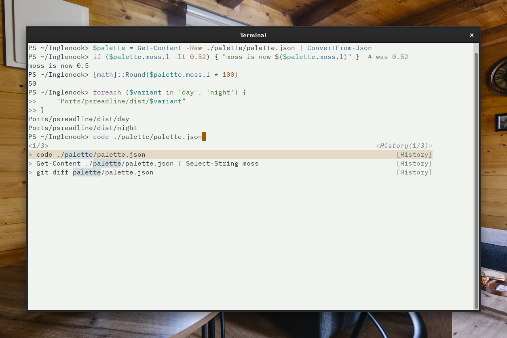
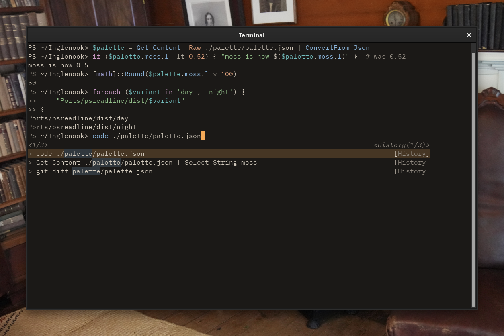

# Inglenook for PSReadLine

**Tier:** 1 Full\
**Variants:** Inglenook Day, Inglenook Night\
**Tested with:** PSReadLine as shipped with PowerShell 7.6.10 on Linux Mint 22.3, in GNOME Terminal 3.52.0

| Day | Night |
|---|---|
|  |  |

PSReadLine is the command line editor in PowerShell. It colors what you type as you type it, and draws the suggestion list.

## Before you start

- PowerShell 7, or Windows PowerShell 5.1. Both come with PSReadLine. Check with `(Get-Module PSReadLine).Version`: 2.0 or later colors the command line, 2.2 or later also the suggestion list.
- A terminal that shows 24-bit color (Windows Terminal, GNOME Terminal, iTerm2, and most others).

## Install

1. Make the folder: `New-Item -ItemType Directory -Force ~/.config/inglenook`
2. Download [`dist/day/psreadline.ps1`](dist/day/psreadline.ps1) (or [`dist/night/psreadline.ps1`](dist/night/psreadline.ps1)) and save it as `~/.config/inglenook/psreadline.ps1`.
3. On Windows, unblock the downloaded file: `Unblock-File ~/.config/inglenook/psreadline.ps1`
4. Make sure your profile exists: `if (-not (Test-Path $PROFILE)) { New-Item -Force $PROFILE }`
5. Run `notepad $PROFILE` (or open `$PROFILE` in any editor) and add this line near the end, after any other `Set-PSReadLineOption -Colors` line:

   ```powershell
   . ~/.config/inglenook/psreadline.ps1
   ```

6. Open a new PowerShell window.

Windows PowerShell 5.1 and PowerShell 7 each have their own `$PROFILE`. To theme both, add the line to both profiles.

### With Nowhere

Nowhere loads `~/.config/nowhere/theme.ps1` last. Put the same `.` line in that file instead of in your profile.

Files to use:

- Inglenook Day: `dist/day/psreadline.ps1`
- Inglenook Night: `dist/night/psreadline.ps1`

## Set the font

PSReadLine draws in your terminal, so it uses the terminal's font. Set [IBM Plex Mono](https://github.com/IBM/plex) in your terminal's settings. If it is not installed yet, follow [Font](../../README.md#font) in the main README.

## Check that it worked

Type `Get-Content -Raw ./notes.txt # read it` without pressing Enter. The command is blue, `-Raw` is terracotta and the comment is a soft gray. Press Shift+Left Arrow a few times: the selected text sits on a soft amber band.

## Switch between Day and Night

1. Replace `~/.config/inglenook/psreadline.ps1` with the file from the other variant.
2. Open a new PowerShell window.

PSReadLine cannot follow the system light or dark setting.

## Uninstall

1. Delete the `.` line from your profile (`notepad $PROFILE`).
2. Delete `~/.config/inglenook/psreadline.ps1`.
3. Open a new PowerShell window. PSReadLine is back to its own colors.

## Troubleshooting

- **"running scripts is disabled on this system"**: Windows PowerShell does not run profiles until you allow it. Run `Set-ExecutionPolicy -Scope CurrentUser RemoteSigned`, then open a new window.
- **"is not digitally signed"**: the file is still marked as downloaded. Run step 3 again.
- **The colors look wrong or banded**: your terminal shows only 256 colors. Turn on 24-bit color in the terminal, or use one that has it.
- **Your own colors stopped working**: the file sets every PSReadLine color it knows. Put your own `Set-PSReadLineOption -Colors` line after the line that loads the file.

## Known limits

- Brackets, braces, pipes and dots take the color of plain text. PSReadLine has no color for them of their own.
- The count of suggestions by source at the top right of the suggestion list (`<History(1/3)>`) partly keeps PSReadLine's own gray.
- PSReadLine 2.0 and 2.1 (Windows PowerShell 5.1 out of the box) have no suggestion list, so there is nothing there to color. Update PSReadLine to get it: `Install-Module PSReadLine -Scope CurrentUser -Force`.
- Output of commands, error messages and `Get-ChildItem` listings are colored by PowerShell itself, not by PSReadLine.

## Sources

- [Set-PSReadLineOption: `-Colors`](https://learn.microsoft.com/powershell/module/psreadline/set-psreadlineoption#-colors)
- [about_Profiles](https://learn.microsoft.com/powershell/module/microsoft.powershell.core/about/about_profiles)
- [about_Execution_Policies](https://learn.microsoft.com/powershell/module/microsoft.powershell.core/about/about_execution_policies)
- [PSReadLine source: the color names (`Cmdlets.cs`)](https://github.com/PowerShell/PSReadLine/blob/master/PSReadLine/Cmdlets.cs)
