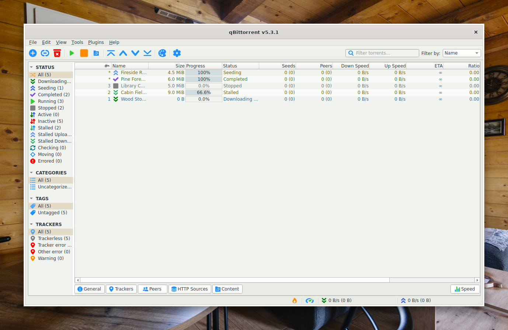
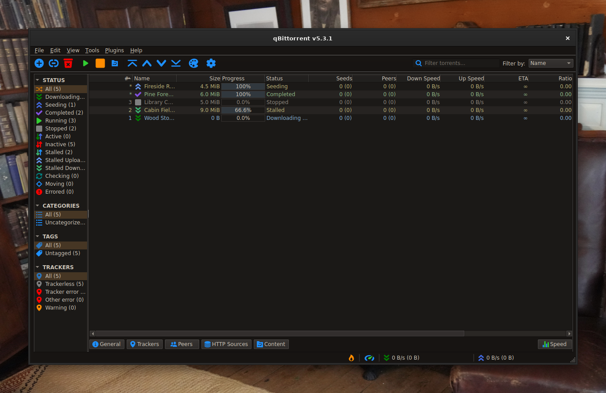

# Inglenook for qBittorrent

**Tier:** 2 Partial\
**Variants:** Inglenook Day, Inglenook Night\
**Tested with:** Not tested yet

| Day | Night |
|---|---|
|  |  |

Each variant is a qBittorrent theme folder: `dist/day/` is **Inglenook Day** and `dist/night/` is **Inglenook Night**. qBittorrent loads a theme folder when you point it at the `config.json` inside it; keep `stylesheet.qss` next to it.

This is for the qBittorrent desktop app. The Web UI is not covered.

## Before you start

- qBittorrent 5.0 or later. Check it in **Help** > **About**.
- Nothing to install.

## Install

1. Download or clone this repo.
2. Open qBittorrent's settings folder:
   - Windows: press **Win+R**, type `%APPDATA%\qBittorrent`, and press **Enter**.
   - macOS and Linux: `~/.config/qBittorrent`.
3. Make a folder named `themes` in it, if there is none.
4. Copy the folder `Ports/qbittorrent/dist/day` into `themes` and rename the copy to `inglenook-day`.
5. Copy `Ports/qbittorrent/dist/night` into `themes` the same way and rename it to `inglenook-night`.
6. In qBittorrent, open **Tools** > **Options** (on macOS, **qBittorrent** > **Preferences**) and select **Behavior**.
7. Under **Interface**, set **Style** to **Fusion**.
8. Tick **Use custom UI Theme** and click the folder button next to it.
9. Pick `config.json` in `themes/inglenook-day` for Day, or in `themes/inglenook-night` for Night.
10. Click **OK**, then quit qBittorrent with **File** > **Exit** and start it again. A theme loads only at startup.

Files to use:

- Inglenook Day: `dist/day/` (`config.json`, `stylesheet.qss`)
- Inglenook Night: `dist/night/` (`config.json`, `stylesheet.qss`)

## Set the font

qBittorrent has no font setting. It uses your system's interface font.

## Check that it worked

Inglenook Day is a soft, faintly green off-white; Inglenook Night is a warm, dark walnut brown. Click a torrent: the selected row is a soft amber tint. Torrents that are seeding or complete are green, stalled ones a muted gold, and ones that failed a muted red.

## Switch between Day and Night

1. Open **Tools** > **Options** > **Behavior**.
2. Next to **Use custom UI Theme**, pick the `config.json` of the other variant.
3. Click **OK** and restart qBittorrent.

qBittorrent cannot switch themes on its own when your system changes between light and dark.

## Uninstall

1. Open **Tools** > **Options** > **Behavior**.
2. Untick **Use custom UI Theme**. Set **Style** back to what it was, such as **System**.
3. Click **OK** and restart qBittorrent.
4. Delete the `inglenook-day` and `inglenook-night` folders from the `themes` folder.

## Troubleshooting

- **Nothing changed**: qBittorrent loads a theme only when it starts. Quit it fully with **File** > **Exit** (closing the window may only hide it in the tray) and start it again.
- **Only some parts changed, or the colors look washed out**: set **Style** to **Fusion** (step 7). Other styles, such as the macOS style, ignore part of the theme.
- **qBittorrent says it failed to load the theme**: the path must end in `config.json`, and the folder must be the one copied from `dist/`. Open **View** > **Log** to see the message.

## Known limits

- **Icons keep qBittorrent's own colors.** The toolbar and status icons are not recolored.
- **The title bar** is drawn by your system, not by qBittorrent.
- **The Web UI** keeps its own look.

## Sources

- [How to use custom UI themes](https://github.com/qbittorrent/qBittorrent/wiki/How-to-use-custom-UI-themes): installing a theme, **Use custom UI Theme**
- [Create custom themes for qBittorrent](https://github.com/qbittorrent/qBittorrent/wiki/Create-custom-themes-for-qBittorrent): `config.json`, the `colors` keys, theme folders
- [qBittorrent source, `src/gui/uithemecommon.h`](https://github.com/qbittorrent/qBittorrent/blob/release-5.3.1/src/gui/uithemecommon.h): every color key qBittorrent 5 reads
