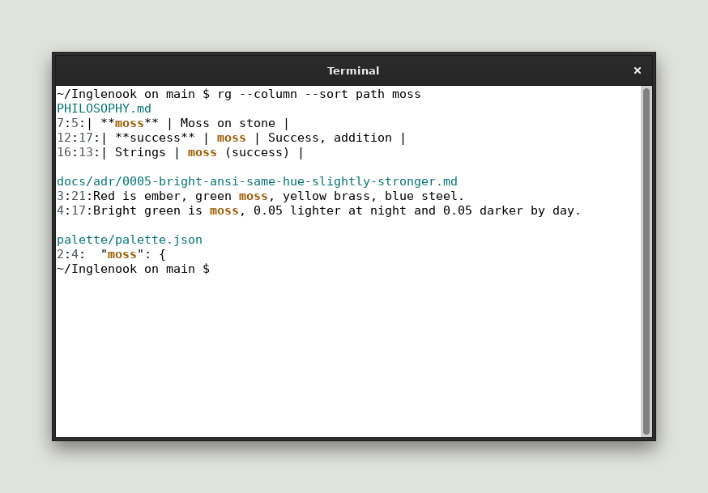
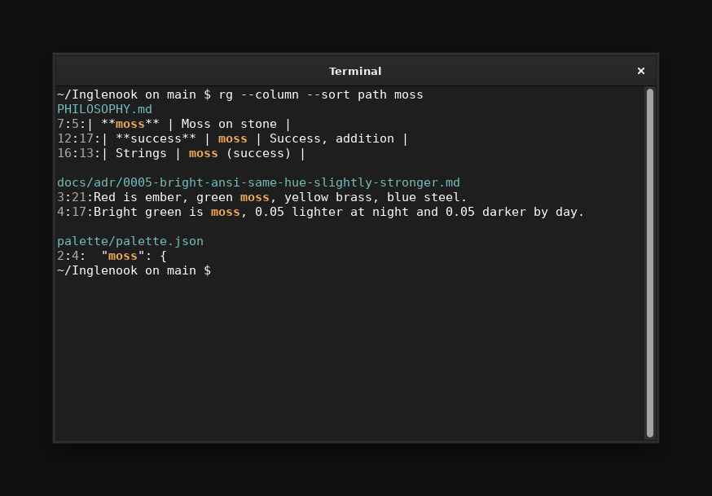

# Inglenook for ripgrep

**Tier:** 2 Partial\
**Variants:** Inglenook Day, Inglenook Night\
**Tested with:** Not tested yet

| Inglenook Day | Inglenook Night |
|---|---|
|  |  |

## Before you start

- ripgrep, in a terminal that shows 24-bit color (Windows Terminal, GNOME Terminal, iTerm2, and most others).
- If you already have a ripgrep config file, you will add the theme's lines to it instead of using the file as is.

## Install

ripgrep reads its settings from the file named by the `RIPGREP_CONFIG_PATH` environment variable. The theme is one such file.

1. Download the file for your variant (see below) and save it as `~/.config/inglenook/ripgreprc`. On Windows that is `%USERPROFILE%\.config\inglenook\ripgreprc`.
2. Point ripgrep at it. In Zsh or Bash, add this line to `~/.zshrc` or `~/.bashrc`:

   ```sh
   export RIPGREP_CONFIG_PATH="$HOME/.config/inglenook/ripgreprc"
   ```

   In PowerShell, add this line to `$PROFILE`:

   ```powershell
   $env:RIPGREP_CONFIG_PATH = "$HOME/.config/inglenook/ripgreprc"
   ```

   If you use Nowhere, put the same line in `~/.config/nowhere/theme.zsh` or `theme.ps1` instead.
3. Open a new terminal.

If `RIPGREP_CONFIG_PATH` already points at your own config file, skip steps 1 and 2: copy the `--colors` lines from the theme file to the end of yours.

Files to use:

- Inglenook Day: `dist/day/ripgreprc`
- Inglenook Night: `dist/night/ripgreprc`

## Set the font

ripgrep prints in your terminal's font, so set the font in the terminal. Inglenook uses [IBM Plex Mono](https://github.com/IBM/plex); if it is not installed yet, follow [Font](../../README.md#font) in the main README.

## Check that it worked

Run `rg --column moss` in a folder with text files. File names are blue-green, line and column numbers are gray, and each match is bold on a soft blue-gray band.

`rg --debug moss` shows which config file ripgrep read.

## Switch between Day and Night

1. Replace `~/.config/inglenook/ripgreprc` with the other variant's file.

ripgrep has no light and dark setting and cannot follow the OS.

## Uninstall

1. Remove the `RIPGREP_CONFIG_PATH` line from your profile, or the `--colors` lines from your own config file.
2. Delete `~/.config/inglenook/ripgreprc`.
3. Open a new terminal.

## Troubleshooting

- **No colors at all**: ripgrep only colors output to a terminal. Piped output is plain unless you add `--color=always`.
- **`rg: error parsing flag --colors`**: a line was changed or split. Download the file again.
- **The theme stops working in one command**: `--no-config` on the command line, or a script that sets `RIPGREP_CONFIG_PATH` itself, skips the file.

## Known limits

- ripgrep colors only file names, line and column numbers, and matches. The background and the rest of each line come from your terminal's theme.
- The band behind each match is made for the Inglenook background. On another terminal background it still reads, but looks less even.
- Color names in your own config, such as `match:fg:red`, use the terminal's colors, not the theme's.

## Sources

- [ripgrep user guide: configuration file](https://github.com/BurntSushi/ripgrep/blob/master/GUIDE.md#configuration-file)
- [ripgrep `--colors` reference](https://github.com/BurntSushi/ripgrep/blob/master/crates/core/flags/defs.rs) (also `rg --help`)
