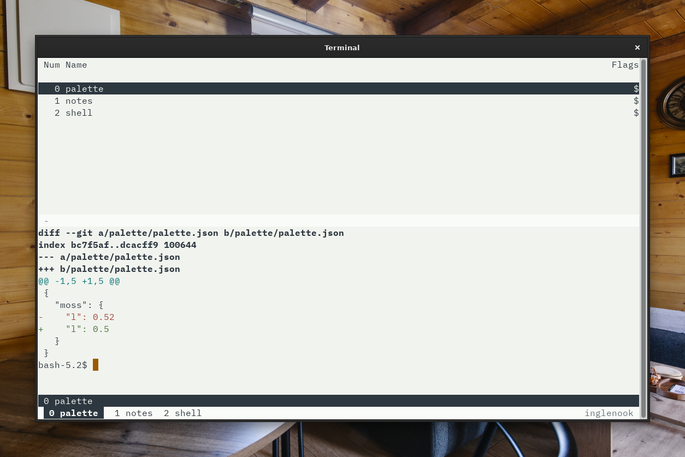
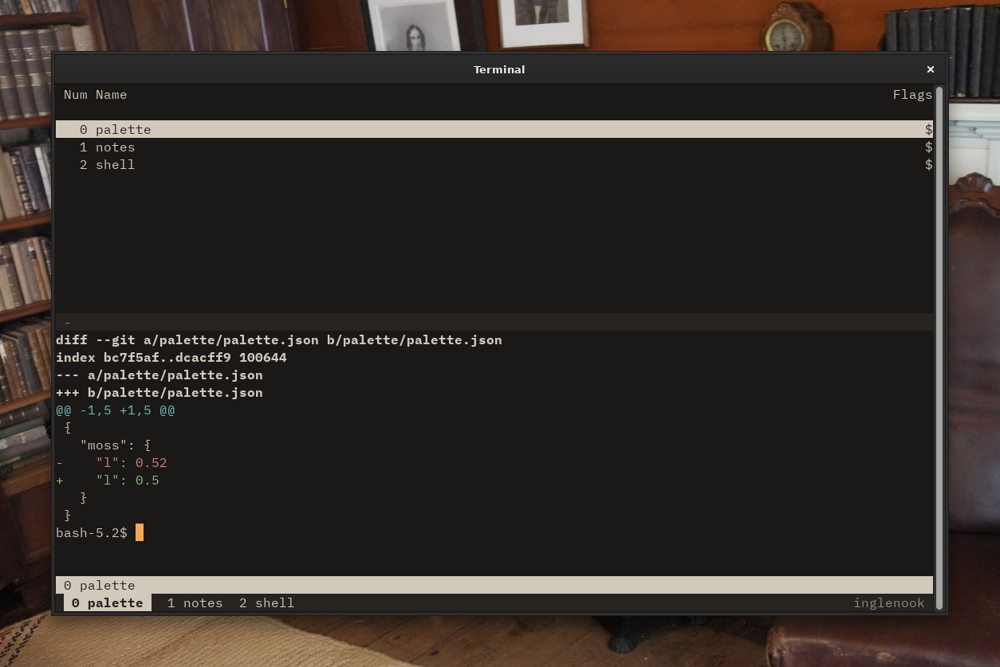

# Inglenook for GNU Screen

**Tier:** 2 Partial\
**Variants:** Inglenook Day, Inglenook Night\
**Tested with:** GNU Screen 4.9.1 on Linux Mint 22.3, in GNOME Terminal 3.52.0

| Day | Night |
|---|---|
|  |  |

## Before you start

- GNU Screen 4. Run `screen --version` to check. Screen 5 spells colors differently, so this theme does not work there yet.
- Your terminal set to Inglenook in the same variant, such as [GNOME Terminal](../gnome-terminal/README.md). Screen picks from the terminal's 16 colors, so the terminal decides how they look.

## Install

1. Create the folder `~/.config/inglenook/`.
2. Save `dist/day/screenrc` (or `dist/night/screenrc`) into it as `~/.config/inglenook/screenrc`.
3. Open `~/.screenrc` (create it if it does not exist) and add this line at the end, after any `hardstatus`, `caption` or `sorendition` lines of your own:

   ```
   source ~/.config/inglenook/screenrc
   ```

4. Start a new Screen session with `screen`. A session that is already running picks the theme up when you press `Ctrl+A` then `:` and type `source ~/.screenrc`.

Files to use:

- Inglenook Day: `dist/day/screenrc`
- Inglenook Night: `dist/night/screenrc`

The theme turns on a status line at the bottom of the screen that lists your windows. If you had your own `hardstatus` line, the theme's replaces it.

## Set the font

Screen uses the terminal's font. Set IBM Plex Mono in your terminal, as its Inglenook guide shows.

## Check that it worked

1. Start `screen` and open a second window with `Ctrl+A` then `c`.
2. The bottom line is a lifted strip in the background's tone, listing both windows. The window you are in is a solid block, and the session name sits at the right in soft gray.
3. Press `Ctrl+A` then `S` to split the screen. Each half has a caption line: the one you are in is a solid block, the other is soft gray.
4. Press `Ctrl+A` then `"`. The window list's cursor line is a solid block too.

## Switch between Day and Night

1. Save the other variant's file over `~/.config/inglenook/screenrc`.
2. Switch your terminal to the same variant.
3. In each running session, press `Ctrl+A` then `:` and type `source ~/.screenrc`, or start a new session.

Screen cannot follow the system's light or dark setting.

## Uninstall

1. Delete the `source ~/.config/inglenook/screenrc` line from `~/.screenrc`.
2. Delete `~/.config/inglenook/screenrc`.
3. Start a new Screen session.

## Troubleshooting

- **The status line shows letters such as `Wk` or no colors at all**: you have Screen 5. Check with `screen --version`.
- **Colors look wrong**: the terminal is not set to Inglenook, or not to the same variant.
- **Nothing changed**: a `hardstatus` or `caption` line after the `source` line in `~/.screenrc` overrides the theme. Move the `source` line to the end.

## Known limits

- Screen shows only the terminal's 16 colors, so its colors are approximate: they match Inglenook only in a terminal set to Inglenook.
- Screen cannot set the background. It is the terminal's, as are the colors of the programs running inside Screen.
- The current window, the focused region and the window list's cursor line are solid blocks, not the theme's amber highlight: the terminal's 16 colors have no amber.
- Searching in copy mode moves the cursor and highlights nothing, so there is no match color.
- Screen 5 is not supported yet.

## Sources

- [GNU Screen manual: String Escapes, the color and attribute codes](https://www.gnu.org/software/screen/manual/html_node/String-Escapes.html)
- [GNU Screen manual: Rendition and Sorendition](https://www.gnu.org/software/screen/manual/html_node/Rendition.html)
- [GNU Screen manual: Hardstatus and Caption](https://www.gnu.org/software/screen/manual/html_node/Hardstatus.html)
- [GNU Screen home page](https://www.gnu.org/software/screen/)
