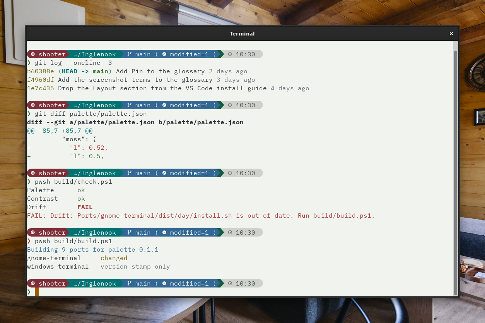
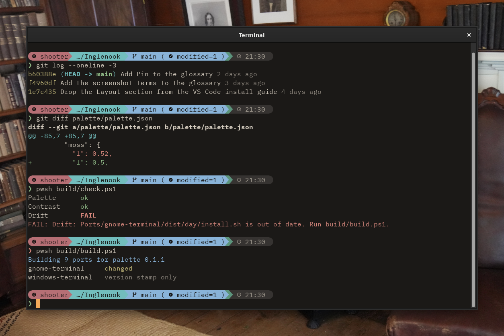

# Inglenook for Starship

**Tier:** 1 Full\
**Variants:** Inglenook Day, Inglenook Night\
**Tested with:** Starship 1.27.0 on Linux Mint 22.3, in GNOME Terminal 3.52.0

| Day | Night |
|---|---|
|  |  |

The port is a whole `starship.toml`: a two-line prompt with colored segments for your system and user name, the folder, Git, the tools in the folder (Node, Python, Rust, Kubernetes and others), and the time, then the `❯` arrow on the next line. Its colors are a Starship palette at the end of the file.

Each variant has three files:

- `starship.toml` is the prompt.
- `starship.sh` (Bash and Zsh) or `starship.ps1` (PowerShell) points Starship at it, by setting `STARSHIP_CONFIG` to `~/.config/inglenook/starship.toml`.

## Before you start

- Starship 1.11 or later (palettes came in 1.11). Check with `starship --version`.
- Starship already set up in your shell. If not, follow the [Starship install guide](https://starship.rs/guide/) first.
- A terminal that shows 24-bit color, such as Windows Terminal or GNOME Terminal. For the full look, theme the terminal with Inglenook too, in the same variant.
- A Nerd Font in the terminal. See [Set the font](#set-the-font).

## Install

### Zsh or Bash (Linux, macOS, WSL)

1. Create the folder `~/.config/inglenook/`.
2. Save [`dist/day/starship.toml`](dist/day/starship.toml) or [`dist/night/starship.toml`](dist/night/starship.toml) there as `starship.toml`.
3. Save [`dist/day/starship.sh`](dist/day/starship.sh) or [`dist/night/starship.sh`](dist/night/starship.sh) there as `starship.sh`.
4. Add this line to the end of `~/.zshrc` (Zsh) or `~/.bashrc` (Bash):

   ```sh
   source ~/.config/inglenook/starship.sh
   ```

5. Open a new terminal. The prompt shows the colored segments.

### PowerShell (Windows, macOS, Linux)

1. Create the folder `~/.config/inglenook/` (on Windows, `%USERPROFILE%\.config\inglenook\`).
2. Save [`dist/day/starship.toml`](dist/day/starship.toml) or [`dist/night/starship.toml`](dist/night/starship.toml) there as `starship.toml`.
3. Save [`dist/day/starship.ps1`](dist/day/starship.ps1) or [`dist/night/starship.ps1`](dist/night/starship.ps1) there as `starship.ps1`.
4. Run `notepad $PROFILE` (or open `$PROFILE` in any editor) and add this line to the end:

   ```powershell
   . ~/.config/inglenook/starship.ps1
   ```

5. Open a new PowerShell window.

### With Nowhere

Put the same line in `~/.config/nowhere/theme.zsh` or `~/.config/nowhere/theme.ps1` instead of your profile. Nowhere loads those last, so the Inglenook prompt replaces Nowhere's.

### Setting the variable another way

Set `STARSHIP_CONFIG` to the full path of the saved `starship.toml`. Or skip the variable and save `starship.toml` as `~/.config/starship.toml`, the file Starship reads by default.

### Keeping your own prompt

To keep your own `starship.toml` and only take the colors, copy two things from the Inglenook file into yours:

1. The line `palette = "inglenook-day"` (or `"inglenook-night"`). Put it near the top, above every `[section]`. If your file already has a `palette = ` line, replace it.
2. The whole `[palettes.inglenook-day]` (or `[palettes.inglenook-night]`) table at the end of the file. Paste it at the end of yours.

Starship's color names (`red`, `green`, `blue` and the rest) then use Inglenook's colors, and you can also use the names in the table, such as `fg:success` or `bg:oxblood`, in your own styles.

Files to use:

- Inglenook Day: `dist/day/starship.toml`, `dist/day/starship.sh`, `dist/day/starship.ps1`
- Inglenook Night: `dist/night/starship.toml`, `dist/night/starship.sh`, `dist/night/starship.ps1`

## Set the font

Inglenook uses [IBM Plex Mono](https://github.com/IBM/plex). Where the app shows icons, use [BlexMono Nerd Font](https://www.nerdfonts.com/font-downloads) instead, the same font with icons added. If it is not installed yet, follow [Font](../../README.md#font) in the main README.

Starship draws in your terminal's font, and the prompt's segment edges and icons need a Nerd Font.

1. Open your terminal's font setting (Windows Terminal: **Settings**, your profile, **Appearance**, **Font face**; GNOME Terminal: **Preferences**, your profile, **Custom font**).
2. Pick **BlexMono Nerd Font Mono**.

## Check that it worked

1. Run `starship print-config palette`. It prints `palette = "inglenook-day"` (or `"inglenook-night"`).
2. Open a Git folder. The prompt starts with a deep red-brown segment for your system and user name, then a green-blue one for the folder and a blue-gray one for Git. The `❯` arrow is green.
3. Run a command that fails, such as `git nope`. The arrow turns red.

## Switch between Day and Night

1. Save the other variant's `starship.toml` over `~/.config/inglenook/starship.toml`.
2. Open a new terminal tab.

Switch your terminal's color scheme at the same time, so the prompt matches the background behind it. Starship cannot follow the system's light or dark setting by itself.

## Uninstall

1. Remove the `source ~/.config/inglenook/starship.sh` line (or the `. ~/.config/inglenook/starship.ps1` line) from your profile.
2. Delete `starship.toml` and `starship.sh` (or `starship.ps1`) from `~/.config/inglenook/`.
3. Open a new terminal. Starship is back to `~/.config/starship.toml`, or to its default prompt if that file does not exist.

If you only copied the palette into your own file, delete the `palette = ` line and the `[palettes.inglenook-...]` table instead.

## Troubleshooting

- **The prompt did not change**: run `echo $STARSHIP_CONFIG` (PowerShell: `$env:STARSHIP_CONFIG`). It should end in `.config/inglenook/starship.toml`. If it shows another file, something later in your profile sets it again: move the source line to the end.
- **Starship logs `Could not find color palette`**: the `[palettes.inglenook-...]` table is missing, or its name differs from the `palette = ` line.
- **Boxes or question marks instead of the segment edges and icons**: set your terminal font to BlexMono Nerd Font Mono.
- **The colors look wrong or too bright**: your terminal may not show 24-bit color. On Windows, use Windows Terminal rather than the old console window.
- **The prompt is hard to read in Day**: the terminal is still on a dark scheme. Switch the terminal to Inglenook Day too.

## Known limits

- Starship draws only the prompt. The background behind it is your terminal's, so use it with an Inglenook terminal theme.
- Starship modules that are not in this prompt keep their own colors if you add them, recolored to Inglenook's red, green, blue and the others.

## Sources

- [Starship configuration](https://starship.rs/config/): config file location, `STARSHIP_CONFIG`, `palette` and `palettes`, the modules in this prompt
- [Starship advanced configuration](https://starship.rs/advanced-config/): style strings and palettes
- [Starship changelog](https://github.com/starship/starship/blob/master/CHANGELOG.md): palettes added in 1.11.0
- The prompt layout comes from [Nowhere](https://github.com/mookeyj79/Nowhere)'s `shared/starship.toml`, MIT license.
