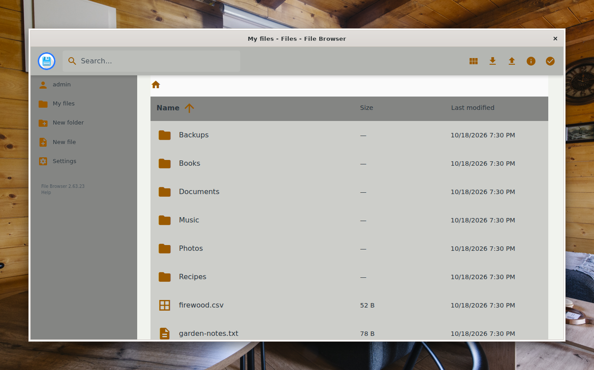
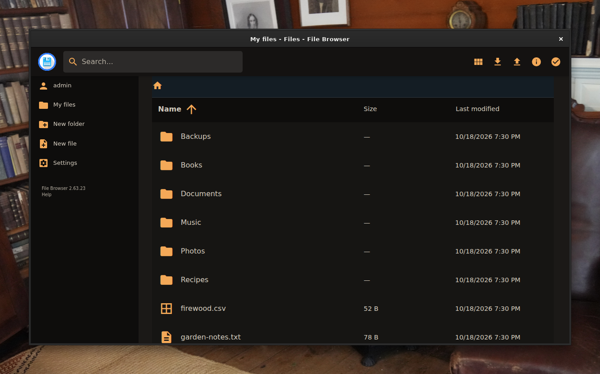

# Inglenook for theme.park

**Tier:** 2 Partial\
**Variants:** Inglenook Day, Inglenook Night\
**Tested with:** Not tested yet

| Day | Night |
|---|---|
|  |  |

[theme.park](https://theme-park.dev) restyles self-hosted web apps such as Sonarr, Radarr, Plex, Jellyfin, Pi-hole and File Browser. Each app gets a base stylesheet from theme.park, and a small theme file sets its colors. This port is that theme file, one for each variant. It works with every app theme.park supports.

## Before you start

- An app that theme.park supports. The list is on the [theme.park themes page](https://docs.theme-park.dev/themes/).
- For the browser method: the Stylus extension for [Chrome](https://chromewebstore.google.com/detail/stylus/clngdbkpkpeebahjckkjfobafhncgmne) or [Firefox](https://addons.mozilla.org/firefox/addon/styl-us/).
- For the server method: Docker, to run your own copy of theme.park.

## Install

There are two ways in. The browser method is quickest and themes the app in one browser. The server method themes the app for everyone who opens it.

### In your browser (Stylus)

1. Download or clone this repo.
2. Open the app in your browser.
3. Click the Stylus icon, then **Write style for:** and the app's address.
4. On the first line, import the app's base stylesheet. Put the app's name where `<app>` is, as it appears in theme.park's addresses, such as `sonarr` or `filebrowser`:

   ```css
   @import "https://theme-park.dev/css/base/<app>/<app>-base.css";
   ```

5. Below it, paste the whole contents of `Ports/theme-park/dist/night/inglenook-night.css` (or `dist/day/inglenook-day.css` for Day).
6. Name the style, such as `Inglenook for Sonarr`, and click **Save**.

### On your server (self-hosted theme.park)

1. Run theme.park's own image, as in its [Docker setup](https://docs.theme-park.dev/setup/#docker):

   ```sh
   docker run -d --name theme-park -p 8085:80 -v /path/to/theme-park:/config ghcr.io/themepark-dev/theme.park
   ```

2. Copy `Ports/theme-park/dist/day/inglenook-day.css` and `Ports/theme-park/dist/night/inglenook-night.css` into `/path/to/theme-park/www/css/theme-options/`.
3. Restart the container: `docker restart theme-park`. It makes an `inglenook-day.css` and `inglenook-night.css` for every app.
4. Open `http://<your-server>:8085/css/base/sonarr/inglenook-night.css` in a browser. You should see a short stylesheet, not an error page.
5. Point your app at it, in one of theme.park's usual ways:
   - **Docker mod** (linuxserver.io and hotio images): add these to the app's container, then recreate it:

     ```sh
     DOCKER_MODS=ghcr.io/themepark-dev/theme.park:<app>
     TP_DOMAIN=<your-server>:8085
     TP_SCHEME=http
     TP_THEME=inglenook-night
     ```

   - **Nginx or SWAG**: inside the app's `location` block, before any rewrites:

     ```nginx
     proxy_set_header Accept-Encoding "";
     sub_filter '</head>' '<link rel="stylesheet" type="text/css" href="http://<your-server>:8085/css/base/<app>/inglenook-night.css"></head>';
     sub_filter_once on;
     ```

   - **Stylus**: a style with one line, `@import "http://<your-server>:8085/css/base/<app>/inglenook-night.css";`.

Files to use:

- Inglenook Day: `dist/day/inglenook-day.css`
- Inglenook Night: `dist/night/inglenook-night.css`

## Set the font

theme.park does not change fonts, and neither does this port. Each app keeps its own. To use IBM Plex Mono where an app shows code or logs, add a line to your Stylus style, after the pasted theme:

```css
code, pre, kbd { font-family: "IBM Plex Mono", monospace; }
```

IBM Plex Mono needs to be installed on the computer you browse from. If it is not installed yet, follow [Font](../../README.md#font) in the main README.

## Check that it worked

Reload the app. Its background turns warm walnut (Night) or soft green-gray (Day), and links, toggles and progress bars turn amber.

## Switch between Day and Night

1. Stylus: replace the pasted theme with the other file's contents, or keep two styles and turn one off.
2. Self-hosted: change `inglenook-night` to `inglenook-day` in `TP_THEME`, the `sub_filter` line, or the `@import`, then reload the app (recreate the container for the Docker mod).

theme.park cannot follow the OS light or dark setting.

## Uninstall

1. Stylus: delete the style.
2. Docker mod: remove the `DOCKER_MODS` and `TP_` variables and recreate the container.
3. Nginx or SWAG: remove the three `sub_filter` lines and reload Nginx.
4. Delete the two files from `www/css/theme-options/` and restart the theme.park container.

## Troubleshooting

- **Nothing changes**: the `@import` is not on the first line of the Stylus style, or the app name in the address is wrong. Open the address on its own to check it loads.
- **The Nginx method does nothing**: the app compresses its pages. Keep the `proxy_set_header Accept-Encoding "";` line, and put the lines outside any `/api` block.
- **The Docker mod still shows another theme**: recreate the container, do not just restart it.
- **Some parts are dark, or tinted, in Day**: see Known limits.

## Known limits

- theme.park sets a few colors per app: backgrounds, popups, buttons, text, links and the accent. Status colors, charts and posters keep each app's own colors.
- theme.park's base stylesheets lay see-through dark and light tints over some surfaces, such as table rows, menus and sidebars. They show the background through them and cannot be turned off from a theme.
- theme.park is made for dark themes. Inglenook Day works, but some apps keep white labels or dark tints that suit a dark page better.
- Parts theme.park does not reach keep the app's own look. If the app has its own light and dark mode, pick dark with Inglenook Night and light with Inglenook Day. In File Browser it is under **Settings**, **Global Settings**.
- The Petio loading spinner keeps its own color.

## Sources

- [theme.park: setup (Docker mod, Nginx, SWAG, Stylus, self-hosting)](https://docs.theme-park.dev/setup/)
- [theme.park: custom themes](https://docs.theme-park.dev/custom/)
- [theme.park source: theme options](https://github.com/themepark-dev/theme.park/tree/master/css/theme-options)
- Based on [Catppuccin for theme.park](https://github.com/catppuccin/theme.park) (MIT License): its list of theme variables, with every color replaced.
