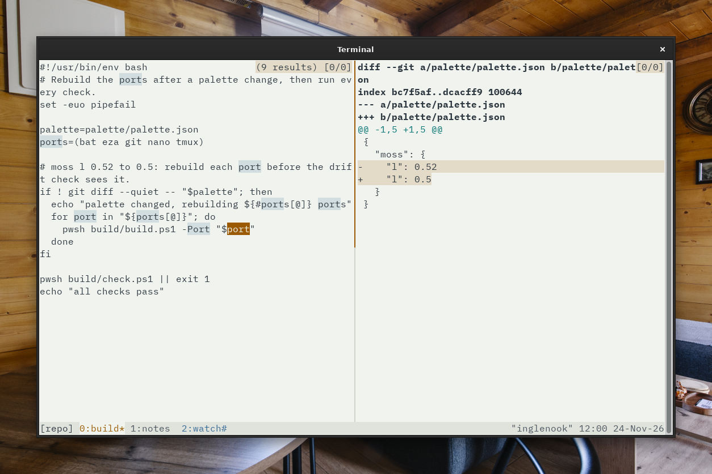
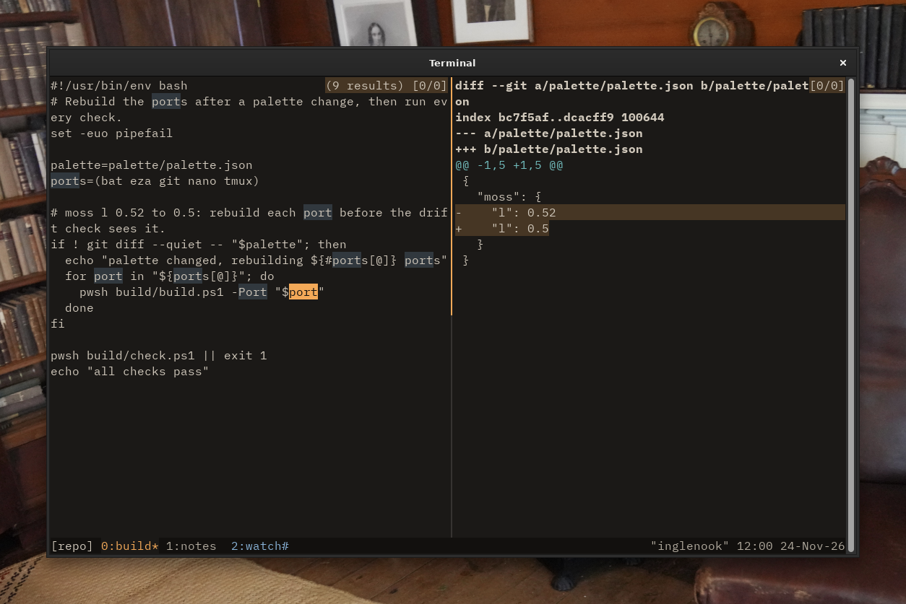

# Inglenook for tmux

**Tier:** 1 Full\
**Variants:** Inglenook Day, Inglenook Night\
**Tested with:** Not tested yet

| Day | Night |
|---|---|
|  |  |

## Before you start

- tmux 3.4 or later. Run `tmux -V` to check.
- A terminal that shows 24-bit color. Most do: GNOME Terminal, iTerm2, Windows Terminal (through WSL), and others.
- Your terminal set to Inglenook in the same variant, such as [GNOME Terminal](../gnome-terminal/README.md). tmux draws its bars and borders itself, but the panes keep the terminal's background and text colors.

## Install

1. Pick the theme file: `dist/day/inglenook-day.conf` for Inglenook Day, `dist/night/inglenook-night.conf` for Inglenook Night.
2. Make the folder `~/.config/tmux/` if it does not exist.
3. Save the theme file into that folder.
4. Open the tmux config you already have, `~/.tmux.conf` or `~/.config/tmux/tmux.conf`. If you have neither, create `~/.config/tmux/tmux.conf`.
5. Tell tmux your terminal shows 24-bit color. Add this line near the top, with your terminal's `TERM` value (run `echo $TERM` outside tmux; most terminals say `xterm-256color`):

   ```
   set -as terminal-features ",xterm-256color:RGB"
   ```

6. Add this line at the end, after any color settings of your own:

   ```
   source-file ~/.config/tmux/inglenook-day.conf
   ```

   For Night, use `inglenook-night.conf`.
7. Quit every tmux session (`tmux kill-server`), then start tmux again. A running tmux keeps its old colors until then.

Files to use:

- Inglenook Day: `dist/day/inglenook-day.conf`
- Inglenook Night: `dist/night/inglenook-night.conf`

## Set the font

tmux uses the terminal's font. Set IBM Plex Mono in your terminal, as its Inglenook guide shows. If your status line shows icons, use BlexMono Nerd Font Mono instead.

## Check that it worked

1. The status line at the bottom is a dark recessed bar in Night (a soft gray one in Day), and the current window's name is amber on the background's tone.
2. Split the window with `Ctrl+b %`. The border beside the active pane is amber, the other borders are quiet lines.
3. Press `Ctrl+b [` for copy mode, then `Ctrl+r` (or `?` with vi keys) and search for a word. Every match gets a soft blue-gray tint, and the one at the cursor is solid amber.

## Switch between Day and Night

1. In your tmux config, change `inglenook-day.conf` to `inglenook-night.conf`, or the other way round.
2. Switch your terminal to the same variant.
3. Quit every tmux session (`tmux kill-server`) and start tmux again.

tmux cannot follow the system's light or dark setting with this theme.

## Uninstall

1. Delete the `source-file ~/.config/tmux/inglenook-...conf` line from your tmux config.
2. Delete `~/.config/tmux/inglenook-day.conf` or `inglenook-night.conf`.
3. Quit every tmux session (`tmux kill-server`) and start tmux again.

## Troubleshooting

- **Colors are close but a little off, or banded**: tmux does not know your terminal shows 24-bit color, so it rounds every color to the nearest of 256. Check step 5: the `TERM` value in the line must match what `echo $TERM` prints outside tmux. Then run `tmux kill-server` and start again.
- **Nothing changed**: a tmux server was still running. Run `tmux kill-server` and start again.
- **"invalid option: menu-style" when tmux starts**: tmux is older than 3.4. Update it.
- **The theme is overridden**: a line after the `source-file` line, or a plugin, sets the same colors. Move the `source-file` line to the end.

## Known limits

- The panes keep the terminal's background and text colors. In a terminal not set to Inglenook, the bars and borders match the theme but the panes do not.
- Programs inside tmux keep their own colors.
- The theme sets only colors. Your status line's content and layout stay as they are, and a status line plugin with its own colors replaces the theme's status line colors.

## Sources

- [tmux manual: options, the STYLES section, and terminal-features](https://man.openbsd.org/tmux)
- [tmux FAQ: how to use RGB color](https://github.com/tmux/tmux/wiki/FAQ#how-do-i-use-rgb-colour)
- [tmux CHANGES: which version added each option](https://github.com/tmux/tmux/blob/master/CHANGES)
