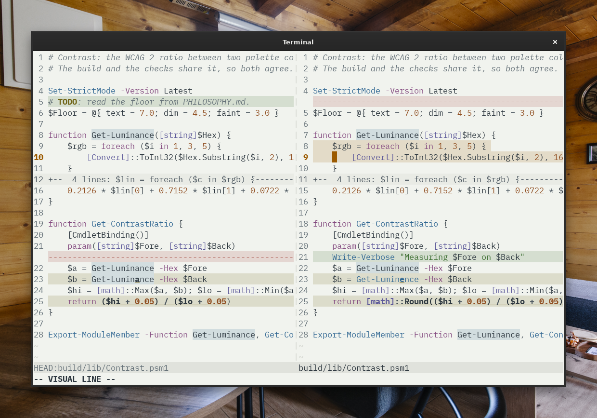
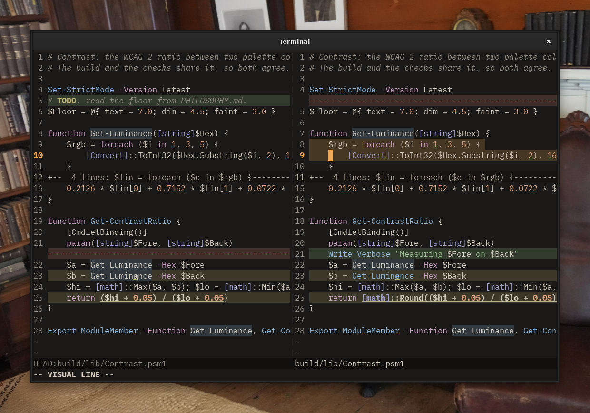

# Inglenook for Vim

**Tier:** 1 Full\
**Variants:** Inglenook Day, Inglenook Night\
**Tested with:** Not tested yet

| Day | Night |
|---|---|
|  |  |

## Before you start

- Vim 9.0 or later, in a terminal or as gVim or MacVim.
- In a terminal, one that shows 24-bit color, such as Windows Terminal, GNOME Terminal, iTerm2, or kitty, gives the full theme. Other terminals get an approximate version, best in a terminal set to Inglenook.

## Install

One colorscheme holds both variants. It shows Inglenook Day when Vim's `background` option is `light` and Inglenook Night when it is `dark`.

1. Find your Vim folder: `~\vimfiles` on Windows, `~/.vim` on Linux and macOS. Create it if it is missing.
2. In that folder, create a folder named `colors` and copy [`dist/day/colors/inglenook.vim`](dist/day/colors/inglenook.vim) into it.
3. In the same Vim folder, create the folders `autoload\inglenook` (Windows) or `autoload/inglenook` (Linux and macOS).
4. Copy [`dist/day/autoload/inglenook/day.vim`](dist/day/autoload/inglenook/day.vim) and [`dist/night/autoload/inglenook/night.vim`](dist/night/autoload/inglenook/night.vim) into `autoload/inglenook`.
5. Open your vimrc: `~\_vimrc` on Windows, `~/.vimrc` on Linux and macOS (create it if it is missing). Add these lines at the end:

   ```vim
   syntax on
   set termguicolors
   colorscheme inglenook
   ```

   Leave out `set termguicolors` if your terminal does not show 24-bit color. gVim and MacVim do not need it.
6. Restart Vim.

Files to use:

- Both variants: `dist/day/colors/inglenook.vim` (the same file is in `dist/night/`)
- Inglenook Day: `dist/day/autoload/inglenook/day.vim`
- Inglenook Night: `dist/night/autoload/inglenook/night.vim`

If you only want one variant, copy only its file in step 4. Vim then always shows that variant.

## Set the font

Inglenook uses [IBM Plex Mono](https://github.com/IBM/plex). Many Vim plugins show icons, so use [BlexMono Nerd Font](https://www.nerdfonts.com/font-downloads), the same font with icons added. If it is not installed yet, follow [Font](../../README.md#font) in the main README.

1. In a terminal, Vim uses the terminal's font: set **BlexMono Nerd Font Mono** in your terminal's settings. For GNOME Terminal, see [Inglenook for GNOME Terminal](../gnome-terminal/README.md).
2. In gVim on Windows, add `set guifont=BlexMono_Nerd_Font_Mono:h11` to your vimrc.
3. In gVim on Linux, add `set guifont=BlexMono\ Nerd\ Font\ Mono\ 11` to your vimrc.
4. In MacVim, add `set guifont=BlexMono\ Nerd\ Font\ Mono:h13` to your vimrc.

## Check that it worked

Run `:colorscheme`. Vim prints `inglenook`, and the background turns soft green-gray (Day) or warm dark brown (Night).

## Switch between Day and Night

1. Run `:set background=dark` for Inglenook Night, or `:set background=light` for Inglenook Day. The colors change at once.
2. To always start in one variant, add `set background=dark` (or `light`) to your vimrc above the `colorscheme` line. In a terminal, also add `set t_RB=` above it, so Vim does not change the variant to match the terminal.

In a terminal, Vim asks the terminal for its background color when it starts and sets `background` to match. If your terminal follows the OS light and dark setting, Vim follows it too the next time it starts.

## Make it see-through (optional)

Vim has no transparency of its own. Some terminals do: Windows Terminal (**Settings** > your profile > **Appearance** > **Background opacity**) and GNOME Terminal (**Preferences** > your profile > **Colors** > **Use transparent background**). The theme itself stays solid.

## Uninstall

1. Delete `colors/inglenook.vim` and the `autoload/inglenook` folder from your Vim folder.
2. Remove the `colorscheme inglenook` line from your vimrc.
3. Restart Vim.

## Troubleshooting

- **`E185: Cannot find color scheme 'inglenook'`**: `colors/inglenook.vim` is not in the Vim folder from step 1. Check the folder name is `colors`.
- **`inglenook: neither autoload/inglenook/day.vim nor night.vim is installed`**: copy the files from step 4 into `autoload/inglenook`, not into `autoload`.
- **The colors look wrong or too bright in a terminal**: run `:set termguicolors?`. If it says `notermguicolors`, add `set termguicolors` to your vimrc above the `colorscheme` line. If the screen then turns gray or colorless, your terminal does not show 24-bit color: take the line out again.
- **The colors changed after `:set termguicolors`**: run `:colorscheme inglenook` again. Vim picks the colors when the colorscheme loads.
- **Vim shows the wrong variant**: Vim could not read your terminal's background. Set `background` and `t_RB` in your vimrc as in "Switch between Day and Night".

## Known limits

- Without 24-bit color, Vim uses the terminal's 16 colors. The colors are approximate: the selection and the search match at the cursor show in reverse video instead of the amber accent, numbers, types and tags borrow the nearest terminal color, and the background is the terminal's own.
- Plugins that set their own colors instead of using Vim's standard highlight groups keep their own colors.

## Sources

- [Vim: `:colorscheme`](https://vimhelp.org/syntax.txt.html#%3Acolorscheme)
- [Vim: highlight groups](https://vimhelp.org/syntax.txt.html#highlight-groups) and [`:highlight` arguments](https://vimhelp.org/syntax.txt.html#highlight-args)
- [Vim: `'background'`](https://vimhelp.org/options.txt.html#%27background%27) and [`'termguicolors'`](https://vimhelp.org/options.txt.html#%27termguicolors%27)
- [Vim: `g:terminal_ansi_colors`](https://vimhelp.org/terminal.txt.html#g%3Aterminal_ansi_colors)
- [Vim: the Vim folder on each system](https://vimhelp.org/options.txt.html#%27runtimepath%27) and [the vimrc file](https://vimhelp.org/starting.txt.html#vimrc)
