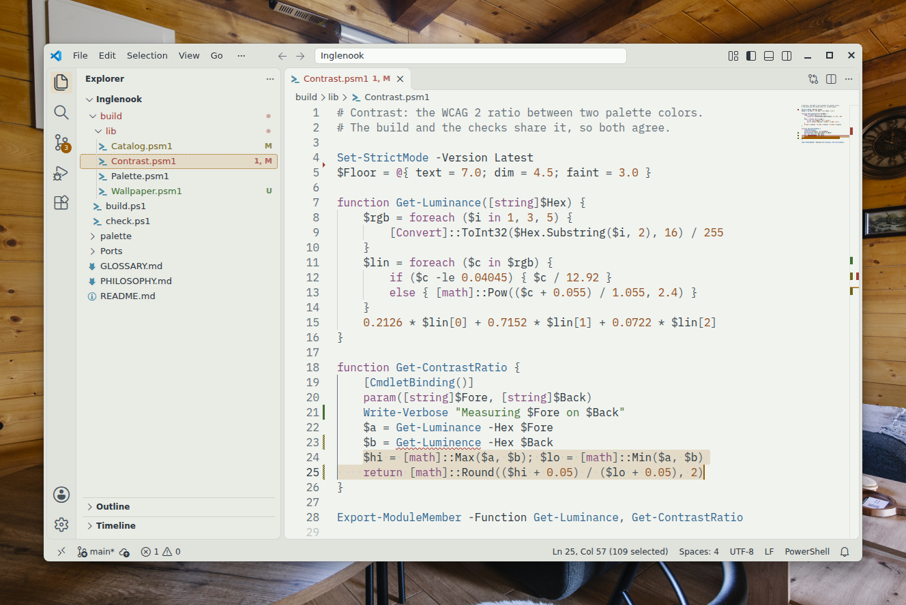
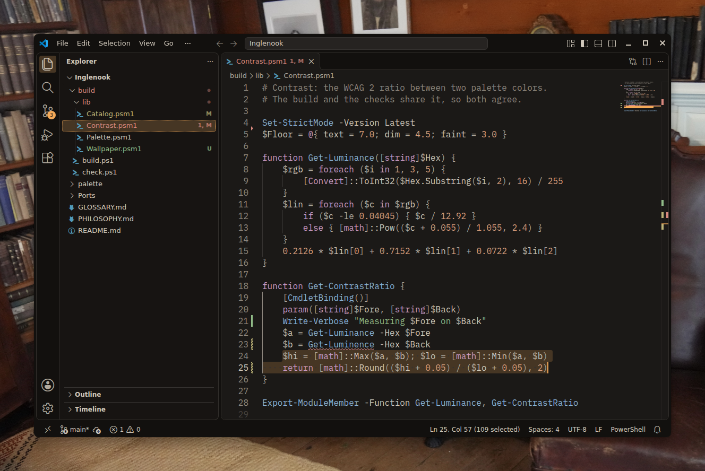

# Inglenook for Visual Studio Code

**Tier:** 1 Full\
**Variants:** Inglenook Day, Inglenook Night\
**Tested with:** VS Code 1.148.0 on Linux Mint 22.3

| Day | Night |
|---|---|
|  |  |

Each variant is its own small VS Code extension: `dist/day/` is **Inglenook Day** and `dist/night/` is **Inglenook Night**. Install both, then pick one or let VS Code follow your system's light or dark setting.

## Before you start

- VS Code 1.80 or later. Check it in **Help** > **About**.
- [Node.js](https://nodejs.org) (the LTS version) to package the extensions. It is only needed during install. If you cannot install Node.js, see [Install without Node.js](#install-without-nodejs).

## Install

1. Download or clone this repo.
2. Open a terminal (PowerShell on Windows) in the repo folder.
3. Go to the Day extension:

   ```
   cd Ports/vscode/dist/day
   ```

4. Package it:

   ```
   npx @vscode/vsce package
   ```

   If `npx` asks to install `@vscode/vsce`, answer `y`. When it finishes, the folder holds a file named `inglenook-day-<version>.vsix`.
5. Do the same for Night:

   ```
   cd ../night
   npx @vscode/vsce package
   ```

   This makes `inglenook-night-<version>.vsix`.
6. Open VS Code. Press **Ctrl+Shift+P**, type `Extensions: Install from VSIX`, and press **Enter**.
7. Pick `Ports/vscode/dist/day/inglenook-day-<version>.vsix` and click **Install**. VS Code shows "Completed installing extension".
8. Repeat steps 6 and 7 with `Ports/vscode/dist/night/inglenook-night-<version>.vsix`.
9. Press **Ctrl+K**, then **Ctrl+T** to open the color theme list. Pick **Inglenook Day** or **Inglenook Night**.

Steps 6 to 8 can also be done from a terminal: `code --install-extension inglenook-day-<version>.vsix`.

On macOS, use **Cmd** where these steps say **Ctrl**.

Files to use:

- Inglenook Day: `dist/day/` (`package.json`, `themes/inglenook-day-color-theme.json`, `LICENSE`)
- Inglenook Night: `dist/night/` (`package.json`, `themes/inglenook-night-color-theme.json`, `LICENSE`)

### Install without Node.js

VS Code's docs describe loading an extension by copying it into the extensions folder. Newer versions keep a list of installed extensions and may ignore folders copied by hand, so use this only if the steps above are not an option.

1. Close every VS Code window.
2. Open File Explorer, click the address bar, type `%USERPROFILE%\.vscode\extensions`, and press **Enter**. On macOS and Linux the folder is `~/.vscode/extensions`.
3. Copy the folder `Ports/vscode/dist/day` into it and rename the copy to `inglenook.inglenook-day`.
4. Copy `Ports/vscode/dist/night` the same way and rename it to `inglenook.inglenook-night`.
5. Open VS Code and continue with step 9 above.

If the themes are not in the list, use the VSIX steps instead.

## Set the font

Inglenook uses [IBM Plex Mono](https://github.com/IBM/plex). Where the app shows icons, use [BlexMono Nerd Font](https://www.nerdfonts.com/font-downloads) instead, the same font with icons added. If it is not installed yet, follow [Font](../../README.md#font) in the main README.

VS Code sets the editor and the terminal font separately. The editor shows no font icons, so it takes IBM Plex Mono. The terminal shows the icons of shell prompts and file listings, so it takes BlexMono Nerd Font Mono.

1. Press **Ctrl+Shift+P**, type `Preferences: Open User Settings (JSON)`, and press **Enter**.
2. Add these lines inside the outer braces:

   ```json
   "editor.fontFamily": "'IBM Plex Mono'",
   "terminal.integrated.fontFamily": "'BlexMono Nerd Font Mono'"
   ```

3. Save. The editor and the terminal switch font right away.

## Check that it worked

Inglenook Day is a soft, faintly green off-white; Inglenook Night is a warm, dark walnut brown. The side bar and the frame around the editor are a shade deeper than the editor. Select some code: the selection is a soft amber tint and the code keeps its colors.

## Switch between Day and Night

To switch by hand, press **Ctrl+K**, then **Ctrl+T**, and pick the other variant.

VS Code can follow the light or dark setting of Windows and macOS:

1. Open your user `settings.json` (step 1 of [Set the font](#set-the-font)).
2. Add:

   ```json
   "window.autoDetectColorScheme": true,
   "workbench.preferredLightColorTheme": "Inglenook Day",
   "workbench.preferredDarkColorTheme": "Inglenook Night"
   ```

3. Save. VS Code now switches when you change Windows **Settings** > **Personalization** > **Colors** > **Choose your mode**, or macOS **System Settings** > **Appearance**.

## Uninstall

1. Open the Extensions view with **Ctrl+Shift+X**.
2. Search for `@installed Inglenook`.
3. Click the gear on **Inglenook Day** and choose **Uninstall**. Do the same for **Inglenook Night**.
4. Press **Ctrl+K**, then **Ctrl+T**, and pick another theme, such as **Light Modern** or **Dark Modern**.
5. Remove the `window.autoDetectColorScheme`, `workbench.preferredLightColorTheme`, `workbench.preferredDarkColorTheme`, and font lines from `settings.json` if you added them.

If you used the folder install, close VS Code and delete the two `inglenook.inglenook-*` folders from the extensions folder instead.

## Troubleshooting

- **`npx` is not recognized**: Node.js is not installed or the terminal was opened before installing it. Install Node.js LTS and open a new terminal.
- **`vsce` stops and asks a question**: answer `y`. It may ask about a missing README in the extension folder.
- **Inglenook is not in the theme list**: reload with **Ctrl+Shift+P** > `Developer: Reload Window`. If you used the folder install, use the VSIX steps.
- **Terminal colors look a little off**: VS Code adjusts terminal text it thinks is hard to read. Set `"terminal.integrated.minimumContrastRatio": 1` to show Inglenook's colors as they are.
- **The title bar is the system default**: set `"window.titleBarStyle": "custom"`. On Windows this is the default.
- **Some colors look like VS Code's own theme**: a setting in `workbench.colorCustomizations` or `editor.tokenColorCustomizations` overrides Inglenook. Remove it, or check for another theme extension forcing colors.

## Known limits

- **Selected text keeps its syntax colors.** The selection is a soft tint, not a solid block with plain text.
- **Overlapping highlights hide each other.** Where a search match, a highlighted word, or the current line meets the selection, the one on top covers the one below instead of blending with it.
- **Changed characters inside a diff line** get a thin outline, not a stronger highlight.
- **Rainbow brackets are off.** All brackets are the same quiet color. To turn bracket colors off entirely, set `"editor.bracketPairColorization.enabled": false`.
- **Buttons do not change color on hover.**
- **Shadows** under popups and menus are VS Code's default shadow.
- **Some newer or rarely seen parts**, such as the notebook editor, chat, and the welcome page, use VS Code's own Light Modern or Dark Modern colors.

## Sources

- [Color Theme guide](https://code.visualstudio.com/api/extension-guides/color-theme): theme file, `colors`, `tokenColors`, semantic highlighting
- [Theme Color reference](https://code.visualstudio.com/api/references/theme-color): every workbench color key
- [Contribution points](https://code.visualstudio.com/api/references/contribution-points#contributes.themes): `contributes.themes`, `label`, `uiTheme`, `path`
- [Publishing extensions](https://code.visualstudio.com/api/working-with-extensions/publishing-extension): `vsce package`, required `publisher` and `engines`
- [Extension Marketplace](https://code.visualstudio.com/docs/configure/extensions/extension-marketplace): **Install from VSIX**, `code --install-extension`, extensions folder per OS
- [Themes](https://code.visualstudio.com/docs/configure/themes): **Ctrl+K Ctrl+T**, following the OS color scheme
