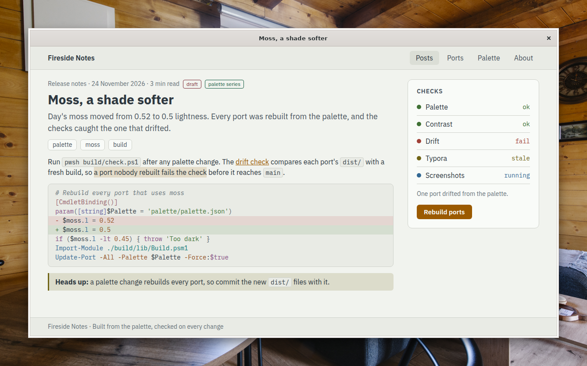
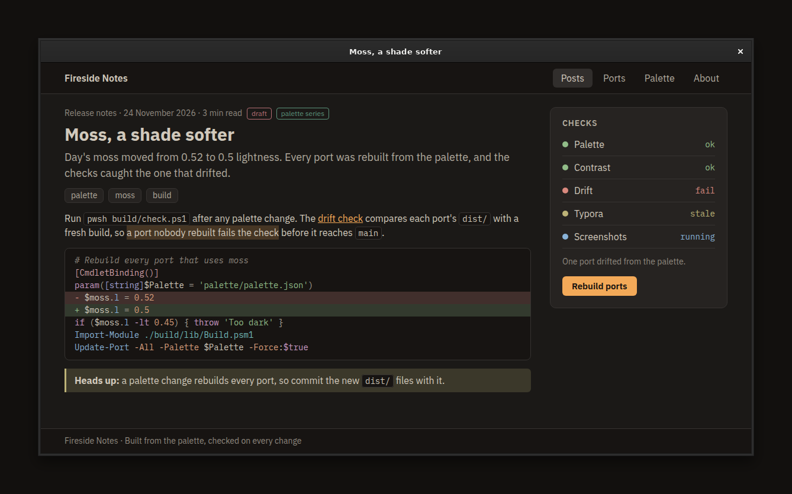

# Inglenook for the web

**Tier:** 1 Full\
**Variants:** Inglenook Day, Inglenook Night\
**Tested with:** Not tested yet

| Day | Night |
|---|---|
|  |  |

This port is two CSS files of custom properties, one per variant, for a website you build. It does not style a page by itself: your own CSS reads the properties with `var()`.

Every property name starts with the variant, such as `--inglenook-day-base` and `--inglenook-night-base`. That way you can load both files at once and switch between them on your site.

## Before you start

- A website whose HTML and CSS you can edit.
- Nothing to install.

## Install

1. Download or clone this repo.
2. Copy `Ports/web/dist/day/theme.css` into your site's CSS folder and name it `inglenook-day.css`.
3. Copy `Ports/web/dist/night/theme.css` into the same folder and name it `inglenook-night.css`.
4. Link both from your page's `<head>`, before your own stylesheet:

   ```html
   <link rel="stylesheet" href="/css/inglenook-day.css">
   <link rel="stylesheet" href="/css/inglenook-night.css">
   <link rel="stylesheet" href="/css/site.css">
   ```

5. Use the properties in your own CSS. See [Use the properties](#use-the-properties).

Files to use:

- Inglenook Day: `dist/day/theme.css`
- Inglenook Night: `dist/night/theme.css`

## Use the properties

Each file sets these on `:root`. Swap `day` for `night` in the names for the other variant.

| Property | What it is for |
|---|---|
| `--inglenook-day-base` | The page background, where content lives |
| `--inglenook-day-deep`, `-deeper` | Recessed areas: header, footer, sidebars, code blocks. `-deeper` is the most recessed |
| `--inglenook-day-raised` | Lifted surfaces: cards, popups, inputs, menus |
| `--inglenook-day-hover` | Hovered and active items, such as the current page in a menu |
| `--inglenook-day-line` | Borders and dividers |
| `--inglenook-day-text`, `-dim`, `-faint` | Body text, supporting text, and dates, captions, and placeholders |
| `--inglenook-day-accent`, `-on-accent` | Links, focus rings, selections, primary buttons, and the text on a button |
| `--inglenook-day-error`, `-warning`, `-success`, `-info` | Failure, caution, success, and information |
| `--inglenook-day-<color>` | The twelve named colors: `firelight`, `ember`, `oxblood`, `clay`, `brass`, `moss`, `ivy`, `pine`, `steel`, `dusk`, `heather`, `rosewood`. Use `oxblood` and `ivy` for badges |
| `--inglenook-day-<color>-wash` | A soft background of a color, for selections, highlighted lines, and notes. Works with any named color, and with `accent`, `error`, `warning`, `success`, and `info` |
| `--inglenook-day-syntax-<token>` | Code colors. See [Color your code](#color-your-code) |

Every color is solid. Draw edges with `-line` borders rather than shadows.

A site that follows the visitor's OS setting can map the properties once:

```css
:root {
  color-scheme: light;
  --page: var(--inglenook-day-base);
  --card: var(--inglenook-day-raised);
  --ink: var(--inglenook-day-text);
  --link: var(--inglenook-day-accent);
  --link-wash: var(--inglenook-day-accent-wash);
}
@media (prefers-color-scheme: dark) {
  :root {
    color-scheme: dark;
    --page: var(--inglenook-night-base);
    --card: var(--inglenook-night-raised);
    --ink: var(--inglenook-night-text);
    --link: var(--inglenook-night-accent);
    --link-wash: var(--inglenook-night-accent-wash);
  }
}
body { background: var(--page); color: var(--ink); }
a { color: var(--link); }
::selection { background: var(--link-wash); color: var(--ink); }
```

## Color your code

The `syntax` properties hold the colors for code, so every site colors it the same way:

| Property | Tokens |
|---|---|
| `-syntax-key` | Keys, properties, functions |
| `-syntax-string` | Strings |
| `-syntax-number` | Numbers, flags, literals |
| `-syntax-keyword` | Keywords, booleans, constants |
| `-syntax-type` | Types, classes |
| `-syntax-reference` | Paths, references, anchors, namespaces |
| `-syntax-tag` | Tags, annotations, decorators |
| `-syntax-error` | Errors, invalid code |
| `-syntax-punctuation` | Punctuation and operators |
| `-syntax-comment` | Comments |

Point your highlighter's classes at them. Pygments, Rouge, and Hugo (with `noClasses = false`) write the same short class names, inside `.highlight` or `.chroma`:

```css
:root {
  --code-bg: var(--inglenook-day-deep);
  --code-keyword: var(--inglenook-day-syntax-keyword);
  --code-string: var(--inglenook-day-syntax-string);
  --code-comment: var(--inglenook-day-syntax-comment);
  /* ...and the rest, with a night block as above */
}
.chroma { background: var(--code-bg); }
.chroma .k, .chroma .kc, .chroma .kd { color: var(--code-keyword); }
.chroma .s, .chroma .s1, .chroma .s2 { color: var(--code-string); }
.chroma .c, .chroma .c1, .chroma .cm { color: var(--code-comment); font-style: italic; }
```

For a diff, put removed lines on `-error-wash` and added lines on `-success-wash`. A token with no row in the table takes the closest one.

## Set the font

Inglenook uses [IBM Plex Mono](https://github.com/IBM/plex) for code. Visitors may not have it installed, so your site serves it.

1. Pick one way to load it:
   - From Google Fonts: add this to your `<head>`, before your own stylesheet:

     ```html
     <link rel="stylesheet" href="https://fonts.googleapis.com/css2?family=IBM+Plex+Mono:ital,wght@0,400;0,600;1,400&display=swap">
     ```

   - From your own site: download `IBMPlexMono-Regular.woff2`, `IBMPlexMono-Italic.woff2`, and `IBMPlexMono-SemiBold.woff2` from the [@ibm/plex-mono package](https://www.npmjs.com/package/@ibm/plex-mono) (`fonts/complete/woff2/`), put them in your site's `fonts/` folder, and add one `@font-face` rule each:

     ```css
     @font-face {
       font-family: "IBM Plex Mono";
       font-style: normal;
       font-weight: 400;
       font-display: swap;
       src: url("/fonts/IBMPlexMono-Regular.woff2") format("woff2");
     }
     ```

     The font is under the SIL Open Font License, which lets you serve it.

2. Set it on code:

   ```css
   code, pre, kbd { font-family: "IBM Plex Mono", monospace; }
   ```

## Check that it worked

Open your browser's developer tools and select `<html>`. Its computed styles list the `--inglenook-day-...` and `--inglenook-night-...` properties with values, and your page shows the variant you mapped.

## Switch between Day and Night

Both variants are loaded at once, so switching is your site's choice:

1. To follow the visitor's OS setting, put the Night set inside `@media (prefers-color-scheme: dark)`, as in [Use the properties](#use-the-properties).
2. To add your own switch, put the Night set under a selector such as `:root[data-theme="night"]`, and set that attribute on `<html>` from your toggle.

## Uninstall

1. Remove the two `<link>` lines from your `<head>`.
2. Delete `inglenook-day.css` and `inglenook-night.css`.
3. Replace any `var(--inglenook-...)` in your CSS with your own values.

## Troubleshooting

- **A property has no value**: the name is misspelled, or the file for that variant is not loaded. Check the browser's Network tab for the two files.
- **Code shows in another font**: the font files did not load. Check the Network tab, and that the `@font-face` paths match where you put the files.
- **Both variants look the same**: the Night set is not inside your `prefers-color-scheme` block or under your switch's selector.

## Known limits

- The files only define properties. Your site decides which elements use them.
- There is no ready-made light and dark switch. You write the few lines that pick a set.
- Your highlighter's classes are yours to map. The table above covers the common tokens.

## Sources

- [MDN: Using CSS custom properties](https://developer.mozilla.org/en-US/docs/Web/CSS/Using_CSS_custom_properties)
- [MDN: prefers-color-scheme](https://developer.mozilla.org/en-US/docs/Web/CSS/@media/prefers-color-scheme)
- [MDN: @font-face](https://developer.mozilla.org/en-US/docs/Web/CSS/@font-face)
- [Pygments: builtin tokens and their class names](https://pygments.org/docs/tokens/)
- [Hugo: syntax highlighting](https://gohugo.io/content-management/syntax-highlighting/)
- [Google Fonts: IBM Plex Mono](https://fonts.google.com/specimen/IBM+Plex+Mono)
