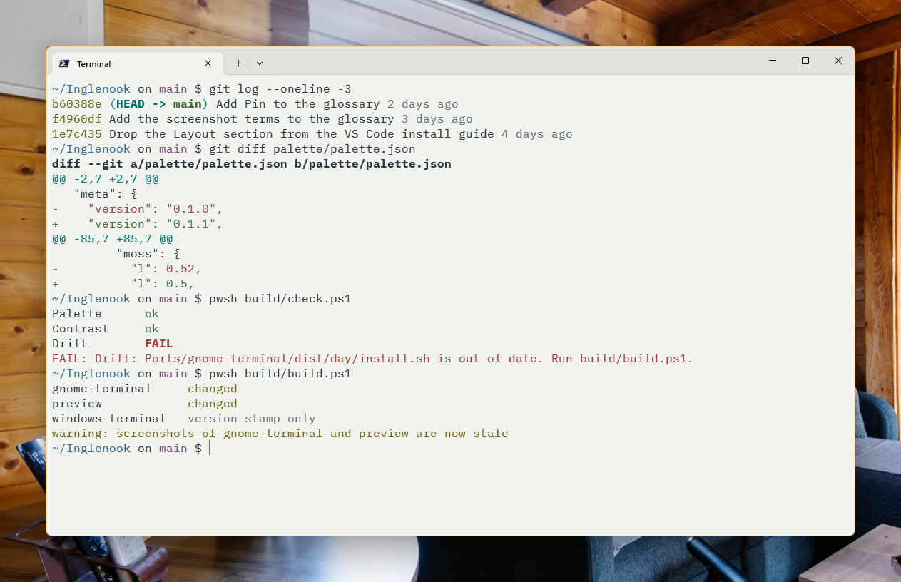
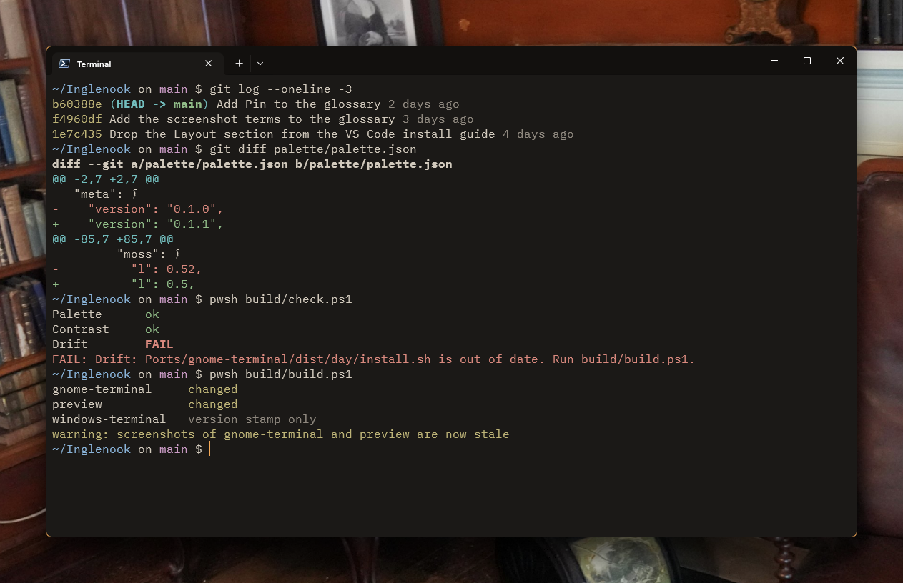

# Inglenook for Windows Terminal

**Tier:** 1 Full\
**Variants:** Inglenook Day, Inglenook Night\
**Tested with:** Not tested yet

| Day | Night |
|---|---|
|  |  |

The port has two parts:

- **Color schemes** color the terminal text and background. They install as a [JSON fragment](https://learn.microsoft.com/windows/terminal/json-fragment-extensions), so you copy files instead of pasting JSON.
- **Themes** color the tab row and the window frame. Fragments cannot hold themes, so these are pasted into `settings.json`.

Installed this way, Windows Terminal follows your Windows light or dark setting: Day in light mode, Night in dark mode.

## Before you start

- Windows Terminal 1.16 or later. Check it in **Settings** > **About**.
- The window frame color needs Windows 11. Everything else also works on Windows 10.
- A text editor for `settings.json`. Windows Terminal opens it in your default editor.

## Install

### Color schemes

1. Download or clone this repo.
2. Open File Explorer, click the address bar, type `%LOCALAPPDATA%\Microsoft\Windows Terminal`, and press **Enter**.
3. If there is no `Fragments` folder, create one. Open it.
4. Inside `Fragments`, create a folder named `Inglenook` and open it.
5. Copy these two files into it:
   - `Ports/windows-terminal/dist/day/schemes-day.json`
   - `Ports/windows-terminal/dist/night/schemes-night.json`

   The first file is now at `%LOCALAPPDATA%\Microsoft\Windows Terminal\Fragments\Inglenook\schemes-day.json`.
6. Close every Windows Terminal window, then open it again. Fragments are read at startup.

### Themes

7. Press **Ctrl+,** to open **Settings**.
8. Click **Open JSON file** in the bottom-left corner. `settings.json` opens in your editor.
9. Find the line `"themes": [`. If there is none, add `"themes": [],` on a new line right after the first `{` in the file.
10. Open `Ports/windows-terminal/dist/day/themes-day.json`. Copy the `{ ... }` object between its `[` and `]`, and paste it inside the `"themes"` brackets in `settings.json`.
11. Do the same with `Ports/windows-terminal/dist/night/themes-night.json`. Put a comma between the two objects.
12. Find the top-level `"theme"` line (add it after `"themes"` if missing) and set it to:

    ```json
    "theme": { "dark": "Inglenook Night", "light": "Inglenook Day" },
    ```

### Profile defaults

13. Find `"defaults"` inside `"profiles"`. Add these lines inside its braces:

    ```json
    "colorScheme": { "dark": "Inglenook Night", "light": "Inglenook Day" },
    "intenseTextStyle": "bold",
    "font": { "face": "BlexMono Nerd Font Mono" }
    ```

    `intenseTextStyle` keeps bold text in the normal text color instead of a lighter gray.
14. Save `settings.json`. Windows Terminal applies it right away. If it shows an error banner, a comma is missing or extra (see Troubleshooting).

If a profile in `"list"` sets its own `colorScheme`, `intenseTextStyle`, or `font`, it overrides these defaults. Remove those lines from the profile to use Inglenook.

Files to use:

- Inglenook Day: `dist/day/schemes-day.json`, `dist/day/themes-day.json`
- Inglenook Night: `dist/night/schemes-night.json`, `dist/night/themes-night.json`

## Set the font

Inglenook uses [IBM Plex Mono](https://github.com/IBM/plex). A terminal shows icons in prompts and file lists, so use [BlexMono Nerd Font](https://www.nerdfonts.com/font-downloads), the same font with icons added. If it is not installed yet, follow [Font](../../README.md#font) in the main README.

Step 13 already sets it. To set it from the settings screen instead:

1. Press **Ctrl+,**, then click **Defaults** under **Profiles** in the left menu.
2. Click **Appearance**, then **Font face**.
3. Pick **BlexMono Nerd Font Mono**, then click **Save**.

## Check that it worked

Open a new tab. In light mode the background is a soft, faintly green off-white; in dark mode it is a warm dark brown. In PowerShell, run `Write-Host "error" -ForegroundColor Red`: the word shows in a calm brick red, softer than the default red.

## Switch between Day and Night

Windows Terminal follows Windows. Change the mode in Windows **Settings** > **Personalization** > **Colors** > **Choose your mode**.

To keep one variant whatever Windows uses:

1. Open `settings.json` (steps 7 and 8).
2. Set `"theme"` and, in `"profiles"` > `"defaults"`, `"colorScheme"` to the same name, for example `"Inglenook Night"`.
3. Save.

## Make it see-through (optional)

The theme is solid. Windows Terminal has its own transparency settings, `opacity` and `useAcrylic`, which you can add to `"defaults"`. See [Appearance profile settings](https://learn.microsoft.com/windows/terminal/customize-settings/profile-appearance#transparency).

## Uninstall

1. Delete the folder `%LOCALAPPDATA%\Microsoft\Windows Terminal\Fragments\Inglenook`.
2. Open `settings.json` (steps 7 and 8).
3. Remove the two Inglenook objects from `"themes"`.
4. Set `"theme": "system"`.
5. Remove the `colorScheme`, `intenseTextStyle`, and `font` lines you added to `"defaults"`.
6. Save, then restart Windows Terminal.

## Troubleshooting

- **The Inglenook schemes are missing from the Color scheme list**: check the folder in step 5, and restart every Windows Terminal window. Copy the files from the repo again if you edited them; Windows Terminal ignores a fragment saved as UTF-16.
- **Error banner after saving `settings.json`**: usually a missing comma between pasted theme objects, or a trailing comma after the last one.
- **Day shows in dark mode, or Night in light mode**: `"theme"` and `"colorScheme"` must both be the `{ "dark": ..., "light": ... }` pair from steps 12 and 13.
- **Some colors look shifted**: set `"adjustIndistinguishableColors": "never"` in `"defaults"`. That setting changes text colors it thinks are too close to the background.

## Known limits

- **Tab and menu text color** cannot be set. It is light text in dark mode and dark text in light mode.
- **Selected text** keeps its own color on the selection. Windows Terminal has no setting for the color of selected text.
- **The window frame color** needs Windows 11.
- **The scrollbar, command palette, and settings screen** keep Windows Terminal's own light or dark look.

## Sources

- [Color schemes](https://learn.microsoft.com/windows/terminal/customize-settings/color-schemes)
- [Themes](https://learn.microsoft.com/windows/terminal/customize-settings/themes)
- [Appearance profile settings](https://learn.microsoft.com/windows/terminal/customize-settings/profile-appearance)
- [JSON fragment extensions](https://learn.microsoft.com/windows/terminal/json-fragment-extensions)
- [Windows Terminal Preview 1.16 release](https://devblogs.microsoft.com/commandline/windows-terminal-preview-1-16-release/): themes added in 1.16
