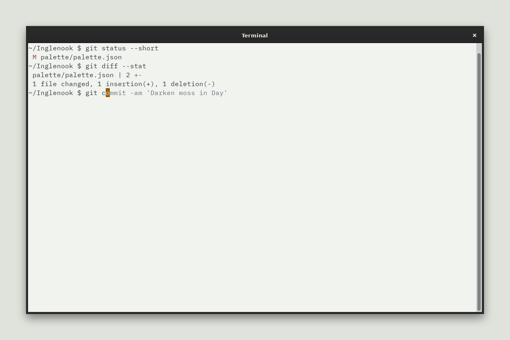
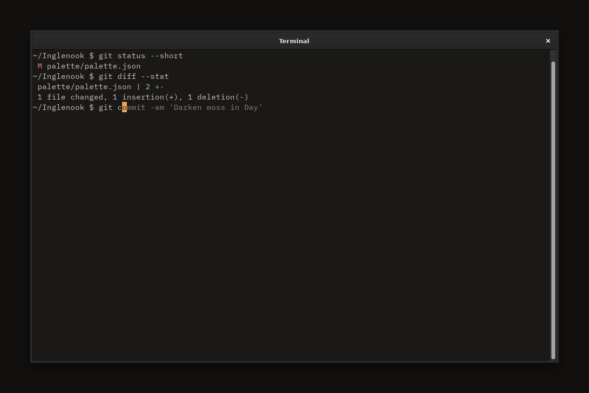

# Inglenook for zsh-autosuggestions

**Tier:** 1 Full\
**Variants:** Inglenook Day, Inglenook Night\
**Tested with:** Not tested yet

| Day | Night |
|---|---|
|  |  |

## Before you start

- Zsh 5.7 or newer, with [zsh-autosuggestions](https://github.com/zsh-users/zsh-autosuggestions) installed and loading from `~/.zshrc`. Check with `zsh --version`, and look for the gray suggestion after the cursor as you type.
- A terminal that shows 24-bit color, such as GNOME Terminal or Windows Terminal (for Zsh in WSL). For the full look, theme the terminal with Inglenook too.

## Install

zsh-autosuggestions reads its color from a shell variable. The theme is a file that sets it, which Zsh loads when it starts.

1. Create the folder `~/.config/inglenook/`.
2. Save [`dist/day/zsh-autosuggestions.zsh`](dist/day/zsh-autosuggestions.zsh) or [`dist/night/zsh-autosuggestions.zsh`](dist/night/zsh-autosuggestions.zsh) there as `zsh-autosuggestions.zsh`.
3. Add this line to `~/.zshrc`, below the line that loads zsh-autosuggestions:

   ```sh
   source ~/.config/inglenook/zsh-autosuggestions.zsh
   ```

4. Open a new terminal.

**Nowhere users**: put the same line in `~/.config/nowhere/theme.zsh` instead of `~/.zshrc`. Nowhere loads that file last.

**Setting the variable another way**: this is the value for Inglenook Day. The Night value is in [`dist/night/zsh-autosuggestions.zsh`](dist/night/zsh-autosuggestions.zsh).

```sh
ZSH_AUTOSUGGEST_HIGHLIGHT_STYLE='fg=#657178'
```

## Set the font

zsh-autosuggestions uses your terminal's font. Set it there, for example in GNOME Terminal under **Preferences**, your profile, **Text**, **Custom font**, or in Windows Terminal under **Settings**, your profile, **Appearance**, **Font face**.

1. Pick **IBM Plex Mono**. If it is not installed yet, follow [Font](../../README.md#font) in the main README.

## Check that it worked

Type the first letters of a command you ran before. The rest of it shows after the cursor in a quiet gray-blue (Day) or warm gray (Night), lighter than the text you typed.

## Switch between Day and Night

1. Save the other variant's file over `~/.config/inglenook/zsh-autosuggestions.zsh`.
2. Open a new terminal.

zsh-autosuggestions has no light or dark setting of its own, so it cannot follow the OS setting.

## Uninstall

1. Remove the `source ~/.config/inglenook/zsh-autosuggestions.zsh` line from `~/.zshrc` (or from `~/.config/nowhere/theme.zsh`).
2. Delete the file from `~/.config/inglenook/`.
3. Open a new terminal. Suggestions are back to the plugin's own gray.

## Troubleshooting

- **The suggestion is still the old gray**: the line runs before something else sets `ZSH_AUTOSUGGEST_HIGHLIGHT_STYLE`, such as an Oh My Zsh or Nowhere setting. Move the line to the end of `~/.zshrc`.
- **The suggestion color looks wrong**: your terminal may not show 24-bit color. In a 256-color terminal, add `zmodload zsh/nearcolor` above the line, so Zsh picks the nearest color it can show.
- **No suggestion at all**: zsh-autosuggestions is not loading. Follow its [install guide](https://github.com/zsh-users/zsh-autosuggestions/blob/master/INSTALL.md).

## Known limits

- Zsh only. zsh-autosuggestions is a Zsh plugin, and Bash has no such suggestions to color.
- The plugin colors only the suggestion. The text you type, the prompt, and the background come from your terminal, your prompt, and other plugins.
- In a terminal without 24-bit color, the suggestion is the nearest color the terminal has, or none, unless you load `zsh/nearcolor`.

## Sources

- [zsh-autosuggestions: Suggestion Highlight Style](https://github.com/zsh-users/zsh-autosuggestions#suggestion-highlight-style)
- [Zsh manual: Character Highlighting](https://zsh.sourceforge.io/Doc/Release/Zsh-Line-Editor.html#Character-Highlighting)
