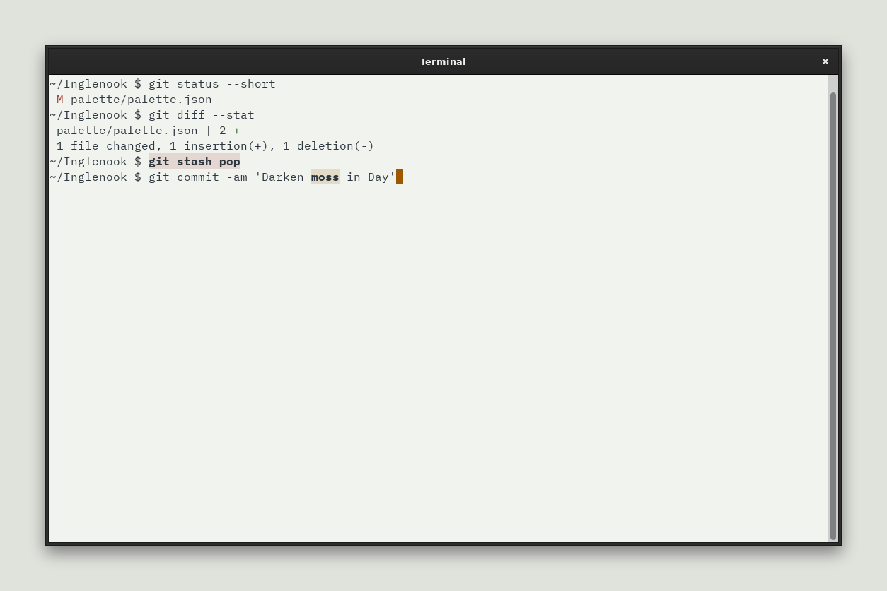
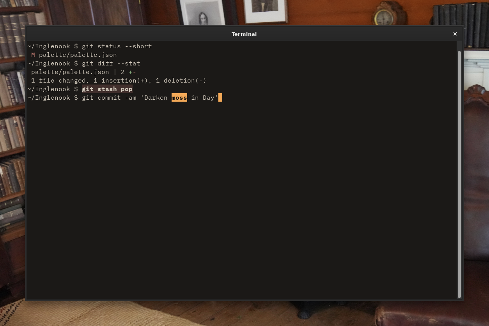

# Inglenook for zsh-history-substring-search

**Tier:** 1 Full\
**Variants:** Inglenook Day, Inglenook Night\
**Tested with:** Not tested yet

| Day | Night |
|---|---|
|  |  |

[zsh-history-substring-search](https://github.com/zsh-users/zsh-history-substring-search) highlights the part of a found command that matches what you typed, and what you typed when nothing matches. This port sets both highlights.

## Before you start

- Zsh 5.7 or later. Check with `zsh --version`.
- zsh-history-substring-search installed, loaded from `~/.zshrc`, and bound to your Up and Down keys, as its [Usage](https://github.com/zsh-users/zsh-history-substring-search#usage) section shows.
- A terminal that shows 24-bit color (Windows Terminal, GNOME Terminal, iTerm2, and most others).

## Install

1. Make the folder: `mkdir -p ~/.config/inglenook`
2. Download [`dist/day/zsh-history-substring-search.zsh`](dist/day/zsh-history-substring-search.zsh) (or [`dist/night/zsh-history-substring-search.zsh`](dist/night/zsh-history-substring-search.zsh)) and save it as `~/.config/inglenook/zsh-history-substring-search.zsh`.
3. Open `~/.zshrc` and add this line after the line that loads the plugin (the plugin's own `source` line, or `source $ZSH/oh-my-zsh.sh` with Oh My Zsh):

   ```sh
   source ~/.config/inglenook/zsh-history-substring-search.zsh
   ```

4. Open a new terminal.

### With Nowhere

Nowhere loads `~/.config/nowhere/theme.zsh` last. Put the same `source` line in that file instead of in `~/.zshrc`.

Files to use:

- Inglenook Day: `dist/day/zsh-history-substring-search.zsh`
- Inglenook Night: `dist/night/zsh-history-substring-search.zsh`

## Set the font

The plugin draws in your terminal, so it uses the terminal's font. Set [IBM Plex Mono](https://github.com/IBM/plex) in your terminal's settings. If it is not installed yet, follow [Font](../../README.md#font) in the main README.

## Check that it worked

1. Type part of a command you ran before, such as `commit`, and press Up. The matching part of the command that comes up is highlighted in solid amber.
2. Press Ctrl+U, type something you never ran, and press Up. What you typed sits on a soft red band.

## Switch between Day and Night

1. Replace `~/.config/inglenook/zsh-history-substring-search.zsh` with the file from the other variant.
2. Open a new terminal.

The plugin cannot follow the system light or dark setting.

## Uninstall

1. Delete the `source ~/.config/inglenook/zsh-history-substring-search.zsh` line from `~/.zshrc` (or `~/.config/nowhere/theme.zsh`).
2. Delete `~/.config/inglenook/zsh-history-substring-search.zsh`.
3. Open a new terminal. The plugin's own magenta and red highlights are back.

## Troubleshooting

- **The highlight is still magenta**: something sets the plugin's colors after the theme loads. Prezto, for one, sets them when its history-substring-search module loads. Move the `source` line to the end of `~/.zshrc`.
- **There is no highlight at all**: you set `HISTORY_SUBSTRING_SEARCH_HIGHLIGHT_TIMEOUT` and the highlight has cleared, or the plugin is not bound to the key you pressed. Check with `bindkey | grep history-substring-search`.
- **Colors look wrong or banded**: your terminal shows only 256 colors. Turn on 24-bit color in the terminal, or use one that has it.

## Known limits

- Zsh only. The plugin is a Zsh line editor script, and Bash and PowerShell cannot load it.
- The bands are made for the Inglenook background. In a terminal with another theme they still read, but look less even.
- On a terminal with only 256 colors, Zsh picks the nearest colors, so the bands are approximate.

## Sources

- [zsh-history-substring-search README: Configuration](https://github.com/zsh-users/zsh-history-substring-search#configuration)
- [Zsh manual: Character Highlighting](https://zsh.sourceforge.io/Doc/Release/Zsh-Line-Editor.html#Character-Highlighting)
