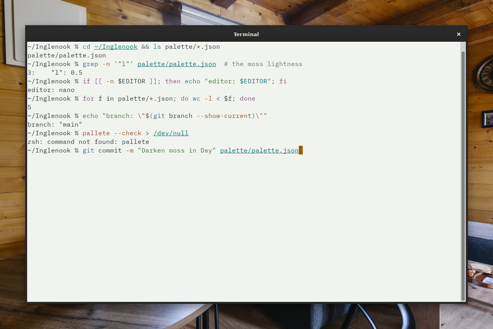
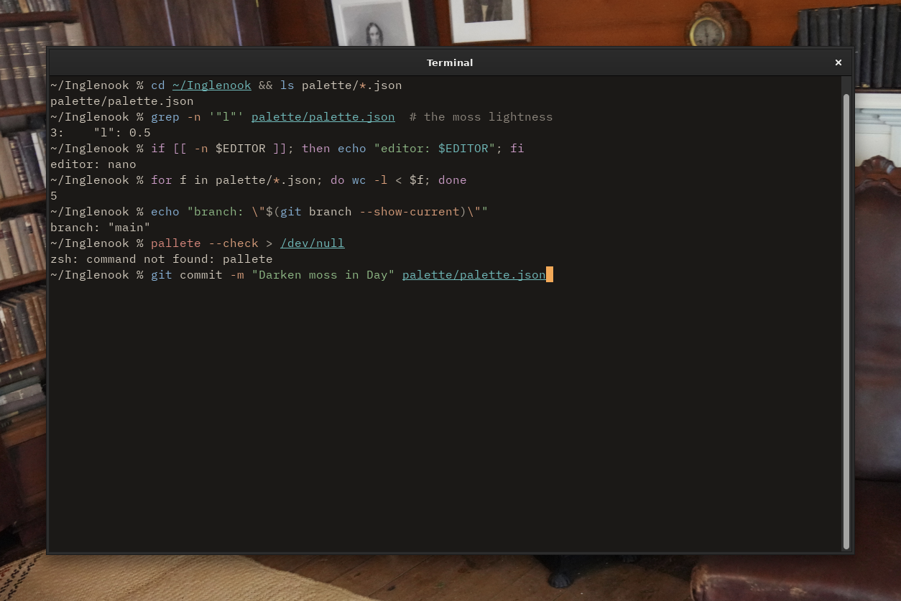

# Inglenook for zsh-syntax-highlighting

**Tier:** 1 Full\
**Variants:** Inglenook Day, Inglenook Night\
**Tested with:** Not tested yet

| Day | Night |
|---|---|
|  |  |

## Before you start

- [zsh-syntax-highlighting](https://github.com/zsh-users/zsh-syntax-highlighting) 0.7.1 or newer, installed and loaded in `~/.zshrc`. Its [install guide](https://github.com/zsh-users/zsh-syntax-highlighting/blob/master/INSTALL.md) covers packages, Homebrew, Oh My Zsh and plugin managers.
- A terminal that shows 24-bit color, such as Windows Terminal, GNOME Terminal or iTerm2. For the full look, theme the terminal with Inglenook too.

## Install

The theme is one file that sets the plugin's `ZSH_HIGHLIGHT_STYLES`. Zsh loads it when it starts.

1. Make the folder: `mkdir -p ~/.config/inglenook`
2. Download [`dist/day/zsh-syntax-highlighting.zsh`](dist/day/zsh-syntax-highlighting.zsh) (or [`dist/night/zsh-syntax-highlighting.zsh`](dist/night/zsh-syntax-highlighting.zsh)) and save it as `~/.config/inglenook/zsh-syntax-highlighting.zsh`.
3. Open `~/.zshrc` and add this line after the line that loads the plugin (`source .../zsh-syntax-highlighting.zsh`, or `source $ZSH/oh-my-zsh.sh` with Oh My Zsh):

   ```zsh
   source ~/.config/inglenook/zsh-syntax-highlighting.zsh
   ```

4. Open a new terminal.

**Nowhere users**: put the same line in `~/.config/nowhere/theme.zsh` instead of `~/.zshrc`. Nowhere loads that file last.

Files to use:

- Inglenook Day: `dist/day/zsh-syntax-highlighting.zsh`
- Inglenook Night: `dist/night/zsh-syntax-highlighting.zsh`

## Set the font

zsh-syntax-highlighting draws in your terminal, so it uses the terminal's font. Set [IBM Plex Mono](https://github.com/IBM/plex) there, for example in Windows Terminal under **Settings**, your profile, **Appearance**, **Font face**, or in GNOME Terminal under **Preferences**, your profile, **Text**, **Custom font**. If it is not installed yet, follow [Font](../../README.md#font) in the main README.

## Check that it worked

Type `echo "hello" --help` and do not press Enter. `echo` turns blue, `"hello"` green and `--help` a terracotta brown. Type a command that does not exist, such as `ech`, and it turns red.

## Switch between Day and Night

1. Save the other variant's file over `~/.config/inglenook/zsh-syntax-highlighting.zsh`.
2. Open a new terminal.

zsh-syntax-highlighting has no light or dark setting of its own, so it cannot follow the OS setting.

## Uninstall

1. Remove the `source ~/.config/inglenook/zsh-syntax-highlighting.zsh` line from `~/.zshrc` (or from `~/.config/nowhere/theme.zsh`).
2. Delete `~/.config/inglenook/zsh-syntax-highlighting.zsh`.
3. Open a new terminal. The plugin is back to its own colors.

## Troubleshooting

- **Nothing is colored**: the plugin is not loaded. Run `echo $ZSH_HIGHLIGHT_VERSION`; it should print a version number.
- **Some colors are the plugin's own**: a line later in `~/.zshrc` sets `ZSH_HIGHLIGHT_STYLES` again. Move the `source` line below it.
- **The colors look wrong or too bright**: your terminal may not show 24-bit color. Use a terminal that does.

## Known limits

- Bash is not supported: zsh-syntax-highlighting is a Zsh plugin, and Bash has no way to color the command line as you type.
- The brackets highlighter is off unless you turn it on. When it is on, its five nesting levels each get their own color, and the bracket matching the cursor gets a soft amber background.
- Version 0.7 leaves file descriptor numbers, such as the `1` in `2>&1`, uncolored.
- Patterns you add yourself with the `pattern` or `regexp` highlighter keep the colors you give them. The `cursor`, `line` and `root` highlighters keep the plugin's own look.
- The background, the prompt and command output come from your terminal and other tools, not from this theme.

## Sources

- [zsh-syntax-highlighting: main highlighter styles](https://github.com/zsh-users/zsh-syntax-highlighting/blob/master/docs/highlighters/main.md)
- [zsh-syntax-highlighting: brackets highlighter styles](https://github.com/zsh-users/zsh-syntax-highlighting/blob/master/docs/highlighters/brackets.md)
- [zsh-syntax-highlighting: install guide](https://github.com/zsh-users/zsh-syntax-highlighting/blob/master/INSTALL.md)
- [Zsh manual: Character Highlighting](https://zsh.sourceforge.io/Doc/Release/Zsh-Line-Editor.html#Character-Highlighting)
