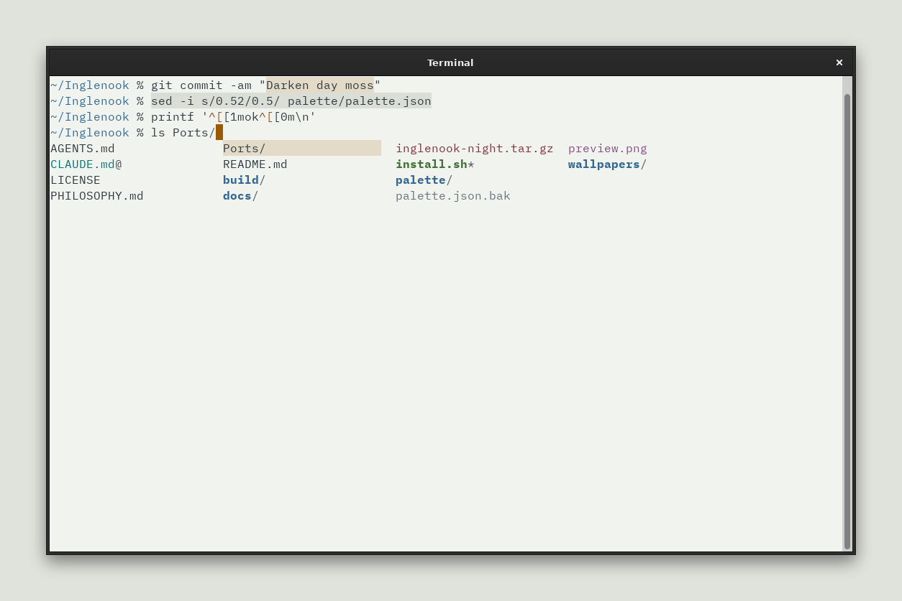
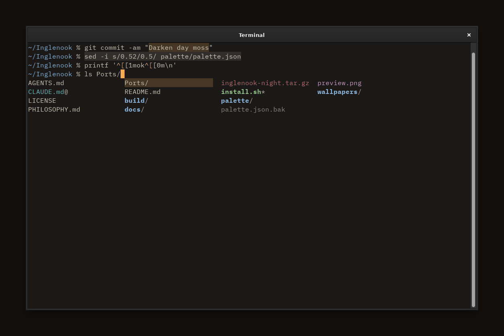

# Inglenook for the Zsh line editor and completion list

**Tier:** 1 Full\
**Variants:** Inglenook Day, Inglenook Night\
**Tested with:** Not tested yet

| Day | Night |
|---|---|
|  |  |

The theme colors two parts of Zsh itself:

- The line editor, where you type commands: selected text, matches while you search your history, pasted text, the slash Zsh adds after a folder name, and special characters such as `^[`.
- The completion list you see when you press Tab: files, folders, links and programs in their own colors, and the entry you are on in a selection menu.

## Before you start

- Zsh 5.7 or newer. Check with `zsh --version`.
- A terminal that shows 24-bit color, such as GNOME Terminal, iTerm2, or Windows Terminal with WSL. For the full look, theme the terminal with Inglenook too.
- For the completion list: the completion system (`compinit`) turned on. Oh My Zsh, Prezto and most `~/.zshrc` files already do this. If yours does not, add `autoload -Uz compinit && compinit` to `~/.zshrc`.
- Optional: a selection menu, so Tab lets you move through the list with the arrow keys. Add `zstyle ':completion:*' menu select` to `~/.zshrc`. The theme colors the entry you are on.

## Install

The theme is one file that your `~/.zshrc` loads when Zsh starts.

1. Create the folder `~/.config/inglenook/`.
2. Save [`dist/day/zsh.zsh`](dist/day/zsh.zsh) or [`dist/night/zsh.zsh`](dist/night/zsh.zsh) there as `zsh.zsh`.
3. Add this line to the end of `~/.zshrc`, after any plugin manager or framework, so nothing changes these colors after it:

   ```sh
   source ~/.config/inglenook/zsh.zsh
   ```

4. Open a new terminal.

**Nowhere users**: put the same line in `~/.config/nowhere/theme.zsh` instead of `~/.zshrc`. Nowhere loads that file last.

Files to use:

- Inglenook Day: `dist/day/zsh.zsh`
- Inglenook Night: `dist/night/zsh.zsh`

## Set the font

Zsh uses your terminal's font. Set it there, for example in GNOME Terminal under **Preferences**, your profile, **Text**, **Custom font**, or in Windows Terminal under **Settings**, your profile, **Appearance**, **Font face**.

1. Pick **IBM Plex Mono**. If it is not installed yet, follow [Font](../../README.md#font) in the main README.

## Check that it worked

1. Type `ls ` and press Tab. Folders show in bold blue, programs in bold green, and links in a blue-green. With a selection menu, the entry you are on sits on a soft amber background.
2. Type a few words, press Ctrl+Space, then Alt+B. The selected words sit on the same soft amber background.

## Switch between Day and Night

1. Save the other variant's file over `~/.config/inglenook/zsh.zsh`.
2. Open a new terminal, or run `source ~/.config/inglenook/zsh.zsh` in the one you have.

Zsh has no light or dark setting of its own, so it cannot follow the OS setting.

## Uninstall

1. Remove the `source ~/.config/inglenook/zsh.zsh` line from `~/.zshrc`.
2. Delete `~/.config/inglenook/zsh.zsh`.
3. Open a new terminal. Selected text is back to inverse video, and the completion list is back to its own colors.

## Troubleshooting

- **The completion list has no colors**: the completion system is off. Add `autoload -Uz compinit && compinit` to `~/.zshrc`, before the theme's line.
- **The completion list has other colors**: something later in `~/.zshrc` sets the `list-colors` style again, often from `LS_COLORS`. Move the theme's line to the end.
- **Selected text shows no background, or odd colors**: your terminal does not show 24-bit color. Use a terminal that does. On a 256-color terminal, add `zmodload zsh/nearcolor` above the theme's line: the line editor then picks the nearest of the 256 colors.

## Known limits

- Bash is not supported. Bash uses its own line editor, which reads none of these settings.
- The theme sets all of the line editor's highlighting, so it replaces any `zle_highlight` you set before it.
- The headings and descriptions some completions show (`-- files --`, option descriptions) keep the colors your `~/.zshrc` gives them.
- The entry you are on in a selection menu shows in plain text, not in its file color.
- The completion list always uses 24-bit color, even with `zsh/nearcolor` loaded.

## Sources

- [Zsh manual: Character Highlighting](https://zsh.sourceforge.io/Doc/Release/Zsh-Line-Editor.html#Character-Highlighting)
- [Zsh manual: Colored completion listings](https://zsh.sourceforge.io/Doc/Release/Zsh-Modules.html#Colored-completion-listings)
- [Zsh manual: the list-colors style](https://zsh.sourceforge.io/Doc/Release/Completion-System.html#index-list_002dcolors_002c-completion-style)
