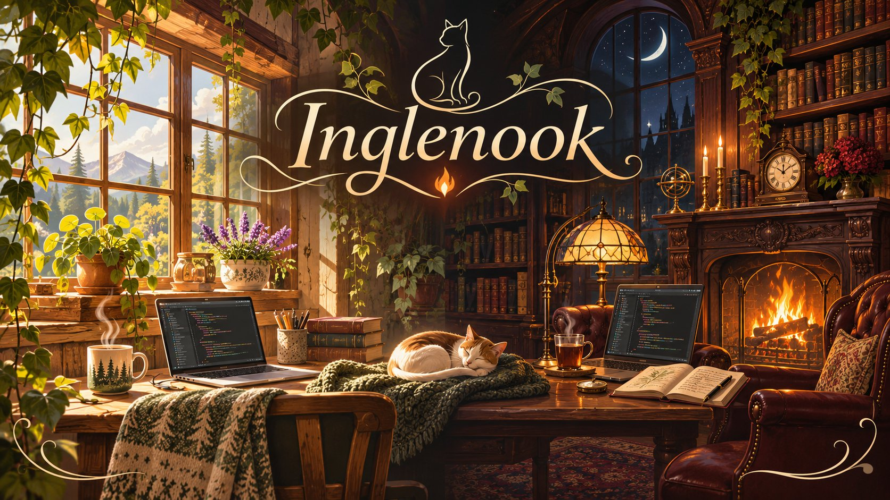
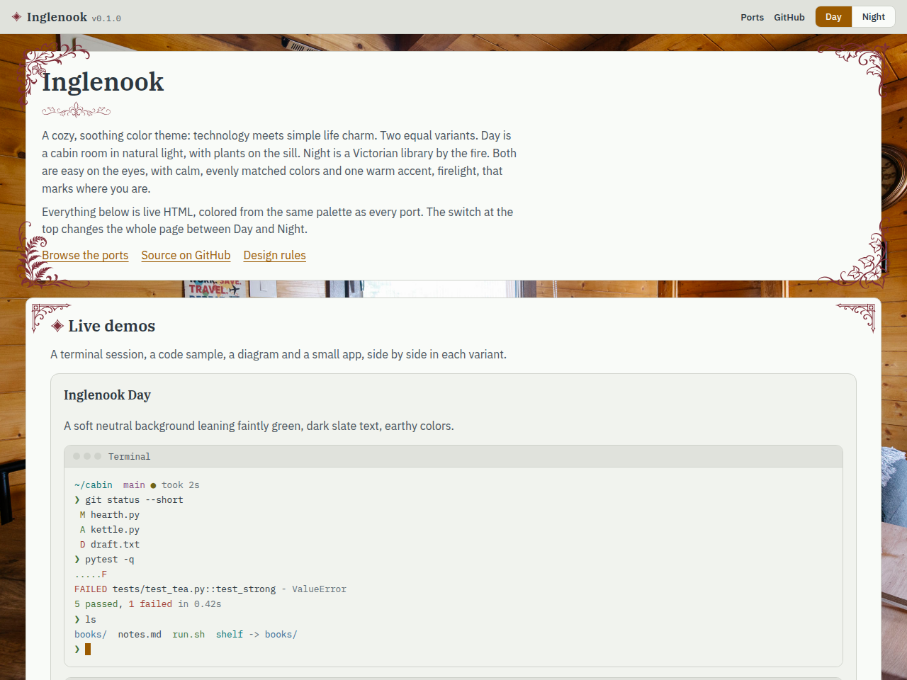
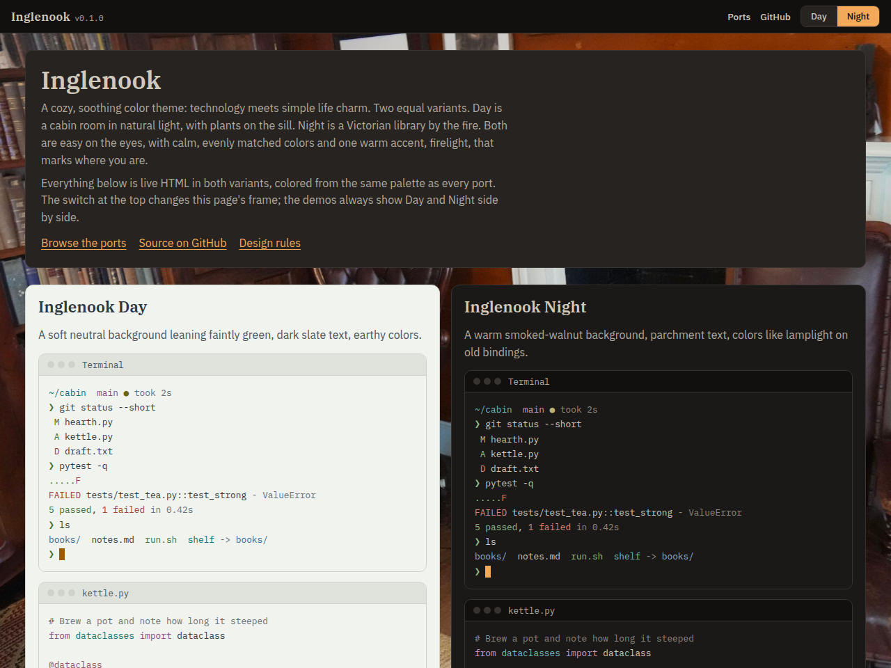

# Inglenook



[](https://github.com/mookeyj79/Inglenook/actions/workflows/check.yml)
[](LICENSE)

*inglenook: the warm corner beside a big open fireplace.*

A cozy, soothing color theme for the tools you use every day. Technology meets simple life charm. Two equal variants, ported to every app, so your whole machine feels like one calm room.

- **Inglenook Day**: a cabin room in natural light, with plants on the sill. A soft neutral background that leans faintly green.
- **Inglenook Night**: a Victorian library by the fire. A warm smoked-walnut background.

**[Open the live preview](https://mookeyj79.github.io/Inglenook/)** to see Day and Night, or **[browse the ports](https://mookeyj79.github.io/Inglenook/ports/)**.

## Status

Inglenook is ported to terminals, shells and prompts, command-line tools, code editors, writing apps, desktop apps, web apps, and operating systems, on Windows, macOS, Linux, and the web. The [ports page](https://mookeyj79.github.io/Inglenook/ports/) lists every port and the ones still planned.

| Inglenook Day | Inglenook Night |
|---|---|
|  |  |

## What you get

- **Easy on the eyes.** Text is clear without glaring, there is no pure black or white, and the colors are muted and evenly matched. Errors are a calm ember, not alarm red.
- **One warm accent.** Firelight amber marks where you are: the cursor, focus, selection, and links. Nothing else uses it.
- **Colors with one job each.** Ember is failure, moss is success, brass is a warning, steel is information, in every app. See [PHILOSOPHY.md](PHILOSOPHY.md).
- **Solid colors.** The theme never depends on transparency. If your app has its own see-through setting, you can still turn it on.
- **One font everywhere:** IBM Plex Mono.

## Ports

**[Browse every port](https://mookeyj79.github.io/Inglenook/ports/)**: search by app, filter by category, and see each port's tier, platforms, and install guide. The list is generated from the ports in this repo, so it is always current.

Each port says how far it gets:

- **Tier 1, Full**: the complete palette
- **Tier 2, Partial**: most of the palette, with some gaps
- **Tier 3, Minimal**: background, accent, and status colors only

### Install a port

1. Open the port's folder, `Ports/<app_name>/`, and read its `README.md`, or open the port from the [ports page](https://mookeyj79.github.io/Inglenook/ports/). It is a step-by-step install guide, with screenshots of both variants.
2. Take the theme file from `dist/day/` or `dist/night/`. Generated files are committed, so there is nothing to build.
3. Follow the guide, including **Set the font**.

## Font

Inglenook recommends **[IBM Plex Mono](https://github.com/IBM/plex)**. Where an app shows icons (shell prompts, file trees), use **BlexMono Nerd Font**, the same font with icons added.

1. Download [IBMPlexMono.zip](https://github.com/ryanoasis/nerd-fonts/releases/latest/download/IBMPlexMono.zip) from the Nerd Fonts release. It contains BlexMono Nerd Font. For plain IBM Plex Mono, use the [IBM Plex release](https://github.com/IBM/plex/releases).
2. Unzip it and install the fonts:
   - **Windows**: select the `.ttf` files, right-click, and choose **Install for all users**.
   - **macOS**: double-click each `.ttf` and choose **Install Font**.
   - **Linux**: copy the `.ttf` files to `~/.local/share/fonts/` and run `fc-cache -f`.
3. In each app, pick **IBM Plex Mono**, or **BlexMono Nerd Font Mono** where you want icons.

Free under the SIL Open Font License.

## Wallpapers

Optional wallpapers that go with each variant are in [`wallpapers/`](wallpapers/), each marked Day or Night, with its author and license. The screenshots and the preview use Cabin Seating in Day and Mission Fireplace in Night. The theme looks complete without them.

## How it works

- **One palette for every app.** Each port says what a color is for (background, text, error), never a specific value. Change a color once and every port updates.
- **Generated files are committed.** You can grab a theme from `dist/` without building anything.

## Add a port

This repo is set up for [Claude Code](https://claude.com/claude-code). Open it there and ask:

> Can you make a theme for Typora?

or run `/new-port typora`. Doing it by hand works too: see [CONTRIBUTING.md](CONTRIBUTING.md), which also covers the repo layout and the build.

## Development

You only need this to change the palette or a port. Requires [PowerShell 7](https://learn.microsoft.com/powershell/scripting/install/installing-powershell), and Docker to take Linux screenshots.

```sh
pwsh build/build.ps1                     # rebuild every port from the palette and templates
pwsh build/build.ps1 -Port <app_name>    # rebuild one port
pwsh build/check.ps1                     # run every check
pwsh build/test.ps1                      # test the build scripts
pwsh build/site.ps1                      # assemble the preview site into _site/
```

To run the tests and checks before every commit, turn on the hook once in a new clone:

```sh
git config core.hooksPath .githooks
```

The [check workflow](.github/workflows/check.yml) runs the same tests and checks on every pull request and push to `main`. The preview site and install guides are published to GitHub Pages on each push to `main`. See [CONTRIBUTING.md](CONTRIBUTING.md#layout-and-build) for the full list of commands.

## Contributing

Ports, fixes, and wallpaper suggestions are welcome. Read [CONTRIBUTING.md](CONTRIBUTING.md) for the rules every port follows and how to propose a palette change.

## License

[MIT](LICENSE), except for third-party assets, which keep their own licenses: wallpapers are listed per image in [`wallpapers/README.md`](wallpapers/README.md).
