# Wallpapers

Optional desktop wallpapers that go well with Inglenook, each marked with the variant it suits. The theme looks complete without them.

Port screenshots and the preview site show Cabin Seating in Day and Mission Fireplace in Night. The `web/` folder holds the smaller copies the site loads.

Every image is a found photo with a license that allows redistribution. Its author, source, and license are listed in its section below. Pairs (the same kind of scene for Day and Night) come first, then single images.

## Cabin Seating

[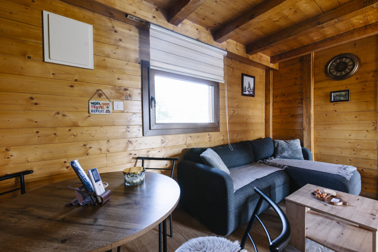](cabin-seating.jpg)

| | |
|---|---|
| File | [`cabin-seating.jpg`](cabin-seating.jpg), 6016 × 4016, unmodified original |
| Variant | Day |
| Subject | A sofa and wooden table in a log cabin, with sunlight through the window |
| Author | [Shixart1985](https://commons.wikimedia.org/wiki/User:Shixart1985) |
| Date | 2026-06-15 |
| Source | [Wikimedia Commons](https://commons.wikimedia.org/wiki/File:Cozy_interior_of_a_wooden_cabin_with_a_seating_area.jpg) |
| License | [CC BY 2.0](https://creativecommons.org/licenses/by/2.0) |

## Orchid Parlour

[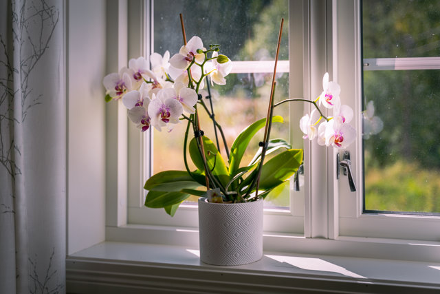](orchid-parlour.jpg)

| | |
|---|---|
| File | [`orchid-parlour.jpg`](orchid-parlour.jpg), 6000 × 4000, unmodified original |
| Variant | Day |
| Subject | An orchid on the windowsill of a farmhouse parlour facing west, Norway |
| Author | [Øyvind Holmstad](https://commons.wikimedia.org/wiki/User:%C3%98yvind_Holmstad) |
| Date | 2020-08-28 |
| Source | [Wikimedia Commons](https://commons.wikimedia.org/wiki/File:Orkide_i_finstua_mot_vest.jpg) |
| License | [CC BY-SA 4.0](https://creativecommons.org/licenses/by-sa/4.0) |

## Syon Conservatory

[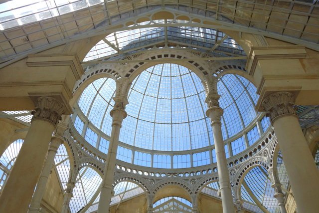](syon-conservatory.jpg)

| | |
|---|---|
| File | [`syon-conservatory.jpg`](syon-conservatory.jpg), 5472 × 3648, unmodified original |
| Variant | Day |
| Subject | Palms and ferns under the glass dome of the Great Conservatory at Syon House, London |
| Author | [Daderot](https://commons.wikimedia.org/wiki/User:Daderot) |
| Date | 2024-06-02 |
| Source | [Wikimedia Commons](https://commons.wikimedia.org/wiki/File:Interior_-_Great_Conservatory_-_Syon_House_-_London,_UK_-_DSC07529.jpg) |
| License | [CC0 1.0, public domain dedication](https://creativecommons.org/publicdomain/zero/1.0/) |

## Porch Coffee

[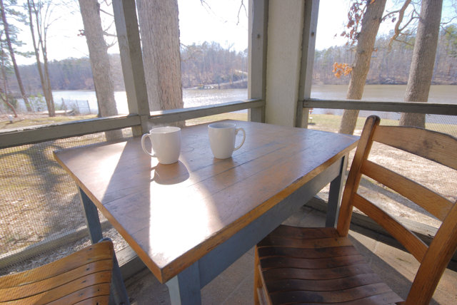](porch-coffee.jpg)

| | |
|---|---|
| File | [`porch-coffee.jpg`](porch-coffee.jpg), 3872 × 2592, unmodified original |
| Variant | Day |
| Subject | Two chairs and coffee on a cabin porch at Twin Lakes State Park, Virginia |
| Author | [vastateparksstaff](https://www.flickr.com/people/37922399@N05) |
| Date | 2013-03-14 |
| Source | [Wikimedia Commons](https://commons.wikimedia.org/wiki/File:Coffee_on_the_porch_for_two_at_Twin_Lakes_State_Park_cabin_(17863722371).jpg) |
| License | [CC BY 2.0](https://creativecommons.org/licenses/by/2.0) |

## Cabin Porch View

[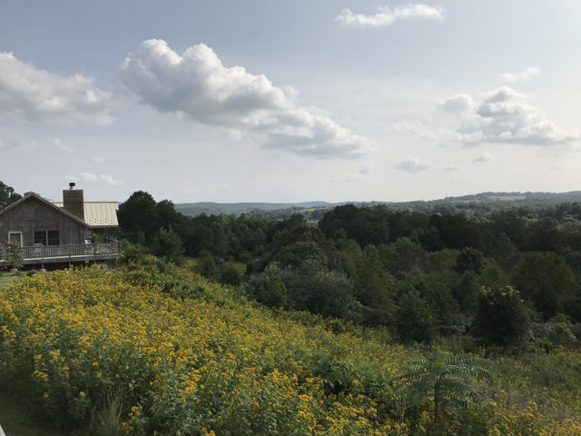](cabin-porch-view.jpg)

| | |
|---|---|
| File | [`cabin-porch-view.jpg`](cabin-porch-view.jpg), 4032 × 3024, unmodified original |
| Variant | Day |
| Subject | The view from a cabin porch into the woods at James River State Park, Virginia |
| Author | vastateparksstaff |
| Date | 2020-09-22 |
| Source | [Wikimedia Commons](https://commons.wikimedia.org/wiki/File:JR_-_9-18-20_-_Cabin_12_porch_view.jpg) |
| License | [CC BY 2.0](https://creativecommons.org/licenses/by/2.0) |

## Mission Fireplace

[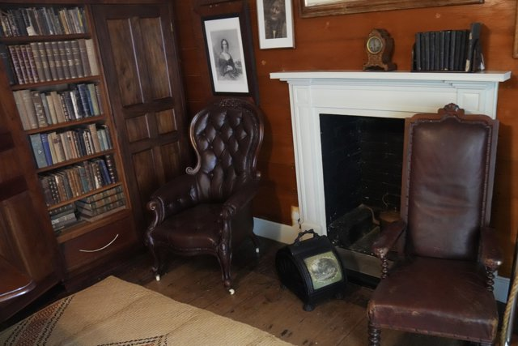](mission-fireplace.jpg)

| | |
|---|---|
| File | [`mission-fireplace.jpg`](mission-fireplace.jpg), 6905 × 4603, unmodified original |
| Variant | Night |
| Subject | A fireplace in the dining room of the old mission house at The Elms, Tauranga, New Zealand |
| Author | [Richard N Horne](https://commons.wikimedia.org/wiki/User:Richard_N_Horne) |
| Date | 2023-02-25 |
| Source | [Wikimedia Commons](https://commons.wikimedia.org/wiki/File:The_fireplace_in_the_dining_room_of_the_mission_house_at_the_The_Elms_-_Formerly_the_Te_Papa_Mission_Station.jpg) |
| License | [CC BY-SA 4.0](https://creativecommons.org/licenses/by-sa/4.0) |

## De Haar Library

[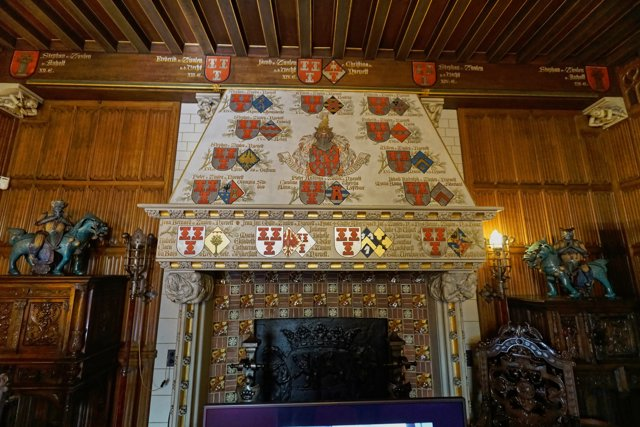](de-haar-library.jpg)

| | |
|---|---|
| File | [`de-haar-library.jpg`](de-haar-library.jpg), 3976 × 2652, unmodified original |
| Variant | Night |
| Subject | The carved library fireplace at Castle De Haar, Netherlands |
| Author | [Txllxt TxllxT](https://commons.wikimedia.org/wiki/User:Txllxt_TxllxT) |
| Date | 2020-09-22 |
| Source | [Wikimedia Commons](https://commons.wikimedia.org/wiki/File:Castle_De_Haar_(1892-1913)_-_Neogothic_architect_Pierre_Cuypers_09_-_Library_Interiors_-_Fireplace.jpg) |
| License | [CC BY-SA 4.0](https://creativecommons.org/licenses/by-sa/4.0) |

## Long Room

[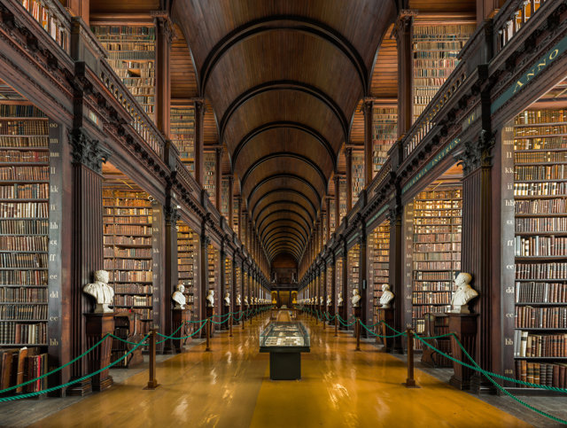](long-room.jpg)

| | |
|---|---|
| File | [`long-room.jpg`](long-room.jpg), 9000 × 6796, unmodified original |
| Variant | Night |
| Subject | The Long Room of the Old Library at Trinity College Dublin |
| Author | [Diliff](https://commons.wikimedia.org/wiki/User:Diliff) |
| Date | 2015-07-21 |
| Source | [Wikimedia Commons](https://commons.wikimedia.org/wiki/File:Long_Room_Interior,_Trinity_College_Dublin,_Ireland_-_Diliff.jpg) |
| License | [CC BY-SA 4.0](https://creativecommons.org/licenses/by-sa/4.0) |

## Coal Fire

[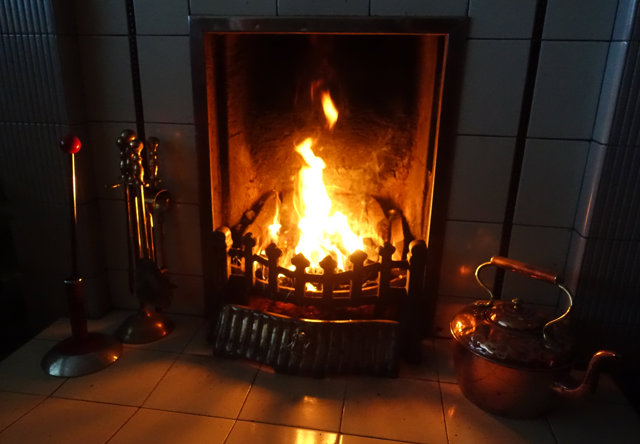](coal-fire.jpg)

| | |
|---|---|
| File | [`coal-fire.jpg`](coal-fire.jpg), 4917 × 3410, unmodified original |
| Variant | Night |
| Subject | A coal fire in a house fireplace in Derbyshire, England |
| Author | [Kmtextor](https://commons.wikimedia.org/wiki/User:Kmtextor) |
| Date | 2018-12-24 |
| Source | [Wikimedia Commons](https://commons.wikimedia.org/wiki/File:Fireplace_coalfire.jpg) |
| License | [CC BY 4.0](https://creativecommons.org/licenses/by/4.0) |

## Abbotsford Study

[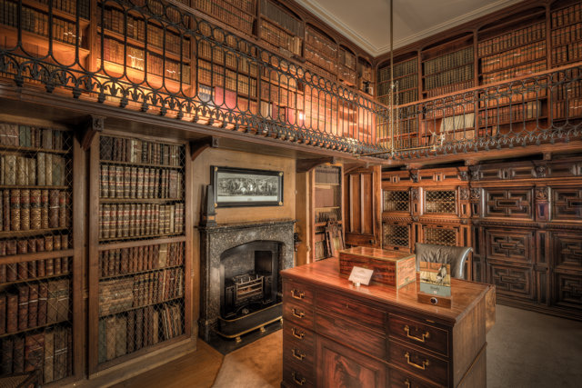](abbotsford-study.jpg)

| | |
|---|---|
| File | [`abbotsford-study.jpg`](abbotsford-study.jpg), 8687 × 5791, unmodified original |
| Variant | Night |
| Subject | Sir Walter Scott's study at Abbotsford House, Melrose, Scotland |
| Author | [Michael D Beckwith](https://commons.wikimedia.org/wiki/User:Mdbeckwith) |
| Date | 2018-03-06 |
| Source | [Wikimedia Commons](https://commons.wikimedia.org/wiki/File:Abbotsford_House_Study_Room.jpg) |
| License | [CC0](http://creativecommons.org/publicdomain/zero/1.0/deed.en) |

## Candlelight

[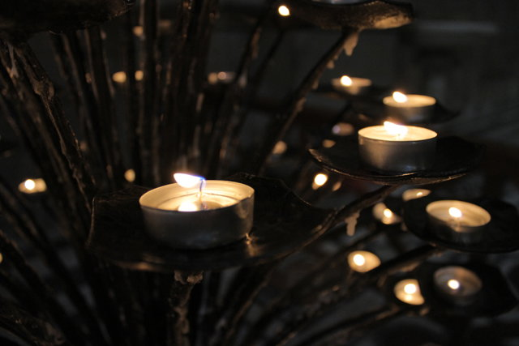](candlelight.jpg)

| | |
|---|---|
| File | [`candlelight.jpg`](candlelight.jpg), 5184 × 3456, unmodified original |
| Variant | Night |
| Subject | Tea lights on an iron candle stand in Santa Maria del Fiore, Florence |
| Author | [Rolland Anthony](https://www.flickr.com/people/30148915@N06) |
| Date | 2013-08-15 |
| Source | [Wikimedia Commons](https://commons.wikimedia.org/wiki/File:Candlelight_(11622436113).jpg) |
| License | [CC BY 2.0](https://creativecommons.org/licenses/by/2.0) |
